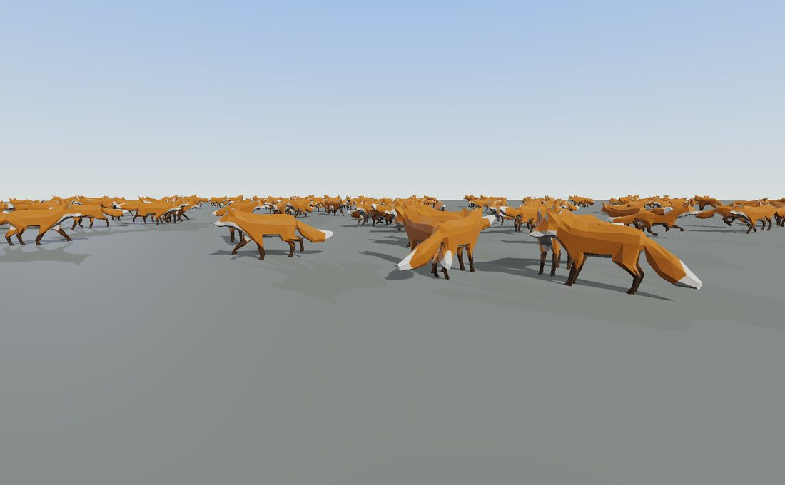

Rigged characters
=================

.. rst-class:: introduction

A :doc:`glTF <gltf>` file carries a skeleton and a set of animation clips.
``OpenGLContext.character`` adds what a game needs on top of them: a map from
joints to named bones, several clips playing at once, attachment points for
items such as weapons, and crowds of many animated figures.

.. code-block:: python

   from OpenGLContext.character import CharacterModel

   model = CharacterModel.load('marine.glb')
   model.attach('grip', load_gltf('handgun.glb').group)
   model.play('run', fade=0.2)
   model.layer('upper', mask=model.mask('spine')).play('fire', loop=False)
   ...
   model.update(dt)                  # once a frame
   scene.children = [model.group]    # the renderable root

The bone map, the animation mixer and the attachment points can each be used
on their own. ``CharacterModel`` combines the three over one loaded document,
which is what most programs use.

.. _characters-bones:

Which joint is which bone
-------------------------

``OpenGLContext.character.humanoid`` maps a document's nodes to the humanoid
bone names of `VRM 1.0 <https://github.com/vrm-c/vrm-specification>`__: the 55
names in ``VRMC_vrm.humanoid.humanBones``, the subset that is required, and
their fixed parent chain. Avatar toolchains already use these names, so many
assets arrive with them.

The bone map comes from the first of these sources that is present:

#. ``VRMC_vrm`` - the file's own bone map. When the file gives one, it is used
   as it is.

#. ``VRMC_vrm_animation`` - the same map in a clip-only document (``.vrma``).

#. The joint names, which is what most content has. All the common naming
   conventions are read: the side can come first or last and can be spelled
   out or abbreviated, a position in a chain can be a number or a word, and
   exporter prefixes are ignored. ``mixamorig:LeftForeArm``, ``forearm.R``,
   ``lowerarm_r`` and ``arm_joint_L_2`` all resolve.

**Some names are ambiguous on their own, so the rig is identified first.**
Unreal's mannequin numbers its spine from one, so ``spine_01`` is the first
segment. Mixamo numbers from zero, so ``Spine1`` is the *second*. The names do
not say which convention they follow, and a rig read the wrong way puts its
chest where its waist should be. A skeleton is therefore first matched
against the rig families in ``humanoid.FAMILIES``. Each family is a set of
names that every rig of that family has, such as ``pelvis`` together with
``clavicle_l``. When a family matches, its own table maps the names. A rig
from a family not listed there is still mapped name by name.

.. code-block:: python

   from OpenGLContext.character import Humanoid

   human = Humanoid.from_scene(scene)     # None if no bone resolves at all
   human.complete                         # every required bone is here
   human.missing                          # the ones that are not
   human.transform('rightHand')           # the scenegraph node for a joint
   human.position('head')                 # where it is, as posed now
   human.mask('spine')                    # the upper body, as node indices
   human.mask('hips', exclude=('spine',)) # the rest

A name that needs a side and has none, such as a bare ``UpperArm``, is not
mapped to a bone, because there is no way to tell which arm it is.

.. _characters-mixer:

Playing several clips at once
-----------------------------

glTF stores clips but does not say how to play two of them together.
``OpenGLContext.character.mixer`` does this with cross-fades, layers masked to
part of the body, and additive layers. None of it is specific to humanoids: it
blends node transforms and morph weights on any model.

Layers
~~~~~~

A layer is a channel of animation with a *mask* (the node indices it may
move) and a weight. Layers are applied in the order they were created, each
blended over the pose built so far. A base layer can animate the whole body
while an ``upper`` layer masked to the arms replaces the pose of those joints
only.

Cross-fades within a layer
~~~~~~~~~~~~~~~~~~~~~~~~~~

Playing a clip on a layer fades out that layer's previous clip over the same
interval. When a layer's weights add up to less than one, as when a clip
fades in with nothing to fade out, the remainder comes from the pose
underneath. A layer therefore eases in from the layer below, not from
nothing.

Additive layers
~~~~~~~~~~~~~~~

An additive layer compares its clip with a reference frame of the same clip
(frame zero by default) and adds the difference. A 20-degree recoil authored
once adds 20 degrees to any aim.

.. code-block:: python

   mixer = AnimationMixer.from_scene(scene)
   mixer.play('run', fade=0.25)                       # the base layer
   mixer.layer('upper', mask=human.mask('spine')).play('fire', loop=False)
   mixer.layer('recoil', additive=True).play('kick', loop=False)
   mixer.update(dt)                                   # once a frame
   mixer.playing                                      # what is contributing

Playing a clip that is already playing keeps its time, so a state machine can
request the same clip every frame at no cost and with no stutter. Pass
``restart=True`` to rewind it instead. A looping track wraps. A one-shot holds
its last frame and sets ``track.finished``.

Blending is computed per node and per animated property, so masks, layer
weights and cross-fades combine without depending on each other.
``mixer.apply()`` poses the model without advancing time, for a capture or a
paused game.

``mixer.reset()`` stops every layer at once and restores the rest pose. Use it
when a character respawns. A dead character holds its death pose until
something ends it, and a fade would blend from dying into the next clip,
showing the body easing back onto its feet.

.. _characters-attachment:

Attachment points
-----------------

glTF has no extension for attachment points, and needs none. The Khronos
registry has none ratified, in progress or vendor-supplied, and OMI's nearest,
``OMI_seat``, is for seating an avatar. A node parented to a joint already
follows that joint's animation, so an empty node under the joint, named for
what it holds, works as an attachment point. It is an ordinary node, so every
exporter, importer and validator keeps it.

``OpenGLContext.character.attachment`` reads a name prefix, ``socket_`` by
default (``SOCKET_PREFIX``). A node called ``socket_grip`` under the right
hand is the attachment point ``grip``.

.. code-block:: python

   model.point('grip')            # the Transform to mount on
   model.attach('grip', weapon)   # None if the model has no such point
   model.detach('grip', weapon)

``point()`` looks for a declared attachment point first, then for a humanoid
bone of that name. ``attach('rightHand', weapon)`` therefore works on a model
with no grip point, but places the weapon at the joint rather than at a grip
an artist positioned.

The direction a mounted model faces depends on how that model was authored.
The attachment point is a node with an orientation, and the mounted model is
placed in that node's space.

Where an item is held
~~~~~~~~~~~~~~~~~~~~~

A rig's ``socket_grip`` says *where an item goes*. A node with the same name
inside the item says *where the item is held*: the grip its artist placed,
rather than wherever the item's origin is. ``mounted()`` lines the two up:

.. code-block:: python

   from OpenGLContext.character.attachment import mounted, sockets

   weapon = load_gltf('sniper-rifle.glb')
   attach(sockets(scene)['grip'], mounted(weapon, 'grip'))

Without it, a rifle whose origin is at its balance point hangs from the hand
by that point, fifteen centimetres away, and every game that loads it needs a
table of offsets for each model. With it, the grip is stored in the model once,
and re-modelling the weapon does not move the hand that holds it.

An item can declare several points, such as ``socket_grip`` for the hand and
``socket_back`` for where it is stowed. ``mounted()`` uses the point with the
name it is given, so one file hangs correctly in both places. An item with no
such point is mounted by its origin.

.. _characters-locomotion:

A character on a landscape
--------------------------

A rigged model that runs across ground is four calls after the scene
(:doc:`tutorials/character/character_run`):

.. code-block:: python

   self.sg = sceneGraph(children=[Background(), DirectionalLight(), land_node])
   self.physics.add_ground(land)
   hero = self.physics.add_character(model='hero.glb', animations=CLIPS,
                                     position=(0, 0.2, 0), parent=self.sg)
   self.follow(hero)

``add_ground`` makes the land a static body (:ref:`physics-ground`).
``add_character`` makes a capsule the world stops and steps it every frame
(:ref:`physics-characters`). ``model`` is a ``CharacterModel``, a loaded glTF
scene, the bytes of a ``.glb``, or a path or an http(s) URL, which is fetched
once into the loader's cache. The character wears it in a node of its own, put
at the capsule's feet each frame and added to ``parent`` where one is given. The
model is scaled to the capsule's standing height and set on its base unless
``fit=False``, and turned toward where the character goes unless
``facing=False``. The world collides with the capsule alone: the model's shapes
are not scenery.

``animations`` is a ``ClipMap``, ``'ual'`` for the Universal Animation
Library's names (``ClipMap.ual()``) or ``'guess'`` for the roles found by the
words in the model's clip names (``ClipMap.guess(model)``); the character then
plays its clips for what the capsule is doing, as :ref:`below
<characters-clipmaps>` describes. A map is the way to say a model's own names
and speeds. The fox of the tutorial has three clips:

.. code-block:: python

   FOX = ClipMap(idle='Survey', walk=('Walk', 1.5), run=('Run', 4.0))

A role the map leaves out is not played: a model with no jump clip keeps the
pose of the ground movement in the air. ``hero.addEventHandler('landed',
function=f)`` calls ``f(landing)`` in the frame the character comes down, with
``landing.speed`` in metres a second, and ``'footstep'`` calls ``f(step)`` for
each foot that lands, with the ``foot``, its ``phase`` in the stride, the
``point`` and the ``material`` of the body under it. A material with a
``footstep`` clip plays it where a foot lands on a body of that material
(:ref:`physics-materials`); :doc:`tutorials/character/character_footsteps` crosses
grass and a stone slab. :doc:`tutorials/character/character_jump` makes a sound
at each landing, as hard as the fall.

.. _characters-clipmaps:

Clips from a character's state
------------------------------

A game that moves a character knows its speed, whether it is on the ground and
what it is doing. ``OpenGLContext.character.locomotion`` turns that into clips
on a ``CharacterModel``: idle, walk, run and sprint blended by speed, each
looping clip played at the rate that keeps its feet on the ground, the jump,
fall, landing, slide, swim and knock-down clips when the character is doing
those, and a footstep when a foot lands.

.. code-block:: python

   from OpenGLContext.character.locomotion import ClipMap, Locomotion, LocomotionInput

   model = CharacterModel.load('hero.glb')
   locomotion = Locomotion(ClipMap.ual(), model)
   locomotion.on_footstep(lambda foot, phase: play_step_sound(foot))
   ...
   locomotion.update(LocomotionInput(speed=3.1, vertical_speed=0.0,
                                     grounded=True), dt)      # once a frame
   model.update(dt)                                           # after it

``LocomotionInput`` is the record a game fills each frame, from a physics
character or from its own simulation:

.. list-table::
   :header-rows: 1
   :widths: 22 78

   * - field
     - meaning
   * - ``speed``
     - ground speed in metres a second
   * - ``vertical_speed``
     - metres a second, up positive
   * - ``grounded``
     - whether something is under the feet
   * - ``state``
     - ``'standing'``, ``'crouching'``, ``'sliding'``, ``'airborne'``,
       ``'down'``, ``'swimming'`` or ``'flying'``
   * - ``slide_progress``
     - 0 to 1 through a slide
   * - ``landing_speed``
     - the speed it hit the ground at, in the frame it landed; otherwise None
   * - ``crouching``
     - whether the character is crouched
   * - ``dead``
     - plays the death clip over everything else

``update`` returns a ``Settled``: the ``role`` showing most, the share of the
pose each clip has (``clips``, summing to 1), the playback rate of each looping
clip (``rates``), the ``progress`` of a held slide, and the ``footsteps`` of the
frame. A ``Locomotion`` built with no model settles and raises footsteps and
plays nothing, which is how a table of states and speeds is tested without a
window.

Clip maps
~~~~~~~~~

A ``ClipMap`` says which clip does each role. The roles are ``idle``,
``walk``, ``run``, ``sprint``, ``crouch_idle``, ``crouch_walk``, ``jump_up``,
``jump_down``, ``land``, ``slide``, ``fall``, ``swim``, ``down``, ``get_up``
and ``death``. A role is a clip name, a ``(clip name, speed)`` pair or a
``ClipSpec``, and a role left out is not played:

.. code-block:: python

   ClipMap(idle='Idle', walk=('Walk', 1.4), run=('Run', 3.8),
           jump_up='Jump', jump_down='Fall', land='Land')
   ClipMap(run=ClipSpec('Run', speed=3.8, cycle=0.7,
                        contacts=(('left', 0.0), ('right', 0.35)), fade=0.1))
   ClipMap.ual()                  # the Universal Animation Library's names
   ClipMap.guess(model)           # roles found by the words in the clip names

The speed is metres a second the clip was authored for. ``contacts`` are the
seconds into the clip at which each foot lands, ``cycle`` the seconds one cycle
lasts (the model's clip length when left out) and ``fade`` the seconds to fade
into the role (the map's ``fade``, 0.15, when left out). ``rate`` is how
fast a one-shot or held role plays, 1.0 as authored: a roll shortened to fit a
knock-down, a takeoff fitted to a short jump (the looping roles play at the rate
their speed gives, and the slide is held at its progress). ``rate_range``, by
default 0.55 to 2.1, bounds the rate a looping clip plays at.

``ClipMap.ual()`` fills every role the library has a clip for. Its speeds and
foot contacts were measured with ``oglc-gait``: walk 1.0 m/s, run
(``Jog_Fwd_Loop``) 5.7 m/s, sprint 8.3 m/s, crouch walk 0.76 m/s and swim
2.8 m/s, in metres on the library's character. The library has no get-up clip,
and its ``Roll`` plays for a knock-down.

``ClipMap.guess`` splits each clip name into words at underscores, digits and
capitals, and gives a role the clip with the words it names and the fewest
others, so ``Walk_Loop`` fills ``walk`` ahead of ``Walk_Formal_Loop``. A clip
may fill several roles. The roles nothing matched are in ``unmatched`` and the
clips no role took are in ``leftover``:

.. code-block:: python

   clips = ClipMap.guess(model)
   clips.unmatched        # ('down', 'get_up')
   clips.leftover         # ('Dance_Loop', 'Interact', ...)

``clips.missing(model)`` names the roles whose clip a model lacks. A
``Locomotion`` leaves those roles out and lists them in ``locomotion.missing``.

Blending by speed
~~~~~~~~~~~~~~~~~

The idle is underneath at full weight. The map's walk, run and sprint lie over
it in that order, and a map without one of them uses the next. This is the
blend ``Gait`` makes, and the share of the run in the mix is
``wander.run_share(speed, walk_speed, run_speed)``: nothing below the walk's
speed, everything above the run's, linear between. The same function sets the
sprint's share between the run's speed and the sprint's.

Below 0.05 m/s a character is standing. From there the walk's share of the idle
rises with speed and reaches 1 where the rate reaches the bottom of
``rate_range``, so a slow walk fades out into the idle and is not played in slow
motion. Each looping clip's rate is the speed over its authored speed, held
inside ``rate_range``. A clip with no speed in the map is measured with
``measure_stride`` when the ``Locomotion`` is made, which costs a few
milliseconds a clip, and takes a default (walk 1.4, run 3.8, sprint 6.0, crouch
walk 0.9, swim 1.5 m/s) when it plants no foot or the model has no skeleton.
``Locomotion(clips, model, measure_missing=False)`` skips the measuring.
``locomotion.speeds`` holds the speeds in use.

The locomotion clips share one phase. Every frame the tracks of the walk, run
and sprint are set to the same point in their cycles, so the legs of two blended
clips do not drift apart.

Other roles
~~~~~~~~~~~

These play on an ``action`` layer over the movement, fading in and out over the
role's ``fade``. The first that applies is used:

1. ``death`` when ``dead`` is set, and ``down`` while ``state`` is ``'down'``.
   Leaving ``'down'`` plays ``get_up`` for its length when the map has one.
2. ``swim`` while swimming, at a rate from the speed. ``fall`` while flying.
3. ``slide`` while sliding, held at ``slide_progress`` through the clip. The
   game decides how progress maps to the pose, for instance holding the low
   pose while the slide lasts and rising over its end.
4. While airborne, ``jump_up`` when the vertical speed is positive, ``fall``
   when it is below minus 6 m/s, and otherwise ``jump_down``.
5. ``land`` for the clip's length (0.35 s if unknown) after a frame with a
   ``landing_speed``. The clip shows in full at 6 m/s and above, and at a
   quarter of its weight at 1.5 m/s and below, over the movement beneath.

A crouch eases in and out over ``crouch_idle``'s fade. The ``crouch_walk`` and
``crouch_idle`` clips replace the standing clips in proportion to how far into
the crouch the character is.

Footsteps
~~~~~~~~~

``on_footstep(function)`` registers ``function(foot, phase)``, called with
``'left'`` or ``'right'`` and the fraction of the cycle at which the foot lands.
The phase advances at the playback rate of the clip showing most, while the
character is on the ground and moving, and each landing in the map's
``contacts`` is raised as the phase passes it, so a long frame raises each one
that fell in it. Without ``contacts`` the left foot lands at the start of the
cycle and the right at its half. A clip whose cycle length is unknown raises no
footsteps.

Actions on a layer
~~~~~~~~~~~~~~~~~~

``play_action(name, layer='upper')`` plays a clip once over the movement, on a
layer that moves the joints under the spine, fades the layer out when the clip
ends, and returns the track. Other layers are made the same way, and ``bones``
names which joints they move:

.. code-block:: python

   locomotion.play_action('fire')                       # the arms and spine
   locomotion.play_action('wave', layer='taunt', bones=('rightShoulder',))

It returns None when there is no model or the model has no such clip.

A character stepped by its game
~~~~~~~~~~~~~~~~~~~~~~~~~~~~~~~

``Physics.frame`` steps a character with ``character.framed`` true once a frame.
A game with rules that run every fixed step sets ``framed`` false and calls
``character.step(dt)`` for each step and ``character.animate(dt)`` once for the
frame, ``dt`` the time of the whole frame. ``step`` moves the capsule, places the
node and the stand-in the world sees and tells ``landed``. ``animate`` plays the
clips, turns the body and raises the footsteps: it hears the speed the character
covered over the frame (the distance since the last animation over ``dt``) and
the hardest landing in any step since it. ``update(dt)`` is ``step(dt)`` and
``animate(dt)``.

``slide(duration, rise, steer=True)``, ``extend_slide(duration)`` and
``end_slide()`` pass to the controller (see :ref:`character`).

A body added with ``blocks_characters=False`` (``physics.add_static(None, proxy,
blocks_characters=False)``) is met by rays, sweeps and overlaps like any other
and is walked through by every character: a hazard the game's rules judge, whose
shape the world still holds for the camera and for a ball that rolls into it.

.. _characters-gait-measure:

Measuring a stride
~~~~~~~~~~~~~~~~~~

``gaitmeasure.measure_stride(model, 'Jog_Fwd_Loop')`` returns the ground speed
of a clip at rate 1, in the model's units a second. It samples the clip and
reads the speed of the lower foot relative to the hips while the foot is
planted, which is the speed of the body. A clip whose hips travel more than
0.05 m/s carries its own root motion, and the speed is that travel.
``measure(model, clip)`` returns a ``Stride`` with the speed, the clip's
length, whether it is root motion and the ``(foot, seconds)`` of each landing.
The model needs a humanoid skeleton with its hips and feet, with +Y up. The
measurement poses the model, and leaves it as its other layers pose it.

``oglc-gait`` prints the same for a file:

.. code-block:: bash

   oglc-gait hero.glb
   oglc-gait hero.glb --clips Walk_Loop,Jog_Fwd_Loop
   oglc-gait hero.glb --all

It measures the clips that ``ClipMap.guess`` gives to the walk, run, sprint,
crouch-walk and swim roles, or those named, or every clip with ``--all``. It
ends with a ``ClipMap(...)`` for the guessed roles carrying the measured
numbers, then the roles with no clip and the clips with no role.

.. _characters-facing:

Facing, the ground and size
~~~~~~~~~~~~~~~~~~~~~~~~~~~

``OpenGLContext.character.facing`` holds what a third-person character's node
needs apart from clips:

.. code-block:: python

   from OpenGLContext.character.facing import Facing, fit_to_height, model_bounds

   facing = Facing(turn_rate=math.radians(540), lean=0.02)
   ...
   pose = facing.update(dt, velocity=velocity, normal=ground_normal,
                        acceleration=acceleration)
   node.rotation = pose.rotation

   low, high = model_bounds(model)
   fit_to_height(low, high, 1.8, base=0.0).place(model_node)

``heading`` is radians about +Y from +Z, as in :ref:`the crowd
<characters-crowds>`. It turns toward ``aim`` (a direction as ``(x, z)`` or
``(x, y, z)``) when one is given and toward the horizontal part of the velocity
otherwise, at ``turn_rate`` radians a second (720 degrees a second by default)
by the shorter way round. A velocity under 0.1 m/s does not turn it. With
``align_to_ground`` (the default) the body is pitched and rolled so its up lies
on the ground normal, easing at ``ground_rate`` (10 a second) and never beyond
``max_tilt`` (50 degrees). ``lean`` is radians of roll per m/s squared of
acceleration across the heading, limited to ``max_lean`` (25 degrees) and eased
at ``lean_rate`` (8 a second); the default of 0 leans nothing. The pose is
``FacingPose(heading, pitch, roll, rotation)``, where ``rotation`` is the
``Transform`` axis-angle of the three together.

``fit_to_height`` returns the scale that makes a model of the given bounds
``height`` tall and the translation that puts its lowest point at ``base``: a
model 3 units tall in a 1.8 m capsule is scaled by 0.6. A model whose bounds
have no height is left as it is. ``model_bounds`` reads the bounds from the
model's vertices in the rest pose and returns None when it has no triangles.

.. _characters-crowds:

Crowds
------

Posing one figure is a few dozen rows of arithmetic: sample the clips, blend
them, compose the skeleton, and build the joint matrices. For so few rows,
most of the cost of a numpy call is the call's own overhead. Posing 250
figures one at a time costs 250 times that overhead, and little more
arithmetic than posing one.

``OpenGLContext.character.crowd.Crowd`` poses all the figures it holds in one
pass. Add the models to it instead of updating each one:

.. code-block:: python

   from OpenGLContext.character.crowd import Crowd

   crowd = Crowd()
   for model in cast:
       crowd.add(model)
   ...
   crowd.update(dt, mode=context)    # once a frame, instead of model.update(dt)

All the figures in a crowd must come from **one loaded document**, so that a
joint index means the same joint in each of them. ``add`` raises
``ValueError`` for a figure whose skeleton is laid out differently. Load the
document once with ``parse_gltf`` and build each figure from it with
``load_gltf(document=…)`` (see :doc:`the loader <gltf>`). The figures then
also share their vertex and keyframe data.

Figures doing the same *kind* of work are computed together: the same layers,
the same masks and the same number of clips, whatever their weights and clock
times. A figure doing something no other figure is doing costs the same as it
would alone. Cross-fades, masked layers and additive layers all batch. A
crowd's result is not an approximation of ``model.update(dt)``: it is the same
arithmetic with an extra figure axis, and the tests check that the two agree.

A lighter mesh at range
~~~~~~~~~~~~~~~~~~~~~~~

A character often ships with a second, lighter mesh exported from the same
armature. Both meshes are the same body, so the skeleton, the clips and the
pose are computed once and only the geometry differs:

.. code-block:: python

   model = CharacterModel.load('marine.glb')
   model.add_level('marine_lod1.glb', 25.0)    # lighter beyond twenty-five metres

``add_level`` gives the coarser document's meshes to the skins that are
already being posed, and puts both levels under a VRML97 ``LOD`` (see
:doc:`lod`). The renderer draws the level the distance calls for. A crowd
batches figures by the level each one shows, so the near figures are one
instanced draw and the far ones another. Both levels use the same range of the
joint palette, because they receive the same matrices.

A level whose skeleton does not match the model's, joint name for joint name,
is **refused** with a warning and ``add_level`` returns False. A coarse mesh
posed by the wrong bones looks worse than the fine mesh drawn at a distance.

A crowd that walks about
~~~~~~~~~~~~~~~~~~~~~~~~

When every figure plays the same clip on the same clock, a crowd looks like
one figure drawn many times. ``OpenGLContext.character.wander`` gives each
figure its own position, heading and point in its animation, and the renderer
still draws them all in one call:

.. code-block:: python

   from functools import partial
   from OpenGLContext.character.wander import Gait, WanderingCrowd

   crowd = WanderingCrowd((-13.0, 13.0, -19.0, -0.5),      # the ground they keep to
                          speed=(0.55, 1.65), scale=0.008,
                          gait=partial(Gait, walk='Walk', run='Run', idle='Survey',
                                       walk_stride=0.82, run_stride=1.38))
   for _ in range(150):
       model = CharacterModel(load_gltf(document=document))
       scene.children.append(crowd.add(model))    # the Transform to mount it by
   ...
   crowd.update(dt, mode=context)                 # once a frame: move, then pose

Each figure walks for a while, stops, does something while stopped, turns
towards a new direction and sets off again. How long each of those lasts, how
fast the figure moves and which way it turns come from a named entropy
stream, per figure. A session run again with the same :doc:`OPENGLCONTEXT_SEED
<environment>` therefore plays out the same way (see :ref:`randomness`). A
figure that reaches the edge of the area turns back inwards.

Blending idle, walk and run
^^^^^^^^^^^^^^^^^^^^^^^^^^^

A single character driven by its state uses the same blend through
:ref:`Locomotion <characters-locomotion>`.

``Gait`` puts the model's clips in three layers: the idle at the bottom, and
the walk and the run over it. Each figure has its own weights on the three. A
figure at half speed blends the idle and the walk. A figure speeding up blends
the walk and the run. A stopped figure shows the idle alone. The crowd groups
figures by the *structure* of their work, not by their weights, so a field of
figures spread across that whole range still takes a handful of runs, not one
per figure.

When a model has more than one idle clip, a figure moves on to the next idle
each time it stops, so a figure that stops twice does two different things.
Tell the crowd how many idles there are so it can spread them across the
figures:

.. code-block:: python

   WanderingCrowd(bounds, actions=3,
                  gait=partial(Gait, walk='Walk', idle=['Survey', 'Sniff', 'Shake']))

Measuring heading and stride
^^^^^^^^^^^^^^^^^^^^^^^^^^^^

A figure moves along its heading, and heading is measured from **+Z**:
``rotation=(0, 1, 0, heading)`` applied to +Z is the direction it travels. For
a model authored facing the other way, pass ``facing=math.pi`` to
``WanderingCrowd`` rather than changing the heading arithmetic.

Measure both the forward direction and each clip's stride by playing the clip
and watching **the part of the mesh touching the ground**. It moves backwards
under the body at the speed the clip carries the body forwards, so its
velocity gives both the stride and the model's forward axis. The strides set
two things: how fast each clip's clock runs for the speed a figure is
actually moving, so the feet stay planted, and the speed at which a figure
changes from walking to running.

Wrong values make a crowd *moonwalk*: the bodies slide along while their legs
stride the other way. A still frame does not show this, because a stride looks
the same forwards and backwards. ``tests/unit/test_character_wander.py``
checks the demo's numbers: the part of the mesh on the ground must not move
across the ground. The test reads the posed mesh, not a foot bone, so it
works on a quadruped as well as on a humanoid skeleton.

``Wander``, underneath, is a state machine over arrays with a figure axis, in
the same way as the posing above. It holds no clips, no scenegraph and no GL,
and 150 figures cost about 0.05 ms a frame together. Each step reports which
figures ``walked`` and which ``turned``, and only those are written back to
the scenegraph: a figure walking straight ahead has not turned, and a standing
one has not moved. Writing fields on scenegraph nodes is the largest cost of
placing a crowd, so unchanged figures are skipped.

Not every figure every frame
~~~~~~~~~~~~~~~~~~~~~~~~~~~~

The largest saving in a crowd is not posing figures whose detail nobody can
see. ``update`` takes a ``budget``: the most figures to pose this frame, taken
in turn so that none is left behind. Each member also has a ``rate`` in poses
per second; 0, the default, poses it every frame.

.. code-block:: python

   member = crowd.add(model, rate=10.0)   # ten poses a second, not sixty
   crowd.update(dt, budget=80)            # at most eighty figures this frame

Clocks always run. A figure posed every third frame is at the right point in
its clip when its turn comes, not three frames behind. A budget or a rate
saves poses, not playback.

``WanderingCrowd.schedule()`` sets the rates from each figure's distance to
the eye. Call it every frame for a crowd that moves, since which figures are
near changes as they walk:

.. code-block:: python

   crowd.schedule(context.platform.position,
                  ((8.0, 0.0),            # inside eight metres, every frame
                   (20.0, 12.0),          # out to twenty, twelve poses a second
                   (float('inf'), 4.0)))  # beyond that, four

``crowd.groups`` is the number of runs of arithmetic the last update took, one
for each set of figures doing the same kind of work. It shows whether the
crowd is batching: 150 figures in 3 runs pay the setup cost 3 times, and in
150 runs they pay it 150 times.

.. _characters-demo:

Seeing it work
~~~~~~~~~~~~~~

   :doc:`python tests/tutorials/core_context/crowd_demo.py <tutorials/core_context/crowd_demo>` - 150 copies of
   one rigged glTF model, each crossing the field on its own, posed by a
   single ``Crowd`` and drawn as one instanced call. Press ``s`` to switch the
   distance scheduler off and on and see how many figures the frame poses;
   press ``b`` to cap the count at eighty a frame. The model is ``Fox`` from
   the Khronos sample catalogue, with 26 joints and three clips, fetched once
   into the on-disk asset cache.

What it prints every sixty frames, from the camera it starts with:

.. code-block:: text

   150 figures  scheduler ON  posed 37.5 of 150 per frame, in 3 runs
       87 walking, 31 running, 4 turning, 28 standing
       96 shapes -> 2 draws (95 instanced in 1 group)

The shader skins the bodies, so all 150 share the same rest-pose vertices and
are drawn in one instanced call; the second draw is the ground. The shadow
pass batches them the same way and reads the same joint palette, so each
shadow matches its body's pose. At that moment, 96 of the scene's 151 shapes
pass frustum culling. With the scheduler off, every figure is posed every
frame, the count reads 150.0, and the picture is the same. See
:doc:`instancing` for how shapes are batched.

Building a crowd from one loaded model, without wandering:

.. code-block:: python

   from OpenGLContext.character.crowd import Crowd
   from OpenGLContext.character.model import CharacterModel
   from OpenGLContext.loaders.gltf import load_gltf, parse_gltf
   from OpenGLContext.scenegraph.basenodes import Transform

   document = parse_gltf('marine.glb')     # parsed and decoded once for all of them
   crowd, children = Crowd(), []
   for index in range(150):
       figure = CharacterModel(load_gltf(document=document))
       figure.play('walk')
       # a different point in the stride, so no two walk in lockstep
       figure.mixer.layers[0].tracks[0].time = (index * 0.131) % 2.0
       crowd.add(figure, rate=12.0 if index > 40 else 0.0)
       children.append(Transform(translation=(index % 15 - 7.0, 0, -(index // 15)),
                                 children=[figure.group]))
   ...
   crowd.update(dt, mode=context)          # once a frame, for all of them

.. _characters-skinning:

Where the skinning happens
--------------------------

Linear-blend skinning computes the same short sum for every vertex of a body:
four joint matrices, weighted. It runs in the **vertex shader** by default, so
the only data sent to the GPU each frame is the joint palette, one matrix per
joint. For a crowd that is a few kilobytes, rather than a few megabytes of
deformed vertices. ``OPENGLCONTEXT_GPU_SKINNING=0`` (or the ``gpuSkinning``
setting) deforms the vertices on the CPU instead. The CPU path is the
reference the shader path is tested against, and it is used on a driver with
no texture unit free for the palette.

Because the shader does the skinning, the vertex arrays of a skinned mesh hold
the **rest pose** for the life of the context. To get the posed vertices, for
example to measure a reach or to test a pose, call:

.. code-block:: python

   mesh.posed_positions()      # where the pose put them, whichever side skins
   mesh.skin_matrices          # the joint matrices of that pose, read-only

``mixer.writable_slots()`` lists the rig slots whose joints the pose is written
back to: every driven joint under ``mixer.pose_write = 'all'`` (the default),
and under ``'exposed'`` only those something outside the rig reaches, plus any
``mixer.observe(node)`` named.

Bounds are computed from the joints, not from the rest vertices, so a figure
whose animation carries it away from where it was modelled is still bounded
where it is.

Where the driver has compute shaders (``ARB_compute_shader``, which many GL
3.3 drivers expose), a crowd also builds the **skeletons and the palettes** on
the GPU. Each frame it uploads the pose, 48 bytes per joint, and two
dispatches write the palettes into the buffer the skinning shader reads.
Nothing is read back. ``OPENGLCONTEXT_GPU_SKELETON=0`` keeps this work in
numpy, as happens on a driver without compute shaders. The two results agree
to single precision, which is the precision the palette is stored in.

The **clips** can be sampled on the GPU as well. For a figure playing plain
clips with nothing attached to its joints, the whole pose is computed there
from the keyframes. The clips are uploaded once, and each frame sends only
what each figure is playing: a clip, a time and a weight per track, sixteen
bytes. 250 figures then cost about a millisecond of CPU time together. All
three glTF interpolation modes are supported, including cubic spline. A
figure doing more than plain clips (a masked or additive layer, morph weights,
or an attachment whose transform is read) is blended in numpy instead, with
the same result, more slowly. ``OPENGLCONTEXT_GPU_BLEND=0`` blends every
figure in numpy.

Figures of one build that share their rest-pose geometry are drawn as a single
instanced call, each instance using its own range of the palette, so a crowd
takes a handful of draws, not one per figure. The environment variables above
are listed with the others in :doc:`environment`.

Performance
~~~~~~~~~~~

Measured on an RTX 3060 Ti, rendering offscreen, with 57-bone rigs, about
four thousand skinned vertices and 23 clips each, every figure on its own
clock and all of them on screen.

.. list-table::
   :widths: auto
   :header-rows: 1

   * - Figures
     - Animation
     - Drawing
     - Frame
   * - 100
     - 0.8 ms
     - 2.7 ms
     - 283 fps
   * - 250
     - 1.3 ms
     - 6.8 ms
     - 124 fps
   * - 500
     - 2.4 ms
     - 14.1 ms
     - 61 fps

At these counts, the drawing time is mostly the GPU filling pixels, because
every figure is on screen and large, not work done by the engine. The CPU-side
cost of a 250-figure frame is 12 ms of the 20. The benchmark is
``tests/helpers/_crowd_perf_harness.py``, which takes a figure count and
reports the split.

.. _characters-sheets:

Contact sheets of every clip
----------------------------

``oglc-character-sheet`` renders a model's clips as contact sheets: one sheet
per clip, with a row for each of four views and a column for each moment of
the clip, the last column at its end. A bad silhouette, a foot through the
floor or an arm through the ribs is easy to see on a sheet and easy to miss
while scrubbing through one clip at a time.

.. code-block:: bash

   oglc-character-sheet marine.glb --out sheets/
   oglc-character-sheet marine.glb --out sheets/ --clips walk,run --phases 8
   oglc-character-sheet marine.glb --out sheets/ --hold grip=handgun.glb

``--hold`` mounts a model on an attachment point, so a firing animation is
reviewed with the weapon in the hand. The command also writes an ``overview``
sheet and an ``index.html`` that shows the whole set on one page.

Sheets are drawn through the ordinary :doc:`PBR pass <pbr>` into a hidden
window, so they show what a game renders.

What a model should carry
-------------------------

The clip names are the game's choice; nothing here requires a particular set.
A model does need:

- a skeleton whose joints resolve (see :ref:`characters-bones`);
- clips whose loops close, and one-shots that end in the pose the game will
  hold;
- an attachment point for anything it is meant to carry.

twig-bb's ``CHARACTER-RIG.md`` is an example of such a contract, and
``grass-clumps/character.py`` in the OpenGL-dev workspace generates a model
that meets it.

.. _characters-hanim:

X3D humanoids (HAnim)
---------------------

An X3D document's ``HAnimHumanoid`` (ISO/IEC 19774, HAnim 1 and 2) is drawn,
skinned and animated by the engine's skinning, with no code of its own:

.. code-block:: python

   from OpenGLContext.loaders.loader import Loader

   scene = Loader.load('JoeKick.x3d')
   humanoid = scene.getDEF('Joe_Kick')
   humanoid.joint('l_shoulder').rotation = (0, 0, 1, 1.2)   # the skin follows
   humanoid.joint('l_ankle')       # aliases and HumanoidRoot resolve too

The skeleton is a hierarchy of transforms. An ``HAnimJoint`` or ``HAnimSite``
is drawn as a ``Transform`` of its children (``center``, ``rotation``,
``translation``, ``scale`` and ``scaleOrientation`` as a Transform reads
them), and an ``HAnimSegment`` as a group of the shapes that make that part of
the body. A joint's children may also hold sites and other nodes, such as the
marker boxes some exported humanoids carry; all of them are drawn. The
humanoid's own fields place the whole figure. Its ``joints``, ``segments`` and
``sites`` lists name nodes the skeleton holds and draw nothing again;
``viewpoints`` that the skeleton does not already place are drawn at the
humanoid's origin.

The skin is every shape whose ``IndexedFaceSet`` (or triangle or quad set)
reads the humanoid's ``skinCoord``. Each is drawn as a skinned
:class:`~OpenGLContext.scenegraph.pbrmesh.PBRMesh`
(:mod:`OpenGLContext.scenegraph.hanim`, through
:mod:`OpenGLContext.scenegraph.coordinatedeform`), in the vertex shader where
the renderer skins there and on the CPU otherwise (:ref:`characters-skinning`).
The document's points are not rewritten.

- Each joint moves the points its ``skinCoordIndex`` lists by its
  ``skinCoordWeight``, as X3D says: a point is posed at
  ``v + sum(weight * (M v - v))``, where ``M`` is the joint's binding matrix
  times its transform in the humanoid's coordinates. The weights need not sum
  to one; what they leave out keeps the point where it is. An index with no
  weight beside it moves its point wholly.
- The renderer reads four influences a vertex, the part left at rest counting
  as one. Where more joints reach a point, the four heaviest are kept and
  scaled to the whole. Weights within 0.5% of one are read as one
  (``character.hanim.WEIGHT_TOLERANCE``).
- ``jointBindingPositions``, ``jointBindingRotations`` and
  ``jointBindingScales`` give each joint (in ``joints`` order) a binding matrix
  that scales, turns and then moves a point before the joint does; a joint
  past the end of the lists binds at the identity. ``skinBindingCoords`` and
  ``skinBindingNormals``, where they hold one value per skin point, are the
  rest pose the joints pose instead of ``skinCoord``'s own points.
  ``skeletalConfiguration`` is kept; every configuration is skinned by these
  rules.
- An ``HAnimDisplacer`` on a joint or the humanoid adds its ``displacements``
  times its ``weight`` to the skin points its ``coordIndex`` lists, before the
  joints pose them; one on a segment moves the points of that segment's
  ``coord`` in the shapes reading it.
- The skin's bounds follow the pose: the culling and the bounds of the
  humanoid are worked out again whenever a joint or a displacer weight
  changes, from a sphere about each joint's own points carried by the joint.
- A skinned shape is drawn by itself, not in an instanced group.

Joints are fields, so the ``OrientationInterpolator`` and
``PositionInterpolator`` routes most HAnim documents animate with work as they
do on a ``Transform``. Two nodes animate a humanoid themselves, polled on the
engine's clock in each context the humanoid is drawn in:

- ``HAnimMotion``, in the humanoid's ``motions`` and enabled by
  ``motionsEnabled``, plays BVH-style data: ``joints`` names a joint for each
  group of ``channels`` (``Xposition`` to ``Zrotation``, ``Xscale`` to
  ``Zscale``; rotations in degrees, composed in the order listed), and
  ``values`` holds every channel of every joint frame by frame. It plays while
  ``enabled``, ``frameIncrement`` frames each ``frameDuration`` seconds, from
  ``startFrame`` to ``endFrame`` (the last frame where ``endFrame`` is not after
  ``startFrame``), again from the start where ``loop`` is true; between frames
  the joints are interpolated. ``next`` and ``previous`` step by
  ``frameIncrement``, and setting ``frameIndex`` moves there. ``frameIndex``,
  ``frameCount``, ``cycleTime`` and ``elapsedTime`` are sent as it plays. A
  group whose ``channelsEnabled`` entry is false, or named ``IGNORED``, drives
  nothing.
- ``HAnimPose``, in the humanoid's ``children``: ``commencePose`` or
  ``set_startTime`` moves each joint the pose holds (by ``name``) to the pose
  joint's translation, rotation and scale over ``transitionDuration`` seconds,
  sending ``isActive``; ``set_fraction`` sets how far along that move the
  joints are; ``resetAllJoints`` moves every joint back to the values it had
  when the humanoid was first read. A pose with no joints resets them all.

Names are read as the HAnim standard gives them, through the aliases X3D's
object model lists (``l_ankle`` is ``l_talocrural``; BVH's ``HumanoidRoot`` is
``humanoid_root``). A motion or pose whose ``loa`` is 0 to 4 moves only the
joints the standard puts at that level of articulation or below
(``character.hanim.joint_level``); ``-1`` moves every joint.
``HAnimJoint.limitedRotation()`` holds a rotation within the joint's
``llimit``, ``ulimit`` and ``limitOrientation`` (angles about the limit
frame's X, Y and Z, an axis whose two limits are equal being free); nothing
applies the limits by itself, since many documents leave them at zero.
``stiffness``, ``mass``, ``centerOfMass`` and ``momentsOfInertia`` are kept.

The arithmetic is :mod:`OpenGLContext.character.hanim`, which reads no
scenegraph: ``skin_influences``, ``binding_matrices``, ``MotionChannels``,
``motion_frame``, ``blend_values`` and ``limited_rotation`` can drive a rig of
another origin the same way.
