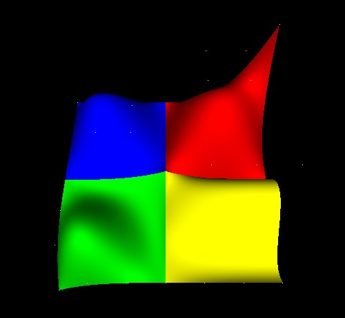
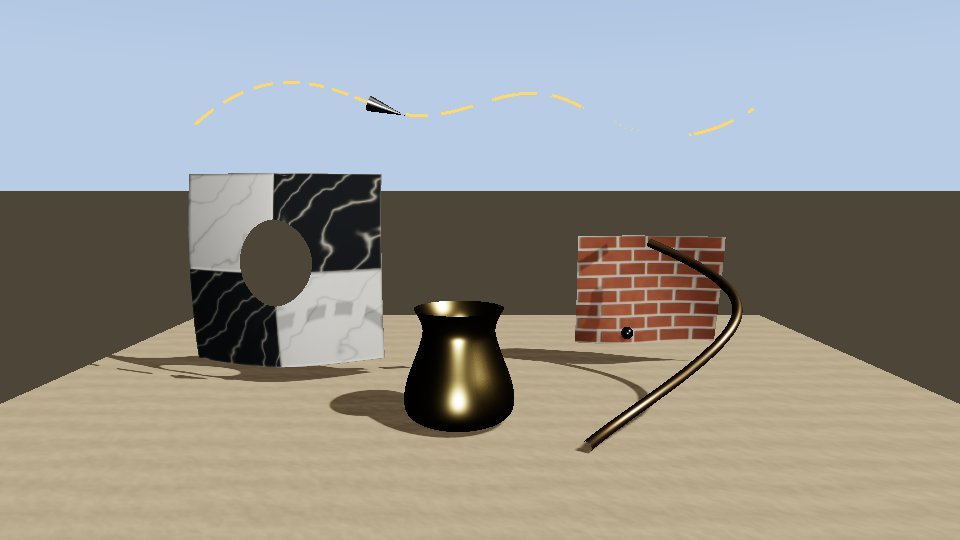
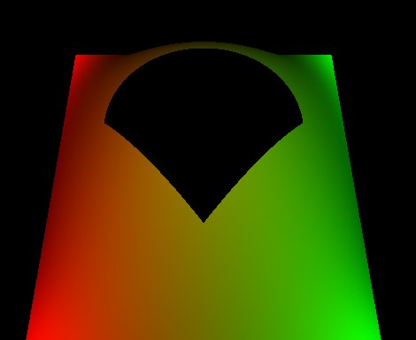

NURBS Surfaces and Curves
=========================

A NURBS surface is a grid of control points with a knot vector along each
parametric direction. It describes a smooth shape with a few numbers instead
of thousands of triangles. The engine draws X3D's NURBS component (ISO/IEC
19775-1, 27) and the older VRML97 NURBS extension's nodes, both evaluated by
`opengl_extrusions <https://github.com/mcfletch/opengl_extrusions>`__, a NumPy
geometry generator, into an indexed triangle mesh. The mesh is drawn in both
the **core and compatibility profiles**: lit, shadowed, textured and
pickable. Evaluation makes no GL calls, so a surface can be built before a
context exists to draw it: on a worker thread while a scene loads, or in a
test with no window.

   Four ``NurbsSurface`` patches meeting in a mound, from ``tests/molehill.py``.
   Each is a 4 by 4 control net; the shading is from the surfaces' own
   derivatives, so the seams between them are smooth.

X3D's NURBS nodes
-----------------

   ``oglc-x3d-nurbs``: a ``NurbsTrimmedSurface`` with a rational circle cut
   from it, a ``NurbsSwungSurface`` vase, a ``NurbsSweptSurface`` rail, a
   ``NurbsPatchSurface`` banner a ``NurbsSurfaceInterpolator`` moves a bead
   over, and a dart the position and orientation interpolators fly along a
   dashed ``NurbsCurve``. The document is ``OpenGLContext/bin/x3d_nurbs.x3d``.

.. list-table::
   :widths: auto
   :header-rows: 1

   * - Node
     - What it is
   * - ``NurbsPatchSurface``
     - a control net (a ``Coordinate`` or ``CoordinateDouble``), with an order,
       a knot vector and a tessellation each way, and optionally a weight per
       control point
   * - ``NurbsTrimmedSurface``
     - the same, cut to the inside of its ``trimmingContour`` loops
   * - ``Contour2D``
     - one closed trimming loop, its ``children`` joined end to end
   * - ``ContourPolyline2D``, ``NurbsCurve2D``
     - a straight or a curved piece of a loop, in the surface's (u, v) knot range
   * - ``NurbsSweptSurface``
     - a 2D ``crossSectionCurve`` swept along a 3D ``trajectoryCurve``
   * - ``NurbsSwungSurface``
     - a 2D ``profileCurve`` swept along a 2D ``trajectoryCurve`` in the xz-plane
   * - ``NurbsCurve``
     - a curve in space, drawn as a line
   * - ``NurbsTextureCoordinate``
     - a surface's texture coordinates as a NURBS net of their own
   * - ``NurbsSet``
     - multiplies the tessellation of the geometry it lists
   * - ``NurbsPositionInterpolator``, ``NurbsOrientationInterpolator``,
       ``NurbsSurfaceInterpolator``
     - a point, a direction or a surface point and normal for each fraction

The surfaces are :class:`~OpenGLContext.scenegraph.meshgeometry.MeshDrawn`
geometry: each draws the ``PBRMesh`` its fields build, kept until one of the
fields it was built from is set -- its own, its control points', its texture
coordinates', its curves' or its contours'. ``NurbsCurve`` draws as the
engine's ``IndexedLineSet``, so ``LineProperties`` widen and dash it. In code
the X3D classes are in ``OpenGLContext.scenegraph.nurbsx3d`` and
``nurbsinterpolators``; ``basenodes.NurbsCurve``, ``NurbsCurve2D`` and
``Contour2D`` are the VRML97 extension's nodes of those names, and an X3D
document builds the X3D ones (``loaders.x3d.X3D_ONLY``).

.. code-block:: python

   from OpenGLContext.scenegraph.basenodes import *

   surface = NurbsPatchSurface(
       uDimension=4, vDimension=4, uOrder=4, vOrder=4,
       controlPoint=Coordinate(point=[
           (x, y, 1.0 if 0 < x < 3 and 0 < y < 3 else 0.0)
           for y in range(4) for x in range(4)]),
       solid=False,
   )

Knots, order and closure
~~~~~~~~~~~~~~~~~~~~~~~~

``controlPoint`` holds ``uDimension * vDimension`` points, u varying
fastest. The degree each way is ``order - 1``. A knot vector of
``dimension + order`` values that never decrease, and never repeat a value
more than ``order`` times, is used as it is; any other, an empty one
included, is replaced by a uniform one over 0..1 with ``order`` equal knots
at each end. A surface or curve whose order is below 2, or whose dimension
is below its order, is not drawn, and that is reported once.

``uClosed``/``vClosed`` (``closed`` on a curve) close a direction whose first
and last rows of control points coincide, with equal weights; otherwise the
field has no effect. A closed direction is evaluated as a periodic spline,
with its first ``order - 2`` rows repeated after the last, and its knots
extended at the spacing they start with, so the seam is as smooth as the rest
of the surface and its two edges are welded.

Weights
~~~~~~~

``weight`` takes one positive weight per control point; another count, or a
weight that is not positive, is ignored. **A weighted control point is given
multiplied by its weight**, as the X3D examples write them: a quarter circle
from (1, 0) to (0, 1) is the points (1, 0), (√2/2, √2/2) and (0, 1) with
weights 1, √2/2 and 1. The middle point is the corner (1, 1) multiplied by
its weight.

.. code-block:: python

   root = 2 ** 0.5 / 2
   arc = NurbsCurve(order=3, weight=[1, root, 1],
                    controlPoint=Coordinate(point=[(1, 0, 0), (root, root, 0), (0, 1, 0)]))

Tessellation
~~~~~~~~~~~~

``uTessellation``, ``vTessellation`` and a curve's ``tessellation`` say how
many segments a direction is divided into: a positive value is the count, a
negative value is that many per control point, and 0 is ten segments per
knot span, but never fewer than two per control point. A straight (order 2)
direction defaults to one segment per span. A ``NurbsSet`` multiplies the
count of every geometry in its ``geometry`` by its ``tessellationScale``;
taken out of the set, a geometry goes back to its own count. Each direction
has between 1 and 512 segments
(``OpenGLContext.scenegraph.nurbseval.segments``).

A surface far from the camera is drawn from a coarser tessellation, half,
a quarter and an eighth of the count at the distance levels of the
:py:mod:`tessellation LOD <OpenGLContext.scenegraph.tessellationlod>`; each
level is kept separately. ``OPENGLCONTEXT_LOD=off`` draws every surface at
its own count.

Which way a surface faces
~~~~~~~~~~~~~~~~~~~~~~~~~

An X3D surface's front is the side its normal ``∂p/∂u × ∂p/∂v`` points to:
seen from the front, u runs to the right and v up. ``solid`` false draws both
sides. A swept or swung surface's ``ccw`` false turns it the other way round.

Texture coordinates
~~~~~~~~~~~~~~~~~~~

Without a ``texCoord``, a surface's texture runs once across its parameters:
(0, 0) at the first control point, (1, 1) at the last. A
``TextureCoordinate`` of one point per control point is evaluated through the
surface's own basis, and a ``NurbsTextureCoordinate``'s own net is evaluated
at the same fractions of its domain; one with too few points is reported once
and the parameters are used. A ``TextureCoordinateGenerator`` makes them in
the shader, as for any X3D geometry, and ``MultiTextureCoordinate`` gives one
set per entry.

Trimming
~~~~~~~~

A ``NurbsTrimmedSurface`` keeps the part of its domain inside an **odd number**
of its ``Contour2D`` loops: an outer boundary and a hole inside it may wind
either way. Loop coordinates are (u, v) in the surface's own knot range, and a
loop reaching past the domain is clipped to it. The kept region is
triangulated in triangles about one lattice cell across each way and the
surface is evaluated at their corners, so a trimmed surface follows the
surface's curvature as closely as an untrimmed one. ``addTrimmingContour`` and
``removeTrimmingContour``, and a ``Contour2D``'s ``addChildren`` and
``removeChildren``, change the loops.

Swept and swung surfaces
~~~~~~~~~~~~~~~~~~~~~~~~

A ``NurbsSweptSurface`` places its cross-section, whose points are (x, z) in
the plane across the trajectory, at each point of its ``trajectoryCurve`` as
an ``Extrusion`` places its cross-section along its spine. A
``NurbsSwungSurface`` does the same with its ``profileCurve`` along its 2D
``trajectoryCurve`` laid in the xz-plane: (x, z) of each trajectory point. A
trajectory running counter-clockwise looking down -y puts the profile's
second coordinate up. Neither is capped, and both are shaded smoothly
throughout; their texture runs once along each curve.

Interpolators
~~~~~~~~~~~~~

The interpolators take ``set_fraction`` from 0 to 1 across their curve's or
surface's domain, and route like the other interpolators:

- ``NurbsPositionInterpolator`` sends the point on its curve.
- ``NurbsOrientationInterpolator`` sends the rotation turning +z to the
  curve's direction there.
- ``NurbsSurfaceInterpolator`` takes a (u, v) fraction and sends the point
  (``position_changed``) and unit normal (``normal_changed``) there.

Their knots, order and weights follow the rules above.

The VRML97 NURBS extension
--------------------------

VRML97 worlds that use the NURBS extension proposal's nodes, and code built on
them, draw them with the nodes below. They are a separate vocabulary from
X3D's: their control points are fields rather than a ``Coordinate``, the
degree comes from the length of the knot vector rather than an order, weights
apply to control points given as they are, and sampling is set by a sampling
node. A ``.wrl`` file builds these classes (``loaders.vrml97.vrml97_prototypes``).

The nodes
~~~~~~~~~

.. list-table::
   :widths: auto
   :header-rows: 1

   * - Node
     - What it is
   * - ``NurbsSurface``
     - a control net, a knot vector each way, and optionally a weight and a colour
       per control point
   * - ``TrimmedSurface``
     - a ``surface`` plus the ``trimmingContour`` loops that bound the part of it to
       keep
   * - ``NurbsCurve``
     - a curve in space, drawn as a line strip
   * - ``Contour2D``
     - one closed trimming loop, built from joined children
   * - ``Polyline2D``
     - a straight-sided piece of a loop
   * - ``NurbsCurve2D``
     - a curved piece of a loop, in the surface's parameter square
   * - ``NurbsToleranceSample``, ``NurbsDomainDistanceSample``
     - how finely a surface is sampled — see below

The :py:mod:`Teapot <OpenGLContext.scenegraph.teapot>` uses the same code:
its 32 Bézier patches are NURBS surfaces of order 4.

.. code-block:: python

   from OpenGLContext.scenegraph.basenodes import *

   KNOT = [0, 0, 0, 0, 1, 1, 1, 1]                 # clamped cubic, 4 points
   surface = NurbsSurface(
       uDimension=4, vDimension=4,
       uKnot=KNOT, vKnot=KNOT,
       controlPoint=[[x, y, 1.0 if 0 < x < 3 and 0 < y < 3 else 0.0]
                     for y in range(4) for x in range(4)],
   )
   scene = sceneGraph(children=[Shape(geometry=surface,
                                      appearance=Appearance(material=Material()))])

A knot vector holds ``dimension + degree + 1`` non-decreasing values, and the
degree is taken from its length: a direction with 4 control points and 8 knots
is cubic. ``controlPoint`` is *v-major*: u varies fastest, as the VRML97 NURBS
proposal specifies.

Weights
~~~~~~~

The ``weight`` field takes one positive number per control point. Weights
make the curve *rational*, which lets it represent a circle exactly. A quarter
circle is exact as a rational quadratic with a middle weight of √2/2, and no
polynomial represents it exactly. Equal weights give the same surface as no
weights.

.. code-block:: python

   root = 2 ** 0.5 / 2
   cylinder = NurbsSurface(
       uDimension=9, vDimension=2,
       uKnot=[0, 0, 0, .25, .25, .5, .5, .75, .75, 1, 1, 1],
       vKnot=[0, 0, 1, 1],                          # degree 1: straight up
       controlPoint=ring_points,                    # 9 around, twice
       weight=[1, root, 1, root, 1, root, 1, root, 1] * 2,
   )

A direction may be degree 1, as the cylinder's length is here. A surface that
runs straight between two rows of control points is evaluated and shaded like
any other.

Sampling: how many triangles
~~~~~~~~~~~~~~~~~~~~~~~~~~~~

A sampling node sets a **rate**: sample intervals per unit of the surface's
knot range. Because it is a rate and not a count, two surfaces at the same
rate get triangles of the same parametric size whatever their knot ranges. A
surface whose knots run from 0 to 4 gets four times as many samples as one
whose knots run from 0 to 1.

.. list-table::
   :widths: auto
   :header-rows: 1

   * - Node
     - Field
     - Meaning
   * - ``NurbsDomainDistanceSample``
     - ``uStep``, ``vStep`` (default 100)
     - the rate itself, one for each direction
   * - ``NurbsToleranceSample``
     - ``tolerance`` (default 50)
     - a rate of 150/tolerance, held between 20 and 100

A surface with no ``sampling`` node gets a tolerance of 5, which is a rate of
30. A surface over the usual 0..1 knots then becomes a 30 by 30 lattice of
1800 triangles.

``NurbsToleranceSample`` keeps its ``method`` and ``parametric`` fields but
does not use them: only ``tolerance`` sets the rate. A smaller tolerance gives
a finer mesh, but it does not guarantee a maximum distance between the mesh
and the surface. To get a mesh of a known size, use
``NurbsDomainDistanceSample``.

Each direction is limited to 512 intervals, so an unusually large knot range
cannot produce an oversized mesh.

Distance level of detail
^^^^^^^^^^^^^^^^^^^^^^^^

A surface far from the camera is tessellated at a coarser rate, and each
level is cached separately, so walking towards a surface rebuilds it once per
level rather than every frame. It uses the same :py:mod:`distance metric
<OpenGLContext.scenegraph.tessellationlod>` as the teapot and the quadrics.
Level 0 uses the node's own sampling, so a surface close to the camera looks
exactly as authored. The coarser levels use rates of 16, 8 and 4. Set
``OPENGLCONTEXT_LOD=off`` (see :doc:`environment`) for the same output at
every distance, for example when comparing reference images.

Trimming
~~~~~~~~

A trimming contour is a closed loop in the surface's parameter square. **The
area to the left of a loop is kept.** A counter-clockwise loop is therefore a
boundary, a clockwise loop inside it is a hole, and a clockwise loop on its
own keeps nothing.

.. code-block:: python

   outer = Contour2D(children=[Polyline2D(point=[[0, 0], [1, 0], [1, 1], [0, 1]])])
   hole = Contour2D(children=[
       NurbsCurve2D(knot=KNOT,
                    controlPoint=[[.25, .5], [.25, .75], [.75, .75], [.75, .5]]),
       Polyline2D(point=[[.75, .5], [.5, .25], [.25, .5]]),
   ])
   trimmed = TrimmedSurface(surface=surface, trimmingContour=[outer, hole])

   A ``TrimmedSurface``, from ``tests/nurbsobject.py``: a counter-clockwise
   square boundary and a clockwise loop inside it, whose top is a
   ``NurbsCurve2D`` and whose point is a ``Polyline2D``. The colours are per
   control point.

A ``Contour2D`` joins its children end to end into one loop. Where one child
ends on the point the next begins with, that point is kept once. The loop
closes from its last point back to its first. A ``NurbsCurve2D`` is evaluated
at 32 points unless its ``tessellation`` field gives another count.

Trim coordinates are in the surface's own knot ranges, in the order ``(v,
u)``.

The kept region is triangulated by the same constrained Delaunay
:doc:`tessellator <tessellation>` that fills the caps of :doc:`swept geometry
<extrusions>`, refined to the triangle size the sampling rate sets. A trimmed
surface is therefore sampled as finely across its middle as an untrimmed one,
not only along its outline. The surface is then evaluated at the resulting
vertices, so a trimmed surface follows the surface's curvature rather than
having a flat hole cut in it.

Which way a surface faces
~~~~~~~~~~~~~~~~~~~~~~~~~

A surface's normal is ``∂p/∂v × ∂p/∂u``, and its triangles are wound to
match. If a surface faces away from the camera, its two parametric directions
are the other way round. Swap ``uDimension`` with ``vDimension`` and swap the
knot vectors with them, or set ``solid=0`` so the back faces are not culled.
``ccw=0`` reverses which winding the fixed-function pipeline treats as front
facing.

``geometryType`` takes ``polygon`` (the default), or ``edge`` / ``patch``,
which draw the tessellation as its edges.

Colour
~~~~~~

The ``color`` field takes one colour per control point. Colours are evaluated
with the same basis functions as the surface, so a colour follows its control
point however finely the surface is sampled. A coloured surface is drawn with
the vertex-colour program, and the material supplies everything except the
diffuse colour.

Where the code is
-----------------

.. list-table::
   :widths: auto
   :header-rows: 1

   * - Module
     - What is in it
   * - ``scenegraph/nurbsx3d.py``
     - X3D's geometry nodes, trims, texture coordinates and ``NurbsSet``
   * - ``scenegraph/nurbsinterpolators.py``
     - X3D's three interpolators; no GL
   * - ``scenegraph/nurbseval.py``
     - X3D's field rules, and curves, surfaces, trims and sweeps evaluated;
       no GL
   * - ``scenegraph/nurbs.py``
     - the VRML97 extension's geometry nodes and both draw paths
   * - ``scenegraph/nurbstess.py``
     - a VRML97 extension surface node to triangles; no GL
   * - ``scenegraph/nurbstrim.py``
     - the VRML97 extension's trimming primitives
   * - ``scenegraph/nurbssampling.py``
     - the sampling nodes
   * - ``scenegraph/teapot_nurbs.py``
     - the Utah Teapot's 32 patches

Demonstrations:

- ``oglc-x3d-nurbs`` - every X3D NURBS node, read from a document; ``t``
  steps the ``NurbsSet``'s tessellation scale through 1, 2 and a quarter.
- ``tests/molehill.py`` - four surfaces meeting.
- ``tests/molehill_edit.py`` - dragging their control points; see
  :doc:`editing` for ``ControlNet``.
- ``tests/nurbsobject.py`` - a trimmed surface, animated.
- ``tests/teapot_nurbs.py`` - the Utah Teapot.
