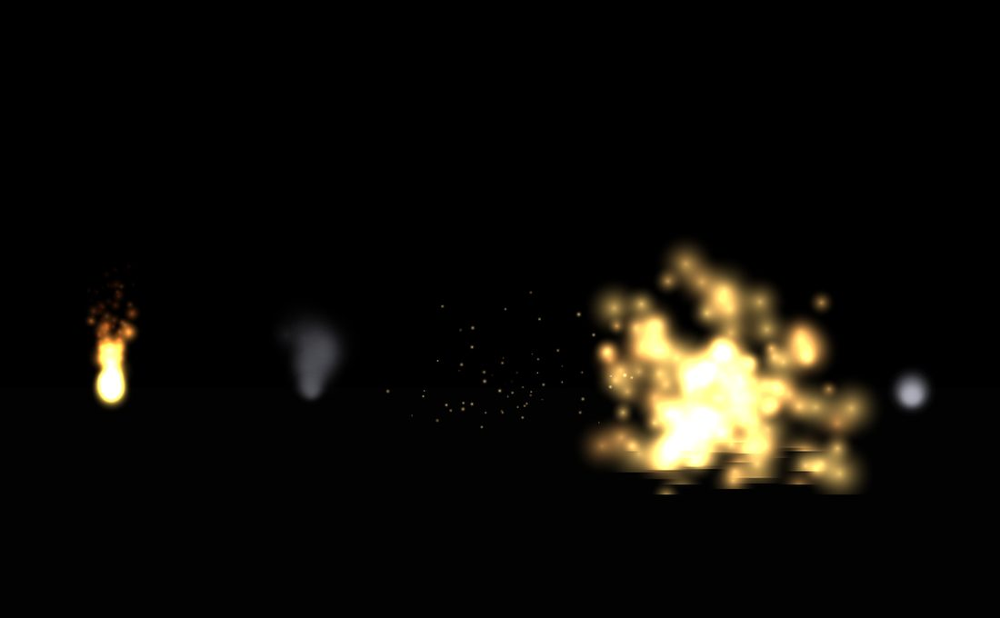
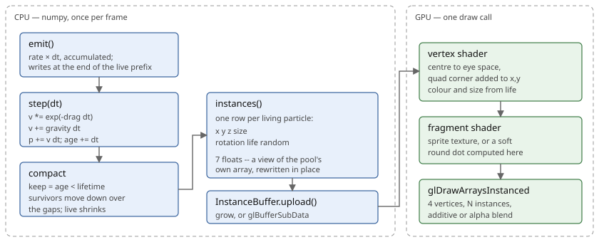
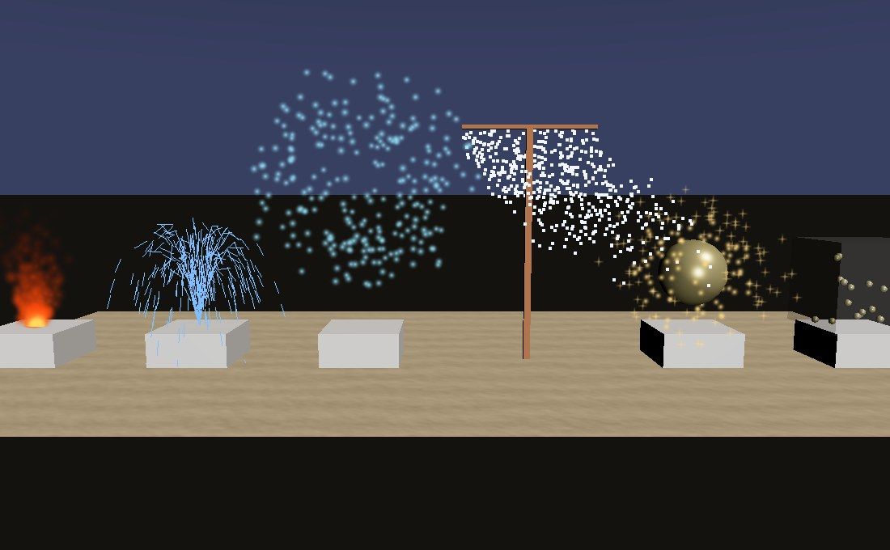

Particle systems
================

.. rst-class:: introduction

A particle system draws many small quads that face the camera, from a single
``ParticleEmitter`` node. Use it for fire, smoke, sparks, explosions, impacts
and trails. Each system is drawn with one instanced draw call, however many
particles it has. The simulation (``OpenGLContext.scenegraph.particlesim``)
is numpy arrays stepped as whole arrays and uses no OpenGL, so it can be
driven and tested without a window. X3D's ParticleSystems component is drawn
by the same simulation and renderer (:ref:`x3d-particles`).

   Five of the presets side by side, from ``tests/particles_effects.py``:
   fire, smoke, sparks, an explosion and a trail. None of them loads a
   texture; without one, a particle is a soft round dot computed in the
   fragment shader.

.. _particles-quickstart:

Using it
--------

A fire
~~~~~~

.. code-block:: python

   from OpenGLContext.scenegraph import particles
   from OpenGLContext.scenegraph.basenodes import Transform

   torch = Transform(translation=(0, 1, -3), children=[
       particles.preset('fire'),
   ])

That is a complete effect. ``ParticleEmitter`` is a rendering node in its own
right, not a geometry inside a ``Shape``: an effect has no material and no
surface, so an ``Appearance`` would have nothing to set.

Six presets are included: ``fire``, ``smoke``, ``sparks``, ``explosion``,
``trail`` and ``impact``. A preset is only a set of field values, so anything
a preset does can be written out by hand, and a preset's values are a
starting point for your own effect. Keyword arguments to ``preset()`` override
the preset's values.

An explosion on demand
~~~~~~~~~~~~~~~~~~~~~~

.. code-block:: python

   burst = particles.preset('explosion', maxParticles=512, color=(0.6, 0.8, 1.0))
   burst.fire()          # again, later

``fire()`` releases a burst at the emitter's position on the next step. By
default an emitter also releases its first burst as soon as it is drawn. Set
``burstOnStart=False`` for an emitter that should only go off when fired;
otherwise every such emitter goes off at its own position the first time the
scene is drawn.

Sparks at each impact
~~~~~~~~~~~~~~~~~~~~~

When the same effect happens in many places, such as a shotgun's eight
impacts, one emitter can release a burst at each place. There is no need to
add a node per effect:

.. code-block:: python

   sparks = particles.preset('sparks', burstOnStart=False, worldSpace=True)
   for hit in shot.impacts:
       sparks.burst_at(hit.point, direction=hit.normal)     # count=... to override

The fields stay on the one node, and each burst gets its own position.
``position`` is in the frame the particles live in: world space for a
``worldSpace`` emitter, and the emitter's own space otherwise. ``direction``
is the axis the particles are thrown along; for an impact, that is the surface
normal. ``burst_at()`` returns how many particles it released. A disabled
emitter releases nothing, so a settings switch that turns an effect off turns
it off for bursts too.

Adding a node per effect would change the scenegraph as often as things
happen, and the render pass discards what it has gathered each time the
scenegraph changes.

.. _particle-sources:

Sources, forces and colour ramps
~~~~~~~~~~~~~~~~~~~~~~~~~~~~~~~~

An emitter's particles start at its origin and are thrown within ``spread`` of
``direction``. ``source`` puts them somewhere else: one of X3D's emitter nodes,
in the emitter's own frame. ``physics`` is a list of X3D's physics-model nodes,
applied after ``gravity`` and ``drag``, in order:

.. code-block:: python

   from OpenGLContext.scenegraph import particles, x3dparticles
   from OpenGLContext.scenegraph.basenodes import Box, Coordinate, ColorRGBA

   sparks = particles.preset('sparks', rate=80.0, burst=0, shape='line',
       # along the edge of a workbench
       source=x3dparticles.PolylineEmitter(
           coord=Coordinate(point=[(-1, 0.9, 0), (1, 0.9, 0)])),
       physics=[x3dparticles.BoundedPhysicsModel(geometry=Box(size=(4, 2, 4)))],
       # white, then orange, then gone, by the fraction of each particle's life
       colorKey=[0.0, 0.3, 1.0],
       colorRamp=ColorRGBA(color=[(1, 1, 1, 1), (1, 0.5, 0.1, 1), (0.5, 0.1, 0, 0)]))

.. list-table::
   :widths: auto
   :header-rows: 1

   * - Source
     - Where particles start, and which way they go
   * - ``PointEmitter``
     - One point, along ``direction``; a zero direction throws every way.
   * - ``ConeEmitter``
     - One point, within ``angle`` radians of ``direction``, spread evenly
       over the cone's cap.
   * - ``ExplosionEmitter``
     - One point, every way.
   * - ``PolylineEmitter``
     - Along the lines ``coordIndex`` draws through ``coord``, chosen by
       length; ``coordIndex`` with no vertex joins the points in order.
   * - ``SurfaceEmitter``
     - On the triangles of the ``surface`` geometry, chosen by area, thrown
       along the surface normal (from either face where the geometry is not
       ``solid``).
   * - ``VolumeEmitter``
     - Inside the closed faces ``coordIndex`` draws through ``coord``; on
       them where ``internal`` is FALSE.

Each source's ``speed`` and ``variation`` are not read by ``ParticleEmitter``,
which throws at its own ``speed`` and ``speedVariation``. The models act on a
particle of the emitter's ``mass`` (kilograms) and ``surfaceArea`` (square
metres):

.. list-table::
   :widths: auto
   :header-rows: 1

   * - Model
     - What it does
   * - ``ForcePhysicsModel``
     - ``force`` newtons divided by the mass. In an X3D ``ParticleSystem`` a
       particle of mass 0 takes no force (19775-1, 40.4.4), and neither the
       wind, as X_ITE has it; ``ParticleEmitter`` takes the force on a
       particle of mass 0 as an acceleration, so the default ``(0, -9.8, 0)``
       is the Earth's gravity there.
   * - ``WindPhysicsModel``
     - A pressure of 0.64615 times the square of ``speed`` (pascals) on the
       surface area, along ``direction``. ``gustiness`` scatters the speed by
       up to that fraction each step; ``turbulence`` (0 to 1) turns each
       particle's push off the wind's direction by up to that fraction of half
       a turn.
   * - ``BoundedPhysicsModel``
     - The triangles of ``geometry``, which particles bounce off from either
       side: a particle whose step crosses one is put back on the side it came
       from with its velocity reflected. The test is every moving particle
       against every triangle the particle's step could reach, so a mesh of a
       few hundred triangles is the size to keep to.

A model with ``enabled`` FALSE does nothing. The same classes, without the
nodes, are in ``particlesim``: ``PointSource``, ``ConeSource``,
``SphereSource``, ``PolylineSource``, ``SurfaceSource``, ``VolumeSource``,
``ConstantForce``, ``Wind`` and ``Bounds``, for ``ParticlePool.spawn`` and
``ParticlePool.step(models=...)``.

.. _authored-particles:

Placing an effect in a model
----------------------------

A glTF file can say where its fires are. An object tagged with the
:ref:`OGLC_hook <hooks>` kind ``fire``, ``smoke`` or ``sparks``
(:doc:`specification <extensions/OGLC_hook>`) loads with an
emitter from the preset of that name at the object's position, alongside any
mesh the object already has. In Blender, put the tag on the object (an empty,
or the brazier itself), either with the **Engine Hook** panel of the
``tools/blender/oglc_hook`` add-on or as a custom property:

.. code-block:: javascript

   {"OGLC_hook": {"kind": "fire", "scale": 2.0}}

.. list-table::
   :widths: auto
   :header-rows: 1

   * - Parameter
     - Default
     - What it does
   * - ``scale``
     - 1
     - Multiplies every length in the effect: particle size at birth and
       death, launch speed and gravity. A flame at scale 2 is twice as tall
       and lasts as long. The object's own scale multiplies it too, so
       resizing the empty in Blender resizes the effect.
   * - ``density``
     - 1
     - Multiplies particles per second, the burst and ``maxParticles``.
   * - an emitter field
     - the preset's
     - Set by name before ``scale`` and ``density`` are applied:
       ``{"kind": "fire", "color": [0.3, 0.6, 1.0]}`` is a gas flame. Every
       :ref:`field <fields>` but ``externalURL`` may be set. A name that is
       not one of them, or a value the field does not accept, is logged and
       ignored.
   * - ``texture``
     - none
     - A sprite image named relative to the document, read only when the
       document was loaded from a file, and only from inside its directory.

What a file asks for is held to the fields' ranges, before and after
``scale`` and ``density`` multiply it: at most 2000 particles a second,
a ``maxParticles`` and a ``burst`` of at most 20000, sizes of at most 20 and
a speed of at most 100. ``scale`` (the object's own scale included) and
``density`` are each at most 100. A value that is no finite number is
logged and the preset's value is kept (``particlehooks.RANGES``).

The ``sparks`` preset is a single burst, for a game to fire on an impact. An
authored ``sparks`` emits a steady 60 a second instead, because nothing in a
world fires it; ``{"rate": 0, "burst": 60}`` gives the preset's burst.

The tag is read from objects only, since a material has no single position
for a flame. A material carrying one of these kinds loads unchanged.
``scene.hook_data['fire']`` (and ``'smoke'``, ``'sparks'``) holds one emitter
per tagged object. Each emitter steps on the engine clock as it is drawn, and
``scene.advance()`` reports whether any is still burning, which keeps
``oglc-view`` drawing frames.

``tools/blender/demos/lakeside.glb`` is a world authored this way, with a
campfire, a brazier and two torches;
``oglc-view tools/blender/demos/lakeside.glb`` shows it.

.. _fields:

Fields
------

Every field is a declared VRML field with a ``UI_HINTS`` entry, so an emitter
can be written into a scene file, carried in an ``MFNode``, watched for
changes, and edited on a generated settings page with no UI code. A
``*Variation`` field scatters each particle's value by up to that fraction of
the base value, either way.

.. list-table::
   :widths: auto
   :header-rows: 1

   * - Field
     - Default
     - Meaning
   * - ``rate``
     - 50.0
     - Particles born per second. Fractions carry over between frames, so a
       rate below one per frame still emits.
   * - ``burst``
     - 0
     - Particles released at once when the emitter starts or ``fire()`` is
       called. A burst with ``rate=0`` is a one-shot, such as an explosion.
   * - ``maxParticles``
     - 500
     - The pool's capacity. Size it from ``rate × lifetime``, which is how many
       particles can be alive at once.
   * - ``lifetime``, ``lifetimeVariation``
     - 1.5, 0.3
     - Seconds a particle lives.
   * - ``enabled``
     - True
     - A disabled emitter emits nothing, but particles already out keep
       ageing, so smoke clears instead of freezing.
   * - ``burstOnStart``
     - True
     - Whether the first ``burst`` is released as soon as the emitter is drawn.
   * - ``source``
     - NULL
     - An X3D emitter node: where particles start and which way they are
       thrown, in the emitter's own frame. NULL starts them at the origin.
   * - ``direction``
     - (0, 1, 0)
     - Which way particles are thrown, in the emitter's own frame.
   * - ``speed``, ``speedVariation``
     - 2.0, 0.3
     - Speed in units per second.
   * - ``spread``
     - 0.4
     - Half-angle of the emission cone, in radians: 0 is a straight line, π a
       full sphere.
   * - ``gravity``
     - (0, −1, 0)
     - Constant acceleration. Negative Y falls; positive Y makes smoke rise.
   * - ``drag``
     - 0.0
     - Rate at which velocity decays, per second.
   * - ``physics``
     - empty
     - X3D physics-model nodes, applied after gravity and drag, in order.
   * - ``mass``, ``surfaceArea``
     - 0.0, 0.0
     - A particle's mass in kilograms and area in square metres, which the
       physics models act on.
   * - ``size``, ``endSize``, ``sizeVariation``
     - 0.3, 0.0, 0.3
     - Size at birth and at death, in world units.
   * - ``spin``, ``spinVariation``
     - 0.0, 1.0
     - Radians per second each particle turns about the view axis.
   * - ``color``, ``endColor``
     - (1, 0.7, 0.3), (0.6, 0.1, 0)
     - Colour at birth and at death.
   * - ``alpha``, ``endAlpha``
     - 1.0, 0.0
     - Opacity at birth and at death.
   * - ``colorKey``, ``colorRamp``
     - empty, NULL
     - A colour ramp in place of the two ends: the colours of a ``Color`` or
       ``ColorRGBA`` node at fractions of the life, interpolated between and
       held past either end. Each particle carries its own colour.
   * - ``shape``
     - ``sprite``
     - ``sprite`` for a quad facing the camera, ``line`` for a streak along
       the particle's velocity as long as its size.
   * - ``texture``
     - empty
     - A sprite image for each particle. Without one, a particle is a soft
       round dot computed in the fragment shader, which suits sparks, embers
       and explosions and needs no asset.
   * - ``blending``
     - ``additive``
     - ``additive`` for effects that give off light, ``alpha`` for effects
       that block it. See :ref:`rendering`.
   * - ``worldSpace``
     - True
     - True leaves particles behind when the emitter moves, as for a rocket
       trail. False carries them with it, as for a torch flame. A world-space
       emitter's ``direction`` is turned by the transforms above it but keeps
       its own length, so a scaled parent moves the effect without throwing
       particles faster.
   * - ``seed``
     - −1
     - A fixed value makes the sequence repeatable, for a reference image. −1
       draws from the :ref:`session's particle stream <randomness>`, so an
       emitter looks different each time the game is played and the same each
       time one recorded session is replayed.

.. _stepping:

When the simulation steps
-------------------------

Particles are stepped when they are drawn, because the draw is the only
per-frame hook a scenegraph node has. This has two consequences:

- A scene rendered twice in one frame, for example by a shadow pass and a
  selection pass, steps by almost zero the second time, not twice, because
  the step is measured from a clock rather than counted.

- When no frames are drawn, the simulation stops. An application showing
  effects has to keep requesting frames; the demo does this in ``OnIdle``.

To drive the simulation yourself, from a fixed-tick game loop or a test, call
``emitter.simulate(dt, origin=...)``. The draw uses the same method.

.. _particles-dataflow:

Each frame
----------

   Emit, step, compact, upload, draw. Each stage is a numpy operation over
   contiguous arrays. Nothing loops over particles in Python, and nothing
   allocates per particle.

.. _pool:

The pool
--------

Lifetimes vary, so particles die out of order. If dead particles stayed in
place, the pool would have gaps, and every stage would need a mask to skip
them.

Instead, the survivors are moved down over the gaps as particles die. The
living particles are therefore always ``arrays[0:live]``: the GPU upload is
one contiguous slice, the draw is one call, and each step is a whole-array
operation with no mask.

.. code-block:: python

   keep = age[:live] < lifetime[:live]
   index = np.flatnonzero(keep)
   for array in (position, velocity, age, ...):
       array[:survivors] = array[index]
   live = survivors

New particles are written after the last live one. When the pool is full, no
more are emitted and nothing is reported: ``maxParticles`` is a budget, and
reaching it is normal.

.. rst-class:: technical

``OpenGLContext/scenegraph/particles.py``, ``ParticlePool._bury``. The class
uses no GL, and ``tests/unit/test_particles.py`` tests it without one.

.. _split:

Per-particle and per-system values
----------------------------------

A particle stores only what differs between particles:

.. list-table::
   :widths: auto
   :header-rows: 1

   * - Per particle (in the pool)
     - Per system (a uniform)
   * - position, velocity
     - gravity, drag
   * - age, lifetime
     - physics models
   * - size *factor* (mean 1.0)
     - size at birth and at death
   * - rotation, spin
     - —
   * - one random number
     - colour and alpha at birth and at death
   * - a colour, from the ramp (white without)
     - texture-coordinate frames

The data sent per instance is sixteen floats: position, size, rotation, age,
the random number, a texture frame, the colour and the velocity. Colour and
size over a particle's life are two uniforms, not a gradient texture with its
own texture unit; a colour ramp is evaluated on the CPU, one interpolation
per channel over the whole pool. Because the absolute size is a uniform,
changing ``size`` on a running emitter also resizes the particles already in
the air.

The per-particle random number lets a shader vary particles without the
simulation storing what it varied.

The step
--------

The step handles five details:

- Exponential drag - ``v -= v * drag * dt`` overshoots and reverses on a long
  frame, so particles fly backwards when the frame rate drops.
  ``v *= exp(-drag * dt)`` cannot overshoot at any step size.

- The engine's clock - the step comes from
  ``OpenGLContext.events.systemtime``, not the wall clock. A system therefore
  follows whatever drives the rest of the scene: a :doc:`recording
  <recording>` advancing one frame at a time, a replay reading the times the
  recording read, or a capture fixed so that the same frame count produces the
  same picture.

- Clamped frame time - each step is limited to ``MAX_STEP`` (0.1 s). Dragging
  a window or a stalled texture upload can produce a frame of several
  seconds, and integrating that would throw every particle out of sight. A
  fixed-timestep physics loop applies the same kind of clamp.

- Fractional emission - at 10 particles a second and 60 frames a second,
  ``int(rate * dt)`` is zero every frame, so the remainder is carried over.

- Random starting angles and uniform cones - each particle starts at a
  random rotation, and the emission cone samples its spherical cap uniformly
  rather than sampling the angle. Sampling the angle crowds particles towards
  the axis, giving a jet a bright core and a thin edge.

.. _rendering:

Rendering
---------

Billboarding is done in eye space. The particle's centre is transformed by
the model-view matrix, and the quad's corner is then added to its ``x`` and
``y``. Because the offset is added after the view transform, the quad faces
the camera at any camera orientation, with no per-particle matrix and no CPU
work.

.. code-block:: glsl

   vec4 centre = uModelView * vec4(aParticle.xyz, 1.0);
   centre.xy += rotate(aCorner, aParams.x) * size;
   gl_Position = uProjection * centre;

The node chooses which matrix to send. A world-space system's particles are
already in world coordinates, so it sends the view matrix. A local-space
system's particles are in the emitter's frame, so it sends the full
model-view matrix. Making this choice on the CPU keeps a branch out of the
vertex shader.

Particles are depth tested but do not write depth, so walls hide them and
they blend with each other instead of hiding each other. They are drawn in
the transparent pass, after opaque geometry (see :doc:`renderpasses`), and
are never drawn into a shadow map.

Blending is additive by default, which suits effects that give off light:
fire, sparks, explosions, muzzle flashes. ``blending='alpha'`` suits effects
that block light: smoke, dust, steam. After its draw a system puts back the
blending and depth writes of the phase it drew in.

``ParticleRenderer`` draws a pool in a ``ParticleLook``, as sprites, quads in
the system's XY plane, lines along each particle's velocity, or points of a
size in pixels. An opaque look (X3D's, where nothing is translucent) blends
nothing, writes depth and cuts its texture out where alpha is below one half.
A look may light its sprites and quads by X3D's Phong equation (``lit``,
``material``), transform the texture coordinates (``texture_matrix``) and
draw lines wider than a pixel (``line_width``) as strips across them. The X3D
ClipPlanes reaching a system clip it, in eye space.

.. rst-class:: technical

The shaders are ``OpenGLContext/shaders/particle.vert`` and ``particle.frag``.
The GL helpers (``InstanceBuffer``, ``GLLayer``) are shared with the terrain
and vegetation nodes in ``scenegraph/instancedgl.py``. If a shader fails to
compile or the driver fails, the node's ``failed`` is set with one logged
warning: the effect is missing, and the rest of the scene still draws. Setting
the node's ``drawn`` to False leaves it undrawn while its simulation goes on.

Bounding volume
---------------

A system reports a box over its living particles, widened by their size, and
over where new ones start and how far the fastest of them could travel in its
lifetime, so a system with nothing out yet is still drawn and still steps. The
box is asked for each frame and is one pass of numpy over the packed pool.

.. _particles-testing:

Testing
-------

The pool is plain numpy, so a test checks it directly:

.. code-block:: python

   pool = particles.ParticlePool(capacity=16)
   pool.emit(1, velocity=(1, 0, 0), spread=0.0, speed_variation=0.0)
   pool.step(0.5)
   assert np.allclose(pool.position[0], (0.5, 0, 0))

The suite covers birth, motion under gravity and drag, ageing, death,
compaction that keeps the survivors' state intact, the budget, fractional
emission, the long-frame clamp, repeatability from a seed, and that a full
pool stepped thirty times allocates almost nothing
(``tests/unit/test_particles.py``); each source, model and ramp
(``test_particle_simulation.py``); X3D's nodes (``test_x3d_particles.py``);
and each shape drawn by both renderers and the compatibility profile, with a
frame that makes and compiles nothing (``test_x3d_particles_gl.py``).

.. _particles-demos:

Demos
-----

:doc:`tests/particles_effects.py <tutorials/particles_effects>` shows five
presets, continuous and burst, side by side over a floor, so you can compare
each effect's fields with how it looks. Press the space bar to fire the
bursts again, and ``p`` to pause emission without freezing the particles
already in the air.

.. code-block:: bash

   python tests/particles_effects.py

``oglc-x3d-particles`` opens an X3D document with one system for each emitter
and physics model (:ref:`x3d-particles`); ``f`` sets the firework off again
and ``w`` switches the wind over the snow.

.. _x3d-particles:

X3D particle systems
--------------------

   ``oglc-x3d-particles``: a brazier of sprites from a ``PointEmitter``, a
   fountain of lines from a ``ConeEmitter``, a firework from an
   ``ExplosionEmitter``, snow as points from a ``PolylineEmitter`` in a
   ``WindPhysicsModel``, two-frame sparks off a ``SurfaceEmitter``, and gold
   beads (``GEOMETRY``) a ``VolumeEmitter`` makes and a
   ``BoundedPhysicsModel`` keeps in.

X3D's ``ParticleSystem`` (ISO/IEC 19775-1, 40) is
``OpenGLContext.scenegraph.x3dparticles.ParticleSystem``, drawn by the same
simulation and renderer:

- A system makes ``maxParticles / particleLifetime`` particles a second, so a
  full system holds about ``maxParticles``. Each lives ``particleLifetime``
  seconds give or take ``lifetimeVariation`` of it, and leaves its emitter at
  the emitter's ``speed`` give or take ``variation`` of it.
- An ``ExplosionEmitter`` makes the whole ``maxParticles`` at once when the
  system starts creating, and again each time ``createParticles``,
  ``enabled`` or the emitter's ``on`` is switched back on.
- ``createParticles`` FALSE (or the emitter's ``on`` FALSE) makes no more;
  those out live on. ``enabled`` FALSE removes every particle.
- ``isActive`` is TRUE while the system is enabled and has particles alive or
  is still making them.
- Particles live in the system's own coordinates: a transform above it
  carries the ones already made.
- A system steps once a frame on the engine's clock, through the render queue
  of each context it is drawn in, while it is active; it asks for frames
  while it does.
- With no emitter, particles stay at the origin.

.. list-table::
   :widths: auto
   :header-rows: 1

   * - ``geometryType``
     - Each particle is drawn as
   * - ``QUAD``, ``TRIANGLE``
     - A quad of ``particleSize`` (width, height) in the system's XY plane,
       facing +Z, seen from both sides.
   * - ``SPRITE``
     - A quad of ``particleSize`` facing the camera.
   * - ``LINE``
     - A line along the particle's velocity, ``particleSize``'s height long.
   * - ``POINT``
     - A point, sized by the appearance's ``PointProperties`` (1 pixel
       without).
   * - ``GEOMETRY``
     - A copy of ``geometry`` in the appearance, lit as any shape is; the
       copies are drawn in one instanced draw.

In a document, which X3D's lighting rules light, ``QUAD``, ``TRIANGLE`` and
``SPRITE`` particles with a ``Material`` are lit by the Phong equation, as
X_ITE lights them: the colour ramp's colour, or the material's diffuse colour,
times the appearance's first texture is the diffuse colour; the material's
emissive and specular colours, ambient intensity and shininess are its own; a
quad's normal is the system's +Z and a sprite's faces the viewer. ``LINE``
and ``POINT`` particles, and all of them under the engine's lighting, are
unlit: the colour ramp's colour where there is one, and otherwise the
material's colour (its emissive colour where it has one, its diffuse or base
colour where not), times the appearance's first texture. Either way the
material's transparency is the alpha. ``colorKey`` and ``texCoordKey`` are a
particle's age in seconds, as 40.4.5 gives them (X_ITE reads them as parts of
the particle's life): colours are interpolated between keys and held past
either end; texture coordinates, four to a key for the quad types, are
stepped from frame to frame, at most 16 frames. The appearance's texture
transform (the first of a ``MultiTextureTransform``) transforms the texture
coordinates, and its ``LineProperties`` ``linewidthScaleFactor`` is a line's
width in pixels. A system is blended where its material is transparent, its
ramp has an alpha below 1 or its texture has an alpha channel, and opaque
otherwise. ``ClipPlane`` nodes reaching a system clip its particles.

The emitter nodes and the physics models are the ones in
:ref:`Sources, forces and colour ramps <particle-sources>`. A ``BoundedPhysicsModel``'s
``geometry`` is in the system's coordinates.

