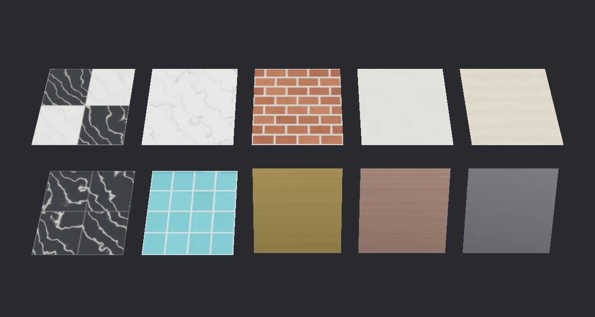

Procedural Surfaces
===================

.. rst-class:: introduction

``OpenGLContext.scenegraph.surfaces`` makes the materials a room is built
from -- marble, tiles, brick, plaster, stone, wood and brushed metals -- as texture
maps generated with NumPy, and the geometry to wear them at their real size.
No image files are needed, every surface repeats seamlessly both ways, and the
same seed gives the same surface.

   Each surface on a one-metre panel. Top: ``checkered_marble``, ``marble``,
   ``brick``, ``plaster``, ``sandstone``. Bottom: ``marble_tiles``,
   ``tiles``, and ``brushed_metal`` in gold, copper and steel.

.. code-block:: python

   from OpenGLContext.scenegraph import surfaces

   # 30 cm tiles: the checker has two tiles each way, so it repeats every 60 cm.
   floor = surfaces.pbr_material(surfaces.checkered_marble(512, tiles=2))
   scene.append(surfaces.shape(surfaces.panel(8.0, 6.0, repeat=0.6), floor,
                               rotation=(1, 0, 0, -1.5708)))

A surface is two steps: a function makes its maps, and
:func:`~OpenGLContext.scenegraph.surfaces.pbr_material` turns them into a
``PhysicalMaterial``. Geometry made here then wears the material by the metre.

The surfaces
------------

Every function takes ``size``, the texture's side in texels, and ``seed``,
which chooses the pattern; the rest have defaults. Colours are linear RGB,
from 0 to 1.

.. list-table::
   :widths: auto
   :header-rows: 1

   * - Function
     - Parameters and defaults
     - One repeat holds
   * - ``checkered_marble``
     - ``size=512, tiles=2, dark=(0.025, 0.028, 0.032), light=(0.80, 0.79,
       0.75), grout=(0.22, 0.21, 0.19), polish=0.05``
     - ``tiles`` by ``tiles`` polished marble tiles, dark and light
       alternating, in matte grout set below the stone. ``tiles`` is even.
   * - ``marble_tiles``
     - ``size=512, tiles=2, colour=(0.025, 0.028, 0.032), vein=(0.62, 0.60,
       0.56), grout=(0.12, 0.12, 0.12), polish=0.05``
     - ``tiles`` by ``tiles`` tiles of one marble -- black veined white, by
       default -- each cut from its own part of the stone.
   * - ``marble``
     - ``size=256, base=(0.86, 0.85, 0.82), vein=(0.32, 0.33, 0.36),
       veins=3, polish=0.06``
     - One slab: ``veins`` diagonal veins, bent by turbulence and slightly
       rougher than the stone.
   * - ``tiles``
     - ``size=256, count=8, colour=(0.12, 0.42, 0.48), grout=(0.78, 0.78,
       0.74), glaze=0.12, spread=0.08``
     - ``count`` by ``count`` glazed tiles, each its own shade within
       ``spread`` of ``colour``, in pale matte grout.
   * - ``brick``
     - ``size=256, courses=8, bricks=4, colour=(0.30, 0.10, 0.055),
       mortar=(0.50, 0.47, 0.42)``
     - ``courses`` rows of ``bricks`` in running bond, each brick its own
       shade, with recessed mortar. ``courses`` is even.
   * - ``plaster``
     - ``size=256, colour=(0.74, 0.70, 0.62)``
     - Hand-finished plaster: a faint mottle and a gentle bumpiness.
   * - ``sandstone``
     - ``size=256, colour=(0.72, 0.58, 0.40)``
     - Dressed stone with fine grain and faint bedding lines across it.
   * - ``wood``
     - ``size=256, colour=(0.42, 0.25, 0.12), rings=9``
     - Planed wood: ``rings`` growth rings running along its length, wandering
       a little, and a fine grain across them.
   * - ``brushed_metal``
     - ``size=256, colour=STEEL, roughness=0.28``
     - A metal brushed along one direction. ``GOLD``, ``COPPER``, ``STEEL``,
       ``BRONZE`` and ``SILVER`` are metals' reflectance colours.
   * - ``knurled``
     - ``size=256, colour=SILVER, count=8, roughness=0.18``
     - A metal knurled into diamonds, ``count`` across the texture: the grip
       of a thumb-wheel or a tool handle.

``polish``, ``glaze`` and ``roughness`` are the surface's roughness: 0 is a
mirror finish, 1 fully matte.

Each returns ``Maps``: ``base`` (``size`` by ``size`` by 3, linear colour),
and ``roughness``, ``metallic`` and ``height`` (``size`` by ``size``), all from
0 to 1, row 0 at the top of the texture.

``pbr_material(maps, relief=2.0, **factors)`` makes the ``PhysicalMaterial``: a
base-colour texture, a metallic-roughness texture, and a normal map derived
from the height, ``relief`` scaling how steep it reads. ``factors`` are the
material's own fields. A factor multiplies its map, so ``roughness=0.5``
halves the map's roughness; any other field, such as ``reflector`` or
``emissiveColor``, is set as given.

Sizing a surface
~~~~~~~~~~~~~~~~

A texture repeats wherever the geometry's texture coordinates pass a whole
number, so the size a surface is seen at is set by the geometry. Every piece
of geometry below takes ``repeat``: the metres one copy of the texture covers.
It is the size of whatever the surface holds, times how many of them one
repeat holds:

.. list-table::
   :widths: auto
   :header-rows: 1

   * - Wanted
     - Surface
     - ``repeat``
   * - 30 cm floor tiles
     - ``checkered_marble(tiles=2)``
     - 0.6
   * - Bricks 10 cm long with their joint
     - ``brick(bricks=4)``
     - 0.4
   * - 10 cm glazed tiles
     - ``tiles(count=8)``
     - 0.8
   * - A slab of veined marble 2 m across
     - ``marble()``
     - 2.0

``size`` is only how much detail one repeat carries. 256 texels over a repeat
of 0.4 m is about 1.5 mm a texel, which is fine for a wall seen across a room;
a surface seen from close to may want 512.

Geometry to wear them
---------------------

Each function returns a ``Geometry``: the ``positions``, ``normals``,
``texcoords``, ``tangents`` and ``indices`` a ``PBRMesh`` takes. The texture
coordinates are in repeats, measured in metres from the piece's own corner.
u runs across a face and v down it, as glTF's texture coordinates run, so
row 0 of a map is at the top of a wall; the tangents run the way u runs, and
the bitangent up the face, which is the way a normal map is read.
Triangles wind counter-clockwise seen from the side the normals face.

.. list-table::
   :widths: auto
   :header-rows: 1

   * - Function
     - Makes
   * - ``panel(width, height, repeat=1.0, start=(0, 0))``
     - A rectangle centred in its own xy plane, facing +z. ``start`` is where
       its bottom-left corner falls on the surface, in metres, so pieces cut
       from one wall carry its pattern on in line.
   * - ``polygon(radius, sides=8, repeat=1.0)``
     - A regular polygon round its origin in the xy plane, facing +z, standing
       on a flat side.
   * - ``block(size, repeat=1.0, chamfer=0.0)``
     - A box of ``size`` (x, y, z) centred on its origin, each face textured
       from its own corner. ``chamfer`` cuts the four upright edges back by
       that many metres, as a machined column's are.
   * - ``prism(outline, height, repeat=1.0)``
     - A convex outline of (x, z) points stood upright, centred and capped;
       the surface wraps its sides without a break.
   * - ``cylinder(radius, height, sides=16, arc=2*pi, repeat=1.0)``
     - The curved face of an upright cylinder, open at the ends. ``arc`` of
       ``math.pi`` is a half column with its flat back on the plane z = 0.
   * - ``sphere(radius, sides=24, repeat=1.0)``
     - A sphere round its origin, ``sides`` faces round the equator and half
       as many pole to pole, so fewer sides is a coarser sphere of the same
       size. The surface is gathered at the poles.
   * - ``moved(geometry, offset)``
     - ``geometry`` shifted by ``offset`` metres.
   * - ``placed(geometry, translation, rotation)``
     - ``geometry`` turned and moved into its parent's space, as a
       ``Transform`` with that translation and rotation would place it; its
       normals and tangents turn with it.
   * - ``merge(parts)``
     - One mesh of several, for one shape; no parts make an empty mesh.
   * - ``shape(geometry, material, translation=(0, 0, 0), rotation=(0, 1, 0, 0), texture=None)``
     - A ``Transform`` holding the geometry as a ``PBRMesh`` wearing the
       material, placed in the scene. ``rotation`` is VRML97's axis and angle.
       ``texture`` is a texture node for the appearance, a ``MovieTexture``
       for one.

A wall with an opening in it is a few panels round the opening, each started
where it sits on the wall, so the courses of brick run straight across:

.. code-block:: python

   brick = surfaces.pbr_material(surfaces.brick(256))
   repeat = 0.4                                      # four 10 cm bricks
   # A 6 by 3 metre wall with a window 2 metres wide, 1 up to 2.5.
   pieces = [((-3.0, -1.0), (0.0, 3.0)), ((1.0, 3.0), (0.0, 3.0)),
             ((-1.0, 1.0), (0.0, 1.0)), ((-1.0, 1.0), (2.5, 3.0))]
   for (left, right), (bottom, top) in pieces:
       panel = surfaces.panel(right - left, top - bottom, repeat,
                              start=(left + 3.0, bottom))
       scene.append(surfaces.shape(panel, brick,
                                   ((left + right) / 2, (bottom + top) / 2, 0.0)))

``merge`` makes several pieces one shape. Each shape costs a draw in every
view that sees it, so scenery built from many small pieces -- moldings, column
bases, window surrounds -- is best placed with ``placed`` and merged by
material, as the hall of ``oglc-mirrors`` merges each wall's pieces. For a
mirror, pieces in one plane that share a material are then one mesh. The four
strips of a floor's border, for example:

.. code-block:: python

   ring = surfaces.merge([
       surfaces.moved(surfaces.panel(8.0, 0.3, 0.6), (0.0, 2.85, 0.0)),
       surfaces.moved(surfaces.panel(8.0, 0.3, 0.6), (0.0, -2.85, 0.0)),
       surfaces.moved(surfaces.panel(0.3, 5.4, 0.6), (3.85, 0.0, 0.0)),
       surfaces.moved(surfaces.panel(0.3, 5.4, 0.6), (-3.85, 0.0, 0.0)),
   ])

Rocks, timber and walls
-----------------------

``OpenGLContext.scenegraph.natural`` makes the shapes that a box and a cylinder
cannot stand in for. Each takes a ``numpy.random.Generator``, so the same
generator makes the same piece, and returns a ``Geometry`` to wear a material,
place with ``placed`` and join with ``merge``. Each says how many metres one
repeat of its texture covers; a photograph keeps its scale on every face.

.. list-table::
   :widths: auto
   :header-rows: 1

   * - Function
     - What it makes
   * - ``stone(rng, radii, divisions=2, repeat=1.0)``
     - A rock about the origin. Seven to thirteen flat discs are pressed into
       a sphere, each flattening what lies under it and leaving the rest, and
       the surface is lumped, undulated and grained over them. ``radii`` is the
       size along each axis before that. ``divisions`` is how finely the
       surface is divided: 1 (42 vertices) for a stone in the hand, 2 for a
       rock, 3 for a boulder. A face is shaded partly flat, so the edges the
       scrapes leave stay crisp. Texture is projected along each face's
       dominant axis.
   * - ``timber(rng, length, radius, repeat=0.6, rings=None, sides=20, crook=0.04)``
     - A trunk along X, centred on the origin, as ``(bark, ends)``: two
       meshes, because the bark and the sawn ends want different textures. The
       axis wanders by up to ``crook`` of the length, the section is a little
       out of round and tapers, the bark is fissured along the grain and
       carries knots. ``ends`` is textured with one picture across each face,
       centred, for a growth-ring texture.
   * - ``scrape(rng, unit, count)``
     - ``unit``, an ``(N, 3)`` array of points on a unit sphere, with ``count`` flat
       discs pressed into it. ``stone`` is built on it, and ``RockProfile.scrapes``
       (see :doc:`roads`) uses it for the boulders of a baked world.
   * - ``rubble(rng, line, width, height, sunk=0.3, repeat=0.8, sections=11)``
     - A low dry-stone wall along ``line``, an ``(N, 3)`` array of points at
       ground level. It is lumpy on both faces and along its crest, reaches
       ``sunk`` below the line and rounds off into the ground at both ends.

.. code-block:: python

   import numpy as np
   from OpenGLContext.scenegraph import natural, surfaces

   rng = np.random.default_rng(7)
   boulder = natural.stone(rng, (0.9, 0.6, 0.7), divisions=3)
   bark, ends = natural.timber(rng, 2.0, 0.25)
   rock = surfaces.shape(boulder, rock_material, translation=(0.0, 0.3, 0.0))

The scraping method is the one the README of ``gl-rock`` describes; see
``license.txt``.

Rocks over a whole landscape
~~~~~~~~~~~~~~~~~~~~~~~~~~~~

``OpenGLContext.scenegraph.rockfield.RockField`` scatters stones over any
ground that answers ``sample(x, z)`` with a height, a ``HeightField`` or land
computed from position, and streams them as the camera moves:

.. code-block:: python

   from OpenGLContext.scenegraph.rockfield import RockField

   rocks = RockField(ground, rock_material, reach=150.0,
                     mask=rockiness, density=0.012, sizes=(0.12, 1.0))
   scene.children.append(rocks)

   # once a frame, with the GL context current
   rocks.update_for_camera(eye, viewport_height)

The world is divided into square cells (``cell``, 64 m by default). A cell's
rocks are made, seated on the ground, sunk a fifth of their radius into it and
merged into one mesh when the camera comes within ``reach`` metres, on a worker
thread; the cell is dropped when the camera leaves. A cell depends only on
``seed`` and its place, so it is the same each time and neighbouring cells meet
without a seam, and its vertices are built around the cell's corner, so they
stay precise at any distance from the world's origin.

``density`` is rocks per square metre where ``mask(x, z)`` is 1. The mask
answers from 0 to 1 how likely a rock is at each point and scales the largest
rock that grows there, so bare rock country has boulders and a forest floor
has stones. A rock bigger than 0.3 m has one to three smaller ones lying at its
foot. The rocks cast shadows and all wear the one ``material``.

``colliders_near(x, z, reach=3.0)`` answers ``(positions, radii)`` for the rocks
within ``reach`` metres of a point, as cylinders a walker is pushed out of;
register it with ``add_collider_source`` on a ``TerrainWalkMixin`` (see
:doc:`terrain`). A rock smaller than 0.3 m is underfoot and has no collider.
A cell's colliders are worked out from the seed alone, so they are there before
the cell is drawn, and the last 64 cells are kept.
``RockScatter`` is the tile generator underneath, for use with
``GeneratedTiles`` or a ``GeneratedTileset`` directly (see
:ref:`tiles3d-generated`).

Making a surface of your own
----------------------------

A surface is any ``Maps``. ``tileable_noise(size, cells, seed=0)`` is smooth
value noise over a lattice of ``cells`` by ``cells`` that wraps, and
``fbm(size, cells, seed=0, octaves=4)`` adds octaves of it, each twice as fine
and half as strong; both answer ``size`` by ``size`` arrays from 0 to 1 that
repeat seamlessly. A weathered terracotta:

.. code-block:: python

   import numpy as np
   from OpenGLContext.scenegraph import surfaces

   size = 256
   mottle = surfaces.fbm(size, 6, seed=40)
   pits = surfaces.fbm(size, 32, seed=41, octaves=2)
   base = np.array([0.55, 0.24, 0.12]) * (0.85 + 0.25 * mottle)[..., None]
   terracotta = surfaces.Maps(np.clip(base, 0, 1), 0.7 + 0.2 * pits,
                              np.zeros((size, size)), 0.4 + 0.4 * pits)
   material = surfaces.pbr_material(terracotta, relief=1.5)

Keep ``cells`` a divisor of ``size`` and the pattern tiles exactly.
``normal_map(height, strength=2.0)`` is the normal map ``pbr_material``
derives, for a caller building textures of its own.

Writing the textures to files
-----------------------------

``images(maps, relief=2.0)`` answers the three textures a glTF metallic/roughness
material holds, as 8-bit RGB arrays: the base colour sRGB-encoded, roughness in
green and metalness in blue, and the normal map. They can be written with PIL
and referenced from a glTF or a Blender material:

.. code-block:: python

   from PIL import Image

   base, packed, normal = surfaces.images(surfaces.brick(512))
   Image.fromarray(base).save('brick_basecolor.png')
   Image.fromarray(packed).save('brick_metallicroughness.png')
   Image.fromarray(normal).save('brick_normal.png')

The module imports nothing but NumPy, so a Blender script can load it by path
without the rest of the engine and bake the same surfaces into a model;
``tools/blender/demos/mirrors.py`` does.

What they cost
--------------

The maps are made on the CPU, when the function is called. On a desktop CPU,
in milliseconds:

.. list-table::
   :widths: auto
   :header-rows: 1

   * - Surface
     - 256
     - 512
     - 1024
   * - ``checkered_marble``
     - 14
     - 52
     - 214
   * - ``marble``, ``brick``, ``plaster``, ``sandstone``, ``wood``
     - 5
     - 20-32
     - 87-130
   * - ``brushed_metal``
     - 3
     - 4
     - 13
   * - ``knurled``
     - 3
     - 9
     - 28

``pbr_material`` adds about 20 ms at 512, for the normal map and the encoding.
Each material uploads its own three textures, so make a surface once and share
the material between every shape wearing it, as the ``Finishes`` of
``oglc-mirrors``' hall does (``OpenGLContext/bin/mirrorhall.py``).

Limits
------

- Textures are square, and every surface is flat: height becomes a normal map
  and nothing is displaced.
- A surface is either metal or not; ``metallic`` is 0 or 1 throughout.
- ``prism`` takes a convex outline; a concave one needs its caps built by the
  caller.
- ``cylinder`` has open ends.

The hall of ``oglc-mirrors`` is built from these, and is a larger example:
see :doc:`reflections`.
