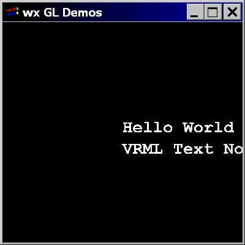

Text Nodes in OpenGLContext
===========================

.. rst-class:: introduction

VRML97's ``Text`` node draws strings in the scene, and its ``FontStyle`` node
chooses the face, size, style and layout. By default OpenGLContext draws
each line with Pillow from the face the ``FontStyle`` names, anti-aliased and
kerned, and places it in the scene as a flat textured quad. It can also draw
text as polygons built from a TrueType font's glyph outlines, which can be
extruded into solid letters, or as screen-aligned bitmap text.

Text on a HUD or an overlay panel is drawn by the overlay renderer rather
than by a ``Text`` node; see :doc:`hud` and :doc:`overlayui`.

A first example
---------------

A ``Text`` node has two fields. ``string`` is an ``MFString``, one value per
line. ``fontStyle`` holds a ``FontStyle`` node. The ``Shape``'s
``Appearance`` colours the text, as it would any other geometry:

.. code-block:: text

   #VRML V2.0 utf8

   Shape {
     geometry Text {
       string [ "Hello World", "VRML Text Node" ]
       fontStyle FontStyle {
         family [ "TYPEWRITER", "SERIF" ]
         style [ "BOLD" ]
       }
     }
     appearance Appearance { material Material { diffuseColor 1,1,1 } }
   }

This is the start of ``tests/wrls/text_simple.wrl``. Open it with:

.. code-block:: bash

   oglc-view tests/wrls/text_simple.wrl

   ``tests/wrls/text_simple.wrl``: two lines in a typewriter face.

The FontStyle fields
--------------------

``family``
   The font face. The field is a list in preference order: the first name
   this machine has a font for is used, and the names after it are
   fallbacks. ``family [ "Gill Sans", "SANS" ]`` asks for Gill Sans and
   uses any installed sans-serif face if it is missing. A style with no
   family, or with only families that are not installed, gets the
   provider's default face. The VRML97 family names map to these faces:

   - ``SERIF`` - a Roman face
   - ``SANS`` - an Arial-like face
   - ``ROMAN`` - a Roman face
   - ``TYPEWRITER`` - a Courier-like face

   Any platform font name can also be given. With FontTools installed,
   OpenGLContext reads the installed font files for their face and family
   names. Matching by name is then more accurate, and the generic families
   above are matched against the fonts actually installed: a font whose
   name says it is sans or monospaced is not taken for ``SERIF``, and where
   the fonts' own classifications name nothing, a face named ``Serif``,
   ``Sans`` or ``Mono`` is.

   A ``Text`` read from a VRML97 or X3D document with no ``fontStyle`` is
   drawn with FontStyle's defaults, family ``SERIF``; one built in code
   without a ``fontStyle`` gets the provider's default face.

``style``
   Weight and slant. Any of these values, in any order; within each set,
   the first value that matches is used:

   - weight - ``thin``, ``extralight``, ``ultralight``, ``light``,
     ``normal``, ``regular``, ``plain``, ``medium``, ``semibold``,
     ``demibold``, ``bold``, ``extrabold``, ``ultrabold``, ``black``,
     ``heavy``
   - slant - ``italic``

``justify``
   Both values are read. The first places each line against the origin by
   its own width: ``BEGIN``, ``MIDDLE`` or ``END``. The second places the
   block of lines as a whole; ``FIRST``, the default, puts the first line's
   baseline on the origin.

``spacing``
   Multiplies the distance between baselines, which is ``size``: the lines
   are ``size`` times ``spacing`` apart, whatever line gap the font keeps.

``topToBottom``
   Reverses the line order, as VRML97 specifies.

``horizontal``, ``leftToRight``
   Declared but not read. Text always runs horizontally, left to right.

The ``string`` field is Unicode. Whether a non-English string renders depends
on the chosen font having glyphs for it.

.. _text-font-library:

Fonts a document brings: FontLibrary
------------------------------------

X3D's ``FontLibrary`` names a TrueType or OpenType font file for its document
(``OpenGLContext.scenegraph.text.fontlibrary``):

.. code-block:: xml

   <FontLibrary family="Signage" url='"fonts/Overpass-Regular.ttf" "fonts/Overpass.otf"'/>
   <Shape><Text string='"EXIT"'><FontStyle family='"Signage" "SANS"'/></Text></Shape>

- The first ``url`` that is a font is read in the background, under the
  document's url policy: a file beside the document (or in a folder below
  it), or one from the same origin as a served document, fetched into the
  asset cache. ``load`` false reads nothing; setting ``url``, ``family`` or
  ``load`` reads again, and a ``LoadSensor`` watching the library sees it
  load or fail.
- The font is then a family of that document by ``family``, and by the
  family name the file gives itself, so ``FontStyle.family`` may name
  either. Several ``FontLibrary`` nodes naming one family give it several
  faces, and ``style`` chooses among them by weight and slant as it does for
  installed fonts.
- The names in ``FontStyle.family`` keep their order: an earlier name the
  machine has a font for is used before a library's later one.
- Only that document's FontStyles see the family; another document, or a
  scene built in code with no FontLibrary, does not. A ``Text`` drawn before
  its font arrives is drawn again in it.
- The Pillow-drawn text reads TrueType and OpenType (CFF) fonts; the solid
  and outline providers read TrueType outlines only.

Font providers and formats
--------------------------

A :py:mod:`FontProvider <OpenGLContext.scenegraph.text.fontprovider>` turns a
``FontStyle`` into a font that can draw. Each provider serves one geometry
format:

- ``texture`` - lines drawn by Pillow, in an atlas (below)
- ``solid`` - filled polygonal glyphs, from FontTools
- ``outline`` - glyph outlines as lines, from FontTools
- ``bitmap`` - screen-aligned text, from the texture atlas, PyGame,
  wxPython or GLUT

A ``FontStyle``'s ``format`` field names the format to use, and a provider
of that format is tried first. Left empty, its default, and where the named
format has no provider, the formats are tried in the order ``texture``,
``solid``, ``bitmap``. A ``FontStyle3D``'s ``format`` defaults to ``solid``.
A provider registers itself when its module is imported; importing
``OpenGLContext.scenegraph.text.toolsfont`` registers the FontTools
providers.

A context loads its providers when the first ``Text`` is drawn: the texture
atlas, which is the first asked, the FontTools solid and outline providers
and the shader bitmap provider. The PyGame and GLUT bitmap providers are not
among them. A program that wants one imports
``OpenGLContext.scenegraph.text.pygamefont``, which imports PyGame, or
``OpenGLContext.scenegraph.text.glutfont``.

The provider returns a ``Font``. The ``Text`` node's render method calls the
font with the string to draw. The font builds or looks up each character,
measures it, and lays the lines out.

Text drawn by Pillow
--------------------

The ``texture`` format draws each line of a ``Text`` node with Pillow, from
the face its ``FontStyle`` names, and keeps the drawn lines in an atlas of
2048 by 2048 texel pages, one atlas for each GL context. Each line is a quad
over its ink, in the ``Text`` node's own coordinates, so the node's transform
places, turns and scales it as it does any geometry. All the lines of one
``Text`` node are one draw for each atlas page they are on, usually one.

- The face is the member of the ``family`` with the weight and slant
  ``style`` asks for, of normal width where the family also has condensed
  or expanded faces. Where the family has no italic face, the nearest is
  sheared by 12 degrees; where its nearest weight is lighter than the bold
  asked for, the glyphs are stroked.
- ``size`` is the face's em, and the lines are ``size`` times ``spacing``
  apart.
- Where Pillow has libraqm, the line is kerned, ligatures are made and
  complex scripts are shaped.
- A line is drawn at a pixel size chosen from the text's size on screen, in
  steps of the square root of two between 8 and 512 pixels to the em, and
  drawn again when the text grows or shrinks past a step.
- The atlas keeps up to four pages. When they are full, the page least
  recently drawn from is cleared and its lines are drawn again when they are
  next shown. A page shown in the current frame is not cleared; the atlas
  takes another page instead.
- The text is white with its coverage as alpha, bound in place of the
  appearance's texture, so the ``Material`` colours and lights it in both
  renderers and in the compatibility profile. A ``Text`` shape is drawn with the blended, transparent shapes,
  which gives its edges their anti-aliasing.
- A texture on the ``Text`` shape's appearance is not drawn, and the text
  casts no shadow.

.. rst-class:: technical

``OpenGLContext.scenegraph.text.pillowtext`` draws and measures a line with
no GL, ``snippetatlas`` packs the lines, and ``pillowfont`` holds the atlas
textures and draws.

Bitmap text from the texture atlas
----------------------------------

Bitmap text is drawn by a shader-based provider. It draws each character as a
textured quad from a pre-rendered atlas of DejaVu Sans Mono. It uses vertex
arrays and a texture rather than ``glBitmap``, ``glRasterPos`` or display
lists, so it runs on an OpenGL 3.3 core-profile context and does not need a
GLUT display.

The first line starts at the ``Text`` node's origin, projected into the
viewport, and the glyphs are drawn upright at the atlas's size facing the
viewer, as ``glRasterPos`` and ``glBitmap`` place a bitmap. The node's
transform moves the text; it does not scale, turn or mirror the glyphs.
Text whose origin is behind the viewer is not drawn. A string drawn again
unchanged is not uploaded again.

The provider registry puts this provider ahead of the other bitmap providers
in both profiles. In the :doc:`core profile <renderpasses>` the
fixed-function providers cannot run and are skipped. In the compatibility
profile they are fallbacks, where a program has imported them. The GLUT
bitmap provider only works inside a live GLUT context, because its routines
crash without one.

The atlas has these limits:

- It holds one face, so ``family`` and ``style`` do not change atlas text.
- It holds the printable ASCII characters, 32 to 126. Any other character
  is drawn as ``?``.
- Its glyphs are anti-aliased and filtered linearly.

.. rst-class:: technical

``scripts/generate_font_atlas.py`` generates the atlas textures, at 10, 12,
14, 16, 18, 20, 24, 28 and 32 pixels. The renderer uses the atlas whose size
is closest to the requested character height.

Solid (extruded) text
---------------------

A :py:mod:`FontStyle3D <OpenGLContext.scenegraph.text.fontstyle3d>` produces
text as geometry. The glyph outlines are read from the TrueType file with
FontTools, tessellated into caps, and swept back along -Z to give the letters
depth. The result is an ordinary lit, shadowed and pickable surface. It sits
in the scene at the angle its ``Transform`` gives it, where atlas text always
faces the screen.

``FontStyle3D`` adds these fields to ``FontStyle``:

- ``thickness`` - how far back the glyph is swept, in the same units as
  ``size``. The default, 0, gives a flat cap with no sides.
- ``renderFront``, ``renderBack``, ``renderSides`` - which of the three
  surfaces are built. The default is the front only, which is the cheapest.
  All three give a closed solid.
- ``quality`` - how many line segments approximate each curve of an
  outline. The default is 3. Higher values are smoother and produce more
  triangles.

.. code-block:: python

   from OpenGLContext.scenegraph.basenodes import *
   from OpenGLContext.scenegraph.text import fontstyle3d

   Shape(
       appearance = Appearance( material = Material( diffuseColor = (.8,.8,.8) )),
       geometry = Text(
           string = [ "Solid Text" ],
           fontStyle = fontstyle3d.FontStyle3D(
               family = [ "SANS" ],
               size = .3,
               justify = "MIDDLE",
               thickness = .25,
               renderFront = 1, renderBack = 1, renderSides = 1,
           ),
       ),
   )

The solid provider draws in both profiles. In the compatibility profile it
uses display lists. In the :doc:`core profile <renderpasses>` it draws from a
vertex buffer of the glyph's positions and normals, with one draw call per
character. ``tests/solid_font.py`` is the demo, and the ``n`` key steps it
through the installed sans-serif faces; :doc:`tutorials/solid_font` walks
through it.

.. rst-class:: technical

Importing ``OpenGLContext.scenegraph.text.toolsfont`` registers the solid
provider. A ``FontStyle3D`` whose ``format`` is left at its default,
``"solid"``, then resolves to it; a ``FontStyle`` asks for it with
``format = "solid"``.

Colour and anti-aliasing
------------------------

Text has no colour fields of its own. As in VRML97, the ``Shape``'s
appearance is applied to the text geometry. The ``texture`` format, the
atlas and the PyGame bitmap providers draw anti-aliased glyphs; the polygon
formats are as smooth as the window's multisampling makes them.

Further reading
---------------

- :doc:`tutorials/glprint` - bitmap text through WGL, after NeHe tutorial
  #13 (``tests/glprint.py``)
- ``tests/glutbitmapcharacter.py`` - GLUT bitmap characters
- :doc:`tessellation` - how the polygonal glyphs are tessellated
- the :py:mod:`OpenGLContext.scenegraph.text <OpenGLContext.scenegraph.text>`
  package reference
- the VRML97 specification of the `Text
  <http://www.web3d.org/resources/vrml_ref_manual/ch3-347.htm>`__ and
  `FontStyle <http://www.web3d.org/resources/vrml_ref_manual/ch3-320.htm>`__
  nodes
