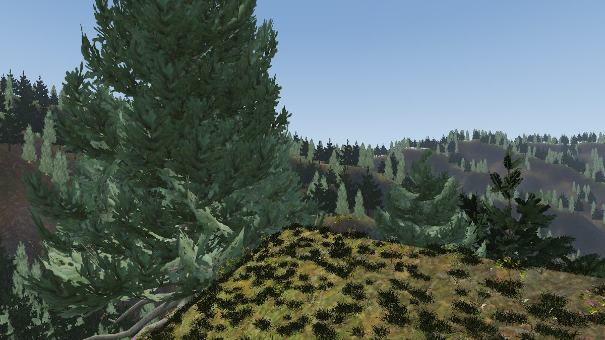

Vegetation
==========

.. rst-class:: introduction

``OpenGLContext.scenegraph.vegetation`` draws trees and ground cover in large
numbers. Plants are stored as **tables of positions**, not as scenegraph nodes,
and drawn as **instanced sets** chosen against the view each frame. Near the
camera a plant is real geometry; further away it is a flat card (an impostor);
between the two they cross-fade, so a tree changes from card to branches with
no visible step. Ground cover is not stored at all: it is scattered on a
world-anchored grid around the camera and re-chosen as the camera moves. All
plants read the same :ref:`canopy shade <canopyshade>`, so the ground under a
wood is dark. The application supplies the plant art; the toolkit ships none,
and ``oglc-cover`` (:ref:`below <cover-demo>`) draws its own.

   The `forest demo <https://pypi.org/project/openglcontext-forest-demo/>`__
   (see :doc:`terrain`): half a million instanced trees and grass clumps on a
   real digital elevation model, walked at eye height.

There are two ways to add vegetation to a world:

- a :ref:`VegetationField <vegetationfield>` and :ref:`GroundCover
  <groundcover>`, held beside the terrain. Use these for a
  :ref:`height field <terrain-heightfield>` or for a large baked forest.
- :ref:`plants scattered into the tiles <intile>` of a :doc:`streamed world
  <tiles3d>`, which load and unload with the ground they stand on.

.. _vegetationfield:

A forest as one node: ``VegetationField``
-----------------------------------------

``OpenGLContext.scenegraph.vegetation.VegetationField`` draws a forest from a
table of tree positions. It makes one instanced draw per species for the
distant cards, and one more for the real geometry within ``NEAR_RADIUS``
(90 m) of the camera. It re-chooses both from the table when the camera moves
far enough to change them.

.. code-block:: python

   from OpenGLContext.scenegraph.vegetation import TreeSpecies, VegetationField
   forest = VegetationField(positions, yaws, heights,
                            [TreeSpecies(name='fir', mesh='fir.npz',
                                         solidTexture='fir_bark.png',
                                         foliageTexture='fir_branch.png',
                                         impostor='fir_imp.png')],
                            species_id=kind)
   forest.update(camera_position, facing=where_it_looks)   # once a frame

A ``TreeSpecies`` defines how one kind of tree is drawn:

- ``mesh`` - a ``.npz`` of named arrays holding a *solid* part (trunk and
  branches, opaque) and a *foliage* part (alpha-masked cards);
- ``solidTexture`` and ``foliageTexture`` - a texture for each part;
- ``impostor`` - the single card the tree becomes at a distance.

A ``TreeSpecies`` is a scenegraph node, and the forest keeps its species in
its ``species`` field, read when the forest is built. The field names match
the keys of a baked world's JSON (``to_json`` and ``from_json``).
``beside(directory)`` returns a copy with its file paths joined to
``directory``, ``located(where)`` a copy with each non-empty file name replaced
by ``where(name)``, and ``varied(cardWidth=0.6)`` a copy with those fields
changed; the original species is unchanged by each. ``beside`` uses the names
as given, so it is for species an application chose; ``TilesTerrain`` reads a
world's species through ``located`` with ``tiles3d.fetch.beside``, which keeps
them inside the world (:ref:`tiles3d-reach`).

The near mesh and the cards cross-fade in their shaders over a shared distance
band. A card's picture is baked separately from the mesh, and a ``cardWidth``
that does not match the mesh shows as the tree narrowing or widening across that
band. ``species.fitted_card_width()`` answers the ``cardWidth`` at which the card
draws the tree as wide as the mesh does: the width of the middle 98% of the
foliage vertices over both horizontal axes, as a fraction of the mesh's height,
divided by the share of the card's picture that is opaque. It reads the mesh and
the impostor from disk; ``species.varied(cardWidth=species.fitted_card_width())``
is the species with it applied.

Choosing what to draw
~~~~~~~~~~~~~~~~~~~~~

Most of the cost of a four-kilometre forest is in the far cards, so
``update(position, facing=None, view=None)`` draws only those in view:

- ``view`` - the camera's view-projection matrix. The cards are chosen against
  the frustum. This is the best choice.
- ``facing`` - the direction the camera looks. The cards are chosen inside a
  cone around it. A cone does not match a frustum: when the camera looks down
  into a valley, trees near the camera fall inside the cone and trees along the
  line of sight fall outside it, which draws a hard edge across the forest. Use
  ``facing`` only when there is no matrix.
- neither - the cards are chosen by distance only. Use this for an orbiting or
  top-down view.

The margin around the view grows with distance. A frustum plane meets the
ground in a straight line, and cutting the cards exactly at the view shows a
straight edge in the forest whenever the view and the selection disagree
slightly. Selection is skipped while the camera is nearly still.

A baked world can carry its forest as a table: see :ref:`Baking a world
<vegetation>`.

Replacing the trees
~~~~~~~~~~~~~~~~~~~

A forest has a fixed table of trees. A world with no end plants the stretch around
the camera and the next stretch as the camera nears its end.
``replant(positions, yaws, heights, species_id=None, shade=None)`` takes the
arguments of the constructor and swaps the table in place. The nodes that draw
the trees, and the meshes and textures they have made on the GPU, are kept, so a
replant costs a table of arrays and not a second upload of every model. What is
drawn is chosen from the new trees at the next ``update``. A species that had no
trees and now has some gets its cards then, and one that has none draws none.
A table whose lengths do not agree raises ``ValueError`` and the forest is left
as it was. ``replant`` builds nothing on the GPU, so the table can be worked out
on a worker thread and handed over with the context current or not.

.. _groundcover:

Ground cover: ``GroundCover``
-----------------------------

The floor of a wood is covered with a mix of plants, such as grass, fern,
nettle and shrub. Each has its own size and density, and grows in beds and
thickets with clear ground between them.
``OpenGLContext.scenegraph.vegetation.GroundCover`` draws a set of
``CoverSpecies`` at every distance from the camera.

.. code-block:: python

   from OpenGLContext.scenegraph.vegetation import (
       CoverSpecies, GroundCover, control_weight)

   cover = GroundCover(
       field,
       [CoverSpecies(name='grass', card='grass_card.png', clump='grass.glb',
                     clumpMesh='tuft_a', clumpFarMesh='tuft_a_far',
                     density=11.0, height=0.15, patchiness=0.25),
        CoverSpecies(name='shrub', card='shrub_card.png', clump='shrub.glb',
                     density=0.5, height=0.22, patchiness=0.8,
                     patchMetres=34.0, canopy=(0.3, 5.0))],
       mask=control_weight(control_image, ['grass', 'forest_floor'],
                           layers, field.extent),
       shade=terrain.shade, canopy=terrain.canopy_cover)
   cover.update(camera_position)                    # once a frame

``field`` is the ground the plants are seated on: anything with
``sample(x, z)``, which answers the height there. A ``HeightField`` is one; so
is land computed from a function, which has no edge. A ground that answers for
hundreds of thousands of points a scatter should answer quickly, and a game
whose land is costly to compute answers from a grid it has laid.

``CoverSpecies`` is also a scenegraph node, kept in the cover's ``species``
field. ``clumpMesh`` and ``clumpFarMesh`` name meshes in the ``.glb``. A string
of digits that matches no mesh name selects the mesh at that position in the
file. With an empty ``clumpFarMesh`` the near mesh is drawn once over the
whole disc, with no second level.

.. _cover-demo:

Walk through it
~~~~~~~~~~~~~~~

.. code-block:: bash

   oglc-cover

A meadow over low hills, with rock on a ridge to the north and a stone well
cut into the ground. Three species grow on it: grass, drawn as geometry in two
levels of detail near the camera and as cards beyond; ferns, gathered in beds
(``patchiness`` 0.85, ``patchMetres`` 18); and flowers in smaller clumps. The
cover grows on the control map's meadow layer through ``control_weight``, so
none grows on the rock. The well is an opening (``holes``): the terrain's mesh
is cut round it and nothing grows over it. ``o`` closes the opening and opens
it again, and ``d`` steps ``density_scale`` through 1, 0.5 and 0. The plants'
cards and the grass's clump are drawn by the demo itself and written to the
per-user cache the first time it runs. ``OpenGLContext.bin.cover_demo.Meadow``
builds the scene, and the :doc:`cover_meadow tutorial <tutorials/cover_meadow>`
walks through it.

Distance levels
~~~~~~~~~~~~~~~

Each species is drawn at three distances, because the detail the eye can see
falls off faster with distance than the cost of drawing it:

- Real geometry near the camera, in two levels of detail: the full mesh
  over the inner ``CLUMP_LOD_FRAC`` (0.45) of the disc's radius, and a
  decimated mesh over the rest. Most plants are in the outer ring, so that is
  where the triangle savings are.
- Cards beyond the geometry, at a lower density. They fade in where the
  geometry fades out.
- Coarse cards beyond those, sparser and larger, out to where the haze
  hides the ground.

Nothing is baked. A one-metre scatter over four kilometres would be sixteen
million instances, so each level is scattered on a *world-anchored* grid
around the camera and re-chosen as the camera moves. Each cell's position and
whether it holds a plant come from a hash of the cell, so nothing shifts or
pops as the disc re-centres. Each species uses its own salted grid, so
species do not compete for the same cells.

Because a cell's plant never changes, the scatter is kept by the block: the
grid is cut into squares at least 32 metres wide, and an eighth of the
disc's radius wide for a far rung whose disc is larger
(``vegetation.grid.ScatterBlocks``), each scattered the first time a disc
reaches it, with its plants' sizes and light, and kept while the camera is
within twice the disc's radius of it. A disc is assembled from the blocks it
reaches, so moving costs the ground newly reached, and driving back over
ground already covered costs nothing but the assembly. ``GroundCover.scattered``
counts the blocks scattered. Setting ``mask``, ``holes``, ``shade`` or
``canopy`` scatters everything again. A block is scattered outside any lock: the
thread assembling a disc and the one preparing ground ahead (``prepare``) share the
blocks, and one waits for another only for a block that other is scattering at that
moment.

The scatter is the expensive half of the work and makes no GL calls.
``GroundCover(..., background=True)`` runs it on a worker thread
(``vegetation.streaming.BackgroundCompute``): ``update`` hands the near scatter (the
geometry and the cards) and the far scatter to two workers and stages what they
made on a later call, so no frame waits for them and the near cover does not
wait for the far. ``wait(timeout)`` blocks until the worker is idle, for a capture or a
bake that wants the cover in place. A cover a streamed world carries
(``TilesTerrain``) is scattered this way, and ``TilesTerrain.wait_for_loads``
waits for it. The discs lead the camera: a vehicle covers tens of metres in the time a scatter
takes, so each scatter is centred where the camera will be when it arrives, its
velocity from successive ``update`` calls and its arrival time measured from the
scatters that have arrived (``GroundCover.latency``, in seconds, 0 for a scatter
made in line). A move of more than 150 m/s between two updates is a jump and
carries no velocity.

``prepare(points)`` scatters the ground about each of ``points``, ``(x, z)``
places the camera will pass, before it gets there. A game that knows the way
ahead, a road or a course, calls it with places along it as the camera advances;
the disc that reaches that ground is then only put together. The blocks made
are kept like any others, so ground more than twice a rung's radius from the
camera is let go of by the next disc and is not made. With ``background`` it
runs on a thread of its own behind the scatter the camera is waiting for.
``GroundCover(..., fade=0.8)`` is where each rung's dissolve into the next
begins, as a fraction of its outer edge: the dissolve is a window of metres, and
a camera crossing it in under a second sees a pop, so a fast game lowers the
fraction (``retune()`` after changing ``fade``).

``far_radius`` is where the coarse field beyond the cards ends. A cover whose
``far_radius`` is no further than its ``card_radius`` (``has_far`` false) has no
coarse field: none is scattered or drawn, which suits a world whose haze hides
the ground past the cards. A scatter that raises is logged and asked for again
on the next ``update``. ``shutdown()`` stops the worker; a cover that is collected stops
its worker as well. Without ``background``, ``update`` scatters on the calling
thread; a caller with its own worker can run ``compute_near`` there and pass
the result to ``apply_near`` on the render thread. The near tree meshes
(``InstancedMeshLOD``) work the same way: ``compute_pending(x, z, radius)``
selects the trees near a point on any thread, and ``stage(result)`` on the
render thread hands the set to the next draw.

``GroundCover`` takes any ground that answers ``sample(x, z)`` with a height
(the ``Ground`` protocol): a ``HeightField``, or an endless land computed from
position. ``relocate(field, mask=None, holes=None, shade=None, canopy=None)``
grows the same cover on another ground, for a world that restarts or is
replaced while the program runs. It keeps the nodes and what they hold on the
GPU, replaces the ground and the four rules (a rule not given is cleared),
drops what the old ground scattered, including a scatter a worker is still
making, and leaves the cover empty until the next ``update``. ``dispose()``
deletes the GL objects of every node and stops the worker; call it with the GL
context current.

.. _vegetation-shadows:

Shadows
~~~~~~~

The trees a ``VegetationField`` draws as geometry, within ``near_radius`` of the
camera, are written into the shadow maps of a light with ``shadows`` on. The node
that draws them is bounded by those trees and no others, so the cascades are not
stretched over the whole forest. ``VegetationField(..., shadows=False)`` leaves them
out. The cards that stand for trees further away, the ground cover and the grass cast
no shadow, so a tree's shadow ends where its geometry does. A node of your own that is
bounded by what it draws can cast through a ``Shape`` whose ``castShadow`` is true
and a ``render`` that answers ``mode.shadow_pass``, as ``InstancedMeshLOD`` does.

.. _vegetation-fog:

Fog
~~~

Trees and ground cover are fogged by the scene's bound ``Fog`` node
(:ref:`Fog <fog>`), with the same curve and colour as the rest of the scene, so
plants fade into the haze at the distance the ground and the sky do. With no
``Fog`` bound they are fogged by the engine's aerial haze: density 0.00016 per
metre, colour ``(0.46, 0.58, 0.76)`` in linear light. A bound ``Fog`` with a
``visibilityRange`` of 0 is no fog. The terrain takes its fog the same way.

Every instanced vegetation node, the terrain and the particle emitters have a
``drawn`` attribute, True by default. Set it False and the node draws nothing
and casts no shadow until it is set True again; a profiling run leaves one
layer out this way. A node whose shaders will not compile on the driver sets
its ``failed`` attribute, logs one warning and draws nothing from then on.

``select`` is the per-frame step: it moves the disc each geometry level is drawn
within onto the current camera. Without it, the disc lags behind the walker and
the density of the middle-distance cover pulses. Each geometry node is given the
whole cache when a scatter arrives, and its ``disc`` (the x and z of the camera
and the level's radius, in metres) on every ``select``. The node cuts its rows
into clusters of neighbouring rows, as it does for the view, and streams the
clusters that reach the disc widened by ``DISC_MARGIN_METRES`` (1 m), so moving
the disc costs a test of the clusters and a copy of the rows drawn, not of the
cache. A disc that has moved less than that margin since the clusters were
chosen needs nothing further. The shader fades each level by its distance from
the live camera, so what is streamed in the margin is not drawn until it is in
reach. ``disc`` is an attribute of every instanced vegetation node; None streams
the whole set.

.. _vegetation-gpu-cull:

Culling on the GPU
~~~~~~~~~~~~~~~~~~

Where the driver has compute shaders and indirect draws (OpenGL 4.3, or the
``ARB_compute_shader`` and ``ARB_shader_storage_buffer_object`` extensions with
4.0 draws), the ground cover's clumps and cards are culled by the GPU. A layer
uploads the set once, when it is staged. Each draw runs a compute pass
(``shaders/veg_cull.comp``, ``vegetation.gpucull.GPUCulledRows``) with one thread
for each instance. A thread keeps its instance when the instance's box reaches
into every plane of the pass's frustum and into the layer's ``disc``, writes it
to the buffer the draw reads its instance attributes from, and counts it in an
indirect draw command. The draw is issued from that command, so the processor
does no work per instance and reads nothing back. An instance's box reaches
``reach`` sideways of its base point and ``rise`` above and ``drop`` below it,
each times its scale. A shared draw of several views counts each instance once
for each view it is sent to.

``OPENGLCONTEXT_GPU_CULL=0`` keeps the processor's culling, which the other
drivers use. The instances kept are drawn in no fixed order; a layer's draw is
depth tested and alpha cut, so the order does not show.

.. _wheretheygrow:

Where each species grows
~~~~~~~~~~~~~~~~~~~~~~~~

Four settings decide where a species grows and how much of it there is.

``mask`` weights the ground by kind. The splat :ref:`control map
<controlmap>` already records where the grass and the leaf litter are, and a
baked world paints the road's corridor out of it.
``control_weight(image, wanted, layers, extent)`` turns that map into a mask:
``layers`` is the map's layer order and ``wanted`` the layers the cover grows
on. The map covers ``extent`` metres along both axes, its columns along x and
its rows along z, and need not be square. It must be fine enough for what it
masks: over four kilometres, 512 pixels are eight metres each, wider than a
road corridor.

``holes(x, z) -> mask`` removes cover where there is no ground, for example
over a tunnel's bore. It is the same function the terrain uses for drawing and
collision (:ref:`openings in the ground <holes>`). A height field returns a
height inside an opening as it does anywhere else, so without ``holes`` cover
would float in the tunnel mouth. A ``TilesTerrain`` passes its own ``holes``
to the cover it creates. For cover you build yourself, set ``cover.holes``.
``holes`` is separate from ``mask``: the mask weights the kinds of ground, and
an opening is no ground at all.

``patchiness`` sets how much a species clusters, from 0 to 1. At 0 a plant is
equally likely anywhere, which suits grass or small flowers. At 1 plants
gather in beds with bare ground between them. ``patchMetres`` is the width of
one bed. The beds are fixed in the world, so a stand of nettles is in the same place
each time you pass it, and each species has its own beds. ``density`` still
means plants per square metre: a patchy species is scattered on a finer grid
and then thinned.

The beds are a ``vegetation.Patches(patchiness, metres, salt=0)``:
``weight(x, z)`` is how much of the species belongs at each world position,
from 0 between beds to 1 in the middle of one, ``thinning`` the fraction of
the ground it keeps overall, and ``density_for(density)`` the grid density
that leaves ``density`` plants per square metre standing after the weight
thins it. It is built from ``vegetation.world_noise(x, z, metres, salt=0)``, a
smooth field in [0, 1] with one blob every ``metres``, anchored to the world
and different for each ``salt``; use it for anything else that should vary
over the ground the same way wherever the camera is.

``canopy`` is the range of tree cover a species grows in,
read from :ref:`terrain.canopy_cover <canopyclosure>`: 0 on open ground, 1
where the tree crowns cover every square metre. A lower bound above 0 keeps
a plant off open ground; a low upper bound keeps it out of a closed stand.
For example, ``canopy=(0.3, 5.0)`` puts shrubs where trees stand apart and
along the edges of clearings. A plant near the edge of its range still grows,
but smaller. With no range, the default, it grows anywhere. The range reads the canopy
*closure*, not the shade: see :ref:`canopyclosure`.

Other settings:

- ``density`` - plants per square metre, before any of the above thins them.
- ``height`` - the average height of a plant, in metres, not the maximum.
- ``density_scale`` - a multiplier on the density of every species in the
  set (default 1). A quality setting changes it to draw less cover in the same
  proportions; 0 draws none. A species with a ``density`` of 0 draws none.
  A new value, like new radii followed by ``retune()``, is scattered at the
  next ``update`` wherever the camera stands.
- ``COVER_JITTER`` (1.7) - how far a plant may move from its grid cell. If
  plants stayed inside their cells, the set would still look like a grid of
  diagonal rows from thirty metres away.

.. _coverassets:

Plant assets
~~~~~~~~~~~~

A ``CoverSpecies`` names one ``.glb`` file and the mesh in it for each
distance level (``clumpMesh`` and ``clumpFarMesh``). One file holds every
variant of a plant and both levels of detail, sharing a single cutout texture.
A 1k RGBA texture is about a megabyte, so one file per level would repeat it.

``oglc-bake-plants``, in `OpenGLContext-editor
<https://github.com/mcfletch/openglcontext-editor>`__, builds such files from
published plant scans. It downloads the model, restores the cutout mask that a
JPEG base colour cannot hold, reduces each plant to the triangle budgets of the
two levels, renders the billboard from the geometry so the two match, and
writes a ``cover.json`` listing the species it made.
``OpenGLContext.scenegraph.vegetation.cover.read_cover_manifest(directory)``
reads it back: each species with its card and clump resolved under
``directory``, and a name leading outside it refused.

.. code-block:: bash

   oglc-bake-plants --out assets --per-asset 2 --patchiness 0.25 \
       grass_medium_01=11.0 grass_medium_02=4.0
   oglc-bake-plants --out assets --per-asset 1 --near 3000 --far 800 \
       --patchiness 0.8 --patch-metres 34 --canopy 0.3 5.0 shrub_04=0.5

A baked world can carry a whole cover set: see :ref:`Ground cover as a recipe
<cover>`.

A card is lit by a flat share of the sun, the species' ``sunLevel``. The default,
``CARD_SUN`` (1.0), gives a card the average brightness of the lit geometry it
replaces at ``CLUMP_RADIUS``, so the hand-over shows no step in brightness. A
``cover.json`` records the ``sunLevel`` each species was written with and
``read_cover_manifest`` returns it; ``species.varied(sunLevel=CARD_SUN)`` takes
the default instead.

.. _canopyshade:

Shade under the trees
---------------------

The shade a wood casts on its own floor is baked into the terrain once, not
computed each frame, because neither the trees nor the sun move. Give a
:ref:`splat terrain <terrain-heightfield>` the trunk positions and it darkens
its static shading under them:

.. code-block:: python

   terrain.canopy = forest.positions          # (N,3) trunk bases
   terrain.shading                            # the lit grid, in [0, 1]
   terrain.shade(x, z)                        # ...read by world position

A tree shades the area under its *crown*, not only the cell its trunk stands
in. The terrain settings are:

- ``canopy_crown`` - the crown width each tree's shade is spread over, in
  metres (default 7). The total is scaled so that one tree per crown area is a
  closed canopy. The shade then means the same at any grid resolution and any
  planting density.
- ``canopy_shade`` - how strongly a closed canopy darkens the ground (default
  1.3).
- ``canopy_deepest`` - the largest fraction of the light the canopy may remove
  (default 0.78).
- ``canopy_spread`` - how far the shadow is offset away from the sun, in metres
  (default 12), because a tree's shadow falls along the light rather than
  straight down.

Plants on shaded ground must be shaded too; grass lit as if in an open field
on ground darkened to a fifth looks lit from inside. The instance layout that
every vegetation node shares carries a shade value alongside position, yaw and
scale:

.. code-block:: python

   forest.lit_by(terrain.shade)               # every tree
   GroundCover(..., shade=terrain.shade)      # every clump and card
   cards.update_instances(points, yaws, scales, shades)   # or by hand

The shade defaults to 1, full sun. A world loaded through ``TilesTerrain``
connects all of this for you, because ``TilesTerrain`` holds both the ground
and the trees.

.. _canopyclosure:

Canopy closure
~~~~~~~~~~~~~~

The shade is *clamped*: past ``canopy_deepest``, more trees remove no more
light. That suits lighting but not planting, because a stand with gaps and a
closed stand are equally dark, and only the first has room for shrubs. The
terrain therefore also provides the canopy *closure*, unclamped: 0 on open
ground, 1 with one crown of tree over every square metre, and higher where
planting is denser:

.. code-block:: python

   terrain.closure                            # the cover grid
   terrain.canopy_cover(x, z)                 # ...read by world position

   CoverSpecies(name='shrub', ..., canopy=(0.3, 5.0))   # a band of it

``CoverSpecies.canopy`` reads this value (see :ref:`where each species grows
<wheretheygrow>`). The values are in crowns, so whether a stand counts as
sparse depends on how densely that world was planted.

.. _intile:

Vegetation in a tile
--------------------

The second method scatters plants onto the surface of a :doc:`streamed tile
<tiles3d>`, so they load and unload with the ground they stand on. The scatter
is deterministic and weighted by triangle area. A ``keep`` function filters
the placements, for example to grass elevations and away from water or peaks.
Every instance shares one prototype, so the :doc:`instancing <instancing>`
batcher draws them in one call. Trees use a distance level of detail: a full
mesh near the camera and a billboard far away. Grass is a dense layer of
blades, limited to a disc around the viewer.

.. code-block:: python

   from OpenGLContext.loaders.tiles3d.vegetation import (
       build_vegetation_lod, build_grass_patch)
   pos, nrm, col, idx = procedural.terrain_patch(-700, 700, -700, 700, 48)
   trees = build_vegetation_lod(pos, idx.reshape(-1, 3), near_mesh, far_billboard,
                                density=0.00035, seed=7, camera=eye,
                                near_distance=450,
                                keep=lambda p: (p[:,1] > 4) & (p[:,1] < 130))

.. rst-class:: technical

The code is in ``loaders/tiles3d/scatter.py`` (per-triangle uniform
barycentric sampling, seeded, with a ``keep`` mask) and
``loaders/tiles3d/vegetation.py`` (``group_from_scatter``,
``partition_by_distance``, ``build_vegetation_lod``, ``build_grass_patch``).

.. _footing:

Where a plant meets the ground
------------------------------

**A placement is the point the plant stands on.** Every vegetation path in the
engine uses this rule. The GPU nodes build it into their vertex data: a
billboard quad spans ``y`` from 0 to 1, ``load_clump_glb`` moves a clump's base
to ``y = 0``, and a tree mesh is modelled with the foot of its trunk at the
origin.

A scenegraph prototype can have its origin anywhere, and VRML's primitives are
centred on theirs. A ``Cone`` used as a shrub would be planted half its height
into the hill. ``group_from_scatter`` measures the prototype's bounds and
lifts it by its lowest point, so it stands on the placement like the GPU
nodes. A prototype already modelled with its foot at the origin is not moved.

.. code-block:: python

   shrub = Shape(geometry=Cone(bottomRadius=2.5, height=8.0), appearance=green)
   veg = build_vegetation_group(pos, idx.reshape(-1, 3), shrub, density=0.004, seed=1)

   group_from_scatter(placements, oak, sink=0.1)     # settle a root flare in
   group_from_scatter(placements, buoy, seat=False)  # modelled about its middle

- ``sink`` lowers the prototype into the ground by that distance, in the
  prototype's own units. Use it for a root flare or a boulder base that should
  sit in the ground rather than on it.
- ``seat=False`` uses the prototype's own origin as the contact point.

The seated prototype is wrapped once and shared by every instance, so the
scatter is still one draw.

.. rst-class:: technical

``OpenGLContext.loaders.assets.seated(node, sink=0)`` does the same for
anything else placed on a surface, such as a prop, a rock or a parked car.
``assets.bounds(node)`` is the measurement it uses: the box a subtree occupies
in its root's coordinates, with every ``Transform`` applied. It needs no GL
context.

.. _clearance:

Clearing trees from a road
--------------------------

Where a road runs on the ground, trees are cleared only from the corridor the
road was cut through, so the canopy can close over a forest road. Where the
road is *raised*, on an embankment, a causeway's retained fill or a bridge
deck, a tree beside it is rooted metres below the road surface, and a crown of
the same width would grow through the structure. There the clearance is the
corridor plus a crown's width. `OpenGLContext-editor
<https://github.com/mcfletch/openglcontext-editor>`__ applies this rule when it
bakes a world (``ProceduralWorld.outside_the_clearing``). :doc:`Roads <roads>`
describes the road itself.

Demos and source
----------------

``oglc-forest``, the `forest demo
<https://pypi.org/project/openglcontext-forest-demo/>`__, is a separate
distribution that uses these nodes at full size: 230,000 GPU-instanced trees
with impostor LOD, two layers of camera-following grass, and canopy shade over
a four-layer splat ground, walked at eye height. ``tests/tiles_vegetation.py``
is a small example.

.. rst-class:: technical

The nodes are in ``scenegraph/vegetation/`` (``field.py``, ``cover.py``,
``clumps.py``, ``billboards.py``, ``nearmesh.py``, ``grid.py``). The tests are
``tests/unit/test_vegetation_field.py`` and
``tests/unit/test_terrain_vegetation.py``. :doc:`Instanced Geometry
<instancing>` describes instancing in general, and :doc:`lod` describes
impostors.
