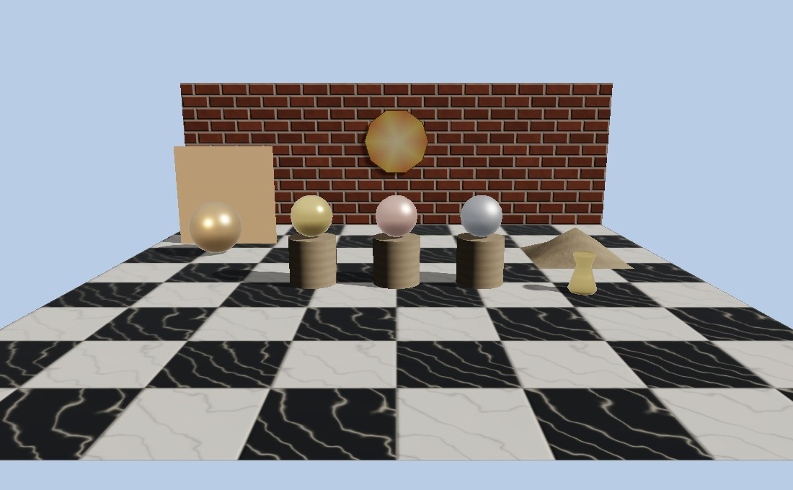
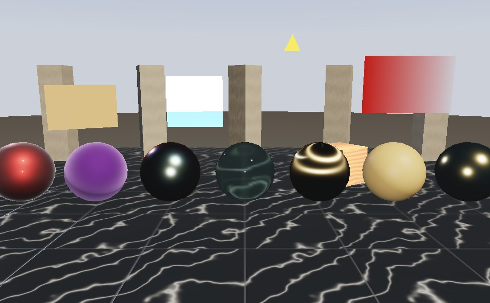
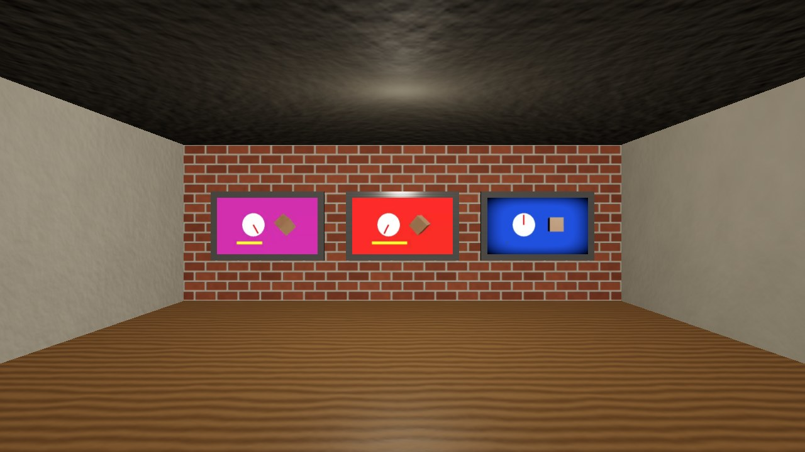
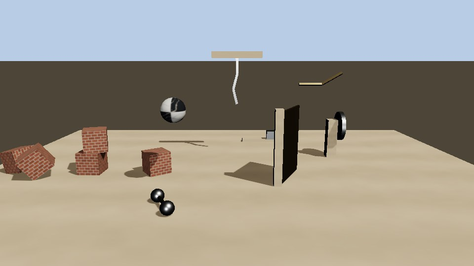
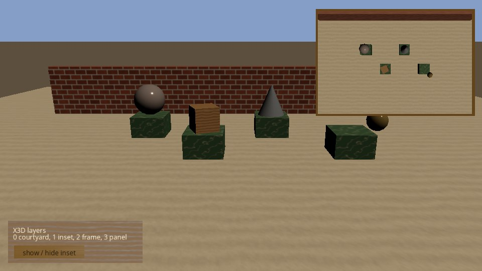
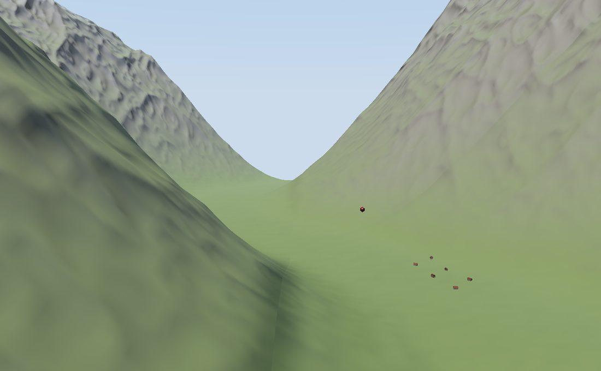
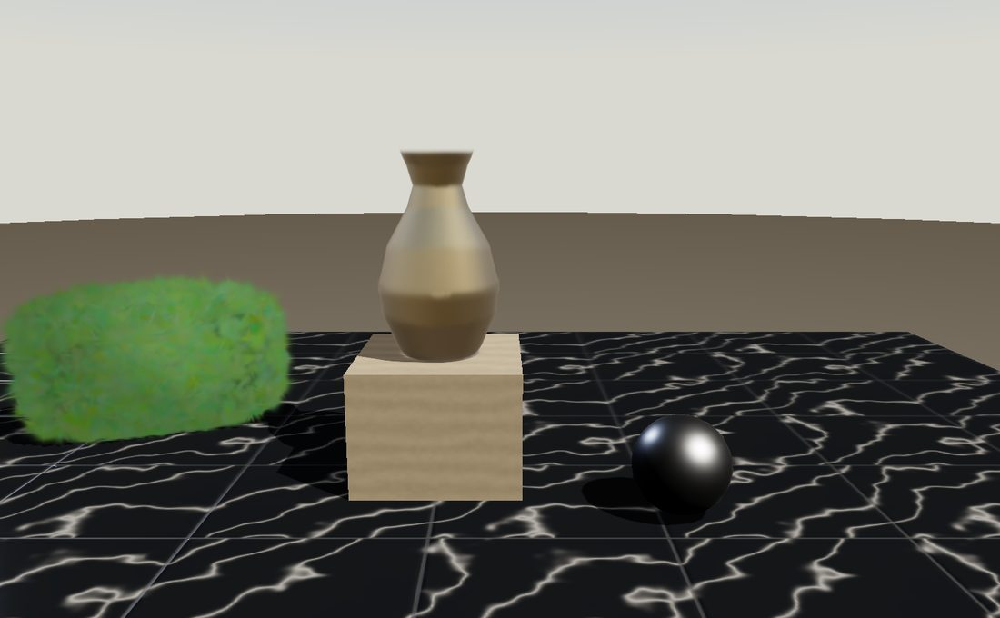
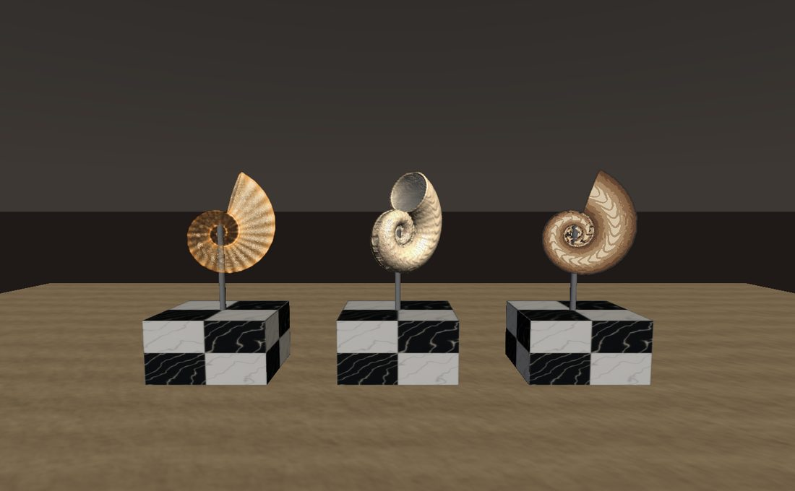
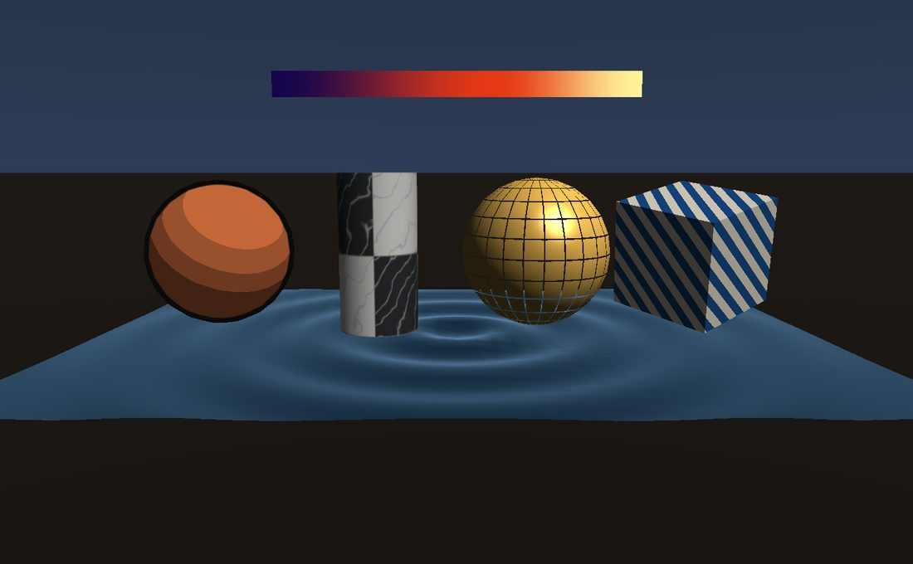

Loading X3D
===========

.. rst-class:: introduction

OpenGLContext loads X3D documents into its scenegraph and draws them with the
:doc:`PBR renderer <pbr>`. `X3D <https://www.web3d.org/standards>`__ is
VRML97's successor, standardised by the Web3D Consortium as ISO/IEC 19775. The
reading and writing are pyvrml97's ``vrml.x3d``; the engine supplies the node
implementations that draw. To open an X3D file and look at it, use
:doc:`oglc-view <viewer>`.

   ``oglc-x3d``: an X3D 4 document read by the engine.

The showcase
------------

``oglc-x3d`` opens ``OpenGLContext/bin/x3d_gallery.x3d``, an X3D 4 document,
and :doc:`tests/x3d_demo.py <tutorials/x3d_demo>` is the same scene as a
tutorial. The document's floor and back wall are an ``IndexedTriangleSet``
and an ``IndexedTriangleStripSet`` wearing ``PhysicalMaterial`` marble and
brick; three ``PhysicalMaterial`` metals stand on sandstone plinths drawn
with an X3D 4 ``Material`` and its ``diffuseTexture``; a ``TriangleFanSet``
with ``ColorRGBA`` colours and a ``LineSet`` make the medallion on the wall;
an ``ElevationGrid`` is the mound; and a glTF vase is ``Inline``\ d. The sun
casts shadows, and the alcove's lamp lights only the alcove. The textures and
the vase are written beside a copy of the document when the command starts,
in the user cache directory or ``--directory``.

Its keys: ``l`` turns the alcove lamp off and on, ``m`` hides and shows the
medallion through its ``visible`` field, and ``w`` writes the scene back as
X3D in each encoding beside the document.

Loading
-------

.. code-block:: python

   from OpenGLContext.loaders.loader import Loader

   scene = Loader.load( 'world.x3d' )
   self.sg = scene

``Loader.load`` and ``Loader.loads``, the :ref:`scene loader <scene-loader>`
and ``oglc-view`` all open these:

.. list-table::
   :widths: auto
   :header-rows: 1

   * - Encoding
     - Suffixes and content types
   * - XML
     - ``.x3d``, ``.x3dz`` (gzip), ``model/x3d+xml``
   * - ClassicVRML
     - ``.x3dv``, ``.x3dvz`` (gzip), ``model/x3d+vrml``, ``model/x3d-vrml``
   * - JSON
     - ``.x3dj``, ``model/x3d+json``, and ``.json`` whose top-level key is
       ``"X3D"``
   * - Compressed binary (Fast Infoset)
     - ``.x3db``, ``.x3db.gz`` (gzip), ``model/x3d+fastinfoset``,
       ``model/x3d+binary``

A compressed binary document is read with the X3D vocabulary Web3D's own
``.x3db`` files are written with. A value given in an X3D encoder other than
delta-zlib integers is reported and left unset; pyvrml97's ``docs/x3d.rst``
gives the limits.

The result is an ``X3DScene``: a ``sceneGraph`` that also holds the
document's ``profile``, ``version``, ``components``, ``units``, ``meta`` and
the ``problems`` reading it found. Each problem is also logged at its
severity. A document with errors in it loads as far as it reads.

Versions
~~~~~~~~

Documents of X3D 3.0 to 4.1 are read, and VRML97 through the same reader. The
scenegraph holds one vocabulary, X3D 4.1's: a field an earlier version names
differently is read under its X3D 4 name, and a field an earlier version gives
another default has that default. ``UNIT`` statements scale the values they
name into metres, radians, kilograms and newtons as the document is read.

What is drawn
-------------

A node the engine implements is built from the engine's class for it; any
other is built from its X3D declaration, keeps its fields, and is not drawn,
and its type is listed once among the scene's ``problems`` at ``info``
severity. ``OpenGLContext.loaders.x3d.prototypes()`` is the map. The engine
implements these X3D nodes, by component:

.. x3d-implemented-start

- CADGeometry - CADAssembly, CADFace, CADLayer, CADPart, IndexedQuadSet, QuadSet
- Core - MetadataBoolean, MetadataDouble, MetadataFloat, MetadataInteger,
  MetadataSet, MetadataString, WorldInfo
- CubeMapTexturing - ComposedCubeMapTexture, GeneratedCubeMapTexture,
  ImageCubeMapTexture
- DIS - EspduTransform
- EnvironmentalEffects - Background, Fog, FogCoordinate, LocalFog, TextureBackground
- EventUtilities - BooleanFilter, BooleanSequencer, BooleanToggle,
  BooleanTrigger, IntegerSequencer, IntegerTrigger, TimeTrigger
- EnvironmentalSensor - ProximitySensor, TransformSensor, VisibilitySensor
- GaussianSplats - GaussianSplats
- Geometry2D - Arc2D, ArcClose2D, Circle2D, Disk2D, Polyline2D, Polypoint2D,
  Rectangle2D, TriangleSet2D
- Geometry3D - Box, Cone, Cylinder, ElevationGrid, Extrusion, IndexedFaceSet, Sphere
- Geospatial - GeoCoordinate, GeoElevationGrid, GeoLOD, GeoLocation, GeoMetadata,
  GeoOrigin, GeoPositionInterpolator, GeoProximitySensor, GeoTouchSensor,
  GeoTransform, GeoViewpoint
- Grouping - Group, StaticGroup, Switch, Transform
- HAnim - HAnimDisplacer, HAnimHumanoid, HAnimJoint, HAnimMotion, HAnimPose,
  HAnimSegment, HAnimSite
- Followers - ColorChaser, ColorDamper, CoordinateChaser, CoordinateDamper,
  OrientationChaser, OrientationDamper, PositionChaser, PositionChaser2D,
  PositionDamper, PositionDamper2D, ScalarChaser, ScalarDamper,
  TexCoordChaser2D, TexCoordDamper2D
- KeyDeviceSensor - KeySensor, StringSensor
- Layering - Layer, LayerSet, Viewport
- Layout - Layout, LayoutGroup, LayoutLayer, ScreenFontStyle, ScreenGroup
- Interpolation - ColorInterpolator, CoordinateInterpolator,
  CoordinateInterpolator2D, EaseInEaseOut, NormalInterpolator,
  OrientationInterpolator, PositionInterpolator, PositionInterpolator2D,
  ScalarInterpolator, SplinePositionInterpolator, SplinePositionInterpolator2D,
  SplineScalarInterpolator, SquadOrientationInterpolator
- Lighting - DirectionalLight, EnvironmentLight, PointLight, SpotLight
- Navigation - Billboard, Collision, LOD, NavigationInfo, OrthoViewpoint, Viewpoint,
  ViewpointGroup
- Networking - Anchor, Inline, InlineGeometry, LoadSensor
- NURBS - Contour2D, ContourPolyline2D, NurbsCurve, NurbsCurve2D,
  NurbsOrientationInterpolator, NurbsPatchSurface, NurbsPositionInterpolator,
  NurbsSet, NurbsSurfaceInterpolator, NurbsSweptSurface, NurbsSwungSurface,
  NurbsTextureCoordinate, NurbsTrimmedSurface
- ParticleSystems - BoundedPhysicsModel, ConeEmitter, ExplosionEmitter,
  ForcePhysicsModel, ParticleSystem, PointEmitter, PolylineEmitter,
  SurfaceEmitter, VolumeEmitter, WindPhysicsModel
- Picking - LinePickSensor, PickableGroup, PointPickSensor, PrimitivePickSensor,
  VolumePickSensor
- PointingDeviceSensor - CylinderSensor, PlaneSensor, SphereSensor, TouchSensor
- Rendering - ClipPlane, Color, ColorRGBA, Coordinate, CoordinateDouble, IndexedLineSet,
  IndexedTriangleFanSet, IndexedTriangleSet, IndexedTriangleStripSet, LineSet,
  Normal, PointSet, Tangent, TriangleFanSet, TriangleSet, TriangleStripSet
- RigidBodyPhysics - BallJoint, CollidableOffset, CollidableShape,
  CollisionCollection, CollisionSensor, CollisionSpace, Contact,
  DoubleAxisHingeJoint, MotorJoint, RigidBody, RigidBodyCollection,
  SingleAxisHingeJoint, SliderJoint, UniversalJoint
- Shaders - ComposedShader, FloatVertexAttribute, Matrix3VertexAttribute,
  Matrix4VertexAttribute, PackagedShader, ProgramShader, ShaderPart,
  ShaderProgram
- Shape - AcousticProperties, Appearance, FillProperties, LineProperties, Material, PhysicalMaterial,
  PointProperties, Shape, TwoSidedMaterial, UnlitMaterial
- Sound - Analyser, AudioClip, AudioDestination, BiquadFilter,
  BufferAudioSource, ChannelMerger, ChannelSelector, ChannelSplitter,
  Convolver, Delay, DynamicsCompressor, Gain, ListenerPointSource,
  MicrophoneSource, OscillatorSource, PeriodicWave, Sound, SpatialSound,
  StreamAudioDestination, StreamAudioSource, WaveShaper
- Text - FontLibrary, FontStyle, Text
- TextureProjection - TextureProjector, TextureProjectorParallel
- Texturing - ImageTexture, MovieTexture, MultiTexture, MultiTextureCoordinate,
  MultiTextureTransform, PixelTexture, RenderedTexture, TextureCoordinate,
  TextureCoordinateGenerator, TextureProperties, TextureTransform
- Texturing3D - ComposedTexture3D, ImageTexture3D, ImageTextureAtlas, PixelTexture3D,
  TextureCoordinate3D, TextureCoordinate4D, TextureTransform3D,
  TextureTransformMatrix3D
- Time - TimeSensor
- VolumeRendering - BlendedVolumeStyle, BoundaryEnhancementVolumeStyle,
  CartoonVolumeStyle, ComposedVolumeStyle, EdgeEnhancementVolumeStyle,
  IsoSurfaceVolumeData, OpacityMapVolumeStyle, ProjectionVolumeStyle,
  SegmentedVolumeData, ShadedVolumeStyle, SilhouetteEnhancementVolumeStyle,
  ToneMappedVolumeStyle, VolumeData
- OpenGLContext - CoordinateDeformer
- X_ITE - AnisotropyMaterialExtension, BlendMode, ClearcoatMaterialExtension,
  DepthMode, InstancedShape,
  DiffuseTransmissionMaterialExtension, DispersionMaterialExtension,
  EmissiveStrengthMaterialExtension, IORMaterialExtension,
  IridescenceMaterialExtension, RetroreflectionMaterialExtension,
  SheenMaterialExtension, SpecularMaterialExtension,
  SpecularGlossinessMaterial, TransmissionMaterialExtension,
  VolumeMaterialExtension, VolumeScatterMaterialExtension

.. x3d-implemented-end

``OpenGLContext`` is the engine's own component, for nodes X3D has no node
for. A document names it with ``<component name='OpenGLContext' level='1'/>``
(``COMPONENT OpenGLContext:1`` in the ClassicVRML encoding), and the writers
write a scene holding one of its nodes with that statement. A browser without
the component does not read such a document. ``CoordinateDeformer`` is
described in :doc:`NURBS <nurbs>`.

Geometry
~~~~~~~~

The triangle sets, the quad sets, ``ElevationGrid``, ``IndexedFaceSet`` and
the primitives ``Box``, ``Sphere``, ``Cone`` and ``Cylinder`` are drawn as the
mesh their fields build (``OpenGLContext.scenegraph.meshgeometry``), in both
renderers and the compatibility profile, with tangents for a normal map where
they have texture coordinates. An ``IndexedFaceSet``'s polygons are
tessellated, convex or not, with normals smoothed within ``creaseAngle``;
each set of a ``MultiTextureCoordinate`` is read through ``texCoordIndex``
(or ``coordIndex`` where that is empty), a ``Tangent`` as the normals are,
and ``attrib`` values one per coordinate. The quadrics have one mesh per
level of detail (``OPENGLCONTEXT_LOD``). Normals that
are not given are generated, smoothed across folds within ``creaseAngle`` for
``ElevationGrid`` and across every shared coordinate for the triangle and quad
sets whose ``normalPerVertex`` is true; ``colorPerVertex`` and
``normalPerVertex`` false give one value per triangle (per quad for the quad
sets and ``ElevationGrid``); ``ccw`` false turns the triangles round. A quad
is drawn as two triangles split from its first corner, so a quad that is not
flat bends along that diagonal. In these and in ``IndexedFaceSet``, a
``Color`` or ``ColorRGBA`` replaces the ``Material``'s ``diffuseColor``, in
both renderers. A ``MultiTextureCoordinate``'s entries are
``TEXCOORD_0``, ``TEXCOORD_1`` and so on, and an entry's ``mapping`` label is
what a material's ``...TextureMapping`` names. The renderer reads two
coordinate sets. A ``LineSet`` is drawn as an ``IndexedLineSet``. A
line, point or triangle set with no ``Coordinate`` node draws nothing. A
``Sphere``'s texture, and a ``Cylinder``'s or ``Cone``'s side, wraps
anticlockwise seen from above from a seam at the back (-Z), with v 0 at the
bottom; a cylinder's top cap shows its image with the image's top toward -Z,
and the bottom caps with it toward +Z. A ``PointSet`` whose ``Color`` holds
more values than it has points uses the first of them. Lines and
points with no ``Color`` node are drawn unlit in the ``Material``'s
``emissiveColor``; in a scene built in code, a material that does not emit
draws them in its diffuse colour instead.

The Geometry2D nodes lie in the z=0 plane facing +z: ``Rectangle2D``,
``TriangleSet2D``, ``Disk2D`` and ``ArcClose2D`` as meshes with texture
coordinates across their bounds, ``Circle2D``, ``Arc2D`` and ``Polyline2D`` as
lines, and ``Polypoint2D`` as points. A curve has 48 segments to a whole turn
(``geometry2d.SEGMENTS``).

Coordinates may be a ``CoordinateDouble`` wherever a ``Coordinate`` is
read. Double-precision coordinates (``CoordinateDouble``, ``GeoCoordinate``
and ``GeoElevationGrid``'s) are built relative to the centre of their
bounds, the geometry's ``meshOrigin()``, in single precision, and the render
pass places the mesh by that origin in double precision, so geometry
millions of metres from the scene's origin is drawn to its own single
precision: a triangle set ten kilometres across keeps millimetres. The
geometry's bounds and ``meshArrays()`` (picking, collision, acoustic
surfaces) are in its own coordinates, in single precision.

``InlineGeometry`` draws the triangles of the file its ``url`` names, in any
format an ``Inline`` reads (an OBJ, a glTF model, an X3D or VRML97
document), with the appearance of the ``Shape`` holding it: every shape in
the file is placed by its transforms and joined into one mesh
(``OpenGLContext.scenegraph.meshdata.merged_arrays``), and the file's own
materials are not used. ``smooth`` false gives each triangle its own normal.
The file is read in the background and the geometry is empty until it
arrives; ``load`` and ``url`` behave as on ``Inline``.

The NURBS surfaces are drawn as the mesh their fields evaluate to and a
``NurbsCurve`` as a line through it, so ``LineProperties`` style it; the
rules each field follows are on the :doc:`NURBS page <nurbs>`.

A ``StaticGroup`` draws its children as a ``Group`` does, and a ``CADFace``
draws its ``shape``.

An ``IndexedFaceSet`` or a triangle set with no ``texCoord`` takes X3D's
default texture coordinates: s from 0 to 1 along the largest dimension of
its coordinates' bounding box, t along the second largest in the same units
(``composedgeometry.default_texcoords``).

A composed geometry's first texture coordinate set may come from a
``TextureCoordinateGenerator``: the PBR vertex shader makes it in the
generator's ``mode`` (``OpenGLContext.scenegraph.texgen``), from the
vertex's own or camera-space position or normal. A generator for a later
set makes that set where a ``MultiTexture`` layer reads it, per fragment
(see :ref:`x3d-texturing`), in both renderers. The compatibility profile
makes the first set with ``glTexGen``: ``COORD`` object-linear,
``COORD_EYE`` and ``CAMERA_SPACE_POSITION`` eye-linear,
``CAMERA_SPACE_NORMAL`` and ``CAMERA_SPACE_REFLECTION_VECTOR`` the normal and
reflection maps, ``SPHERE`` and ``SPHERE_LOCAL`` the sphere map; the noises
and the refracting sphere maps generate nothing there. A ``TextureCoordinate3D`` or ``TextureCoordinate4D``
in a composed geometry's ``MultiTextureCoordinate`` is its 3D texture
coordinates (the first of them; it takes no 2D set's number).

A grouping node or shape whose ``visible`` is false is not drawn, picked or
shadowed, nor is anything under it; setting it takes effect on the next frame.

Line, point and fill properties
~~~~~~~~~~~~~~~~~~~~~~~~~~~~~~~

An ``Appearance``'s ``lineProperties``, ``pointProperties`` and
``fillProperties`` are drawn in both renderers and in the compatibility
profile (``OpenGLContext.scenegraph.drawproperties``):

- ``LineProperties`` - ``linewidthScaleFactor`` is the width in pixels (zero
  or less is one pixel), and ``linetype`` 1 to 5 are solid, dashed, dotted,
  dash-dot and dash-dot-dot, the dashes in pixels and as long again for each
  pixel of width. Another linetype is drawn solid and reported once. In the
  shader paths a styled line is a band facing the screen, its dashes
  continuing around each polyline's corners; the compatibility profile uses
  the line width and stipple, whose pattern repeats every multiple of 16
  pixels nearest its length.
- ``PointProperties`` - points are ``pointSizeScaleFactor`` pixels over
  ``a + b r + c r²`` for ``attenuation`` (a, b, c) and the distance r from
  the viewer, between ``pointSizeMinValue`` and ``pointSizeMaxValue``
  pixels. Without one, an engine ``PointSet``'s own ``size`` is its pixels.
- ``FillProperties`` - ``hatchStyle`` 1 to 6 (horizontal, vertical, rising,
  falling, square and diagonal crosshatch) are drawn over the polygon in
  ``hatchColor``, unlit, the lines eight pixels apart and fixed to the
  screen; ``filled`` false draws only the hatching, or nothing where
  ``hatched`` is false. Another style is drawn as style 1 and reported once.
  It applies to polygons, not to lines or points.

A shape drawn with a line or fill style is drawn by itself, not instanced
with others.

Materials and appearance
~~~~~~~~~~~~~~~~~~~~~~~~

The :doc:`PBR renderer <pbr>` page describes ``PhysicalMaterial``,
``UnlitMaterial`` and ``Material`` with their texture fields and mapping
labels, ``Appearance.alphaMode`` and ``alphaCutoff``, and
``MultiTextureTransform``. A ``Material``'s ``diffuseTexture``,
``emissiveTexture``, ``normalTexture`` and ``occlusionTexture`` are its base
colour, emissive, normal and occlusion maps, and its ``normalScale`` and
``occlusionStrength`` are read. A normal map is read along tangents made from
the first set of texture coordinates, or along a triangle set's ``Tangent``
node where it has one. Without a ``diffuseTexture``, the
appearance's ``texture`` is the base colour map. In the same way it is a
``PhysicalMaterial``'s base map without a ``baseTexture``, and an
``UnlitMaterial``'s emissive map without an ``emissiveTexture``, in drawing
and in a glTF written from the scene. Under X3D's lighting a ``Material``'s
``ambientTexture`` multiplies its ambient term by the map's colour, its
``specularTexture`` the specular colour by the map's colour, and its
``shininessTexture`` the ``shininess`` by the map's alpha, each through its
own ``...TextureMapping`` label, as X_ITE draws them. The PBR program reads
them through samplers a Phong draw has no other use for: the lightmap's, the
metallic/roughness map's, and the specular colour map's where the extension
maps are compiled in or else the split-sum table's
(``pbrpass.draw_slots``). The VRML97 renderer draws the diffuse map alone.
A texture is sampled with its ``TextureProperties`` filters where it has
one. Without, a document's image smaller than 16 texels on its longer side
(``sampler.SMALL_IMAGE``) is sampled from its nearest texel, so a small
``PixelTexture`` is drawn as crisp squares; larger images, and textures made
in code, are filtered trilinearly. An ``UnlitMaterial`` is drawn as its
``emissiveColor`` and ``transparency``, times its texture, in both renderers.
A geometry that is not ``solid`` draws its back faces with
``Appearance.backMaterial``, or with a ``TwoSidedMaterial``'s ``back...``
fields where its ``separateBackColor`` is true, through the PBR program: the
shape is drawn a side at a time and is not batched with others. The alpha
mode is the front material's, and the fixed-function path draws both sides
with the front material. A ``Box``, ``Sphere``, ``Cone`` or ``Cylinder``
whose ``solid`` is false draws its inside.

.. _x3d-xite:

   ``oglc-x3d-materials``: X_ITE's material extensions, modes and instances.

``oglc-x3d-materials`` writes and opens ``x3d_materials.x3d``, and
:doc:`tests/x3d_materials.py <tutorials/x3d_materials>` is the same scene as a
tutorial script.

X_ITE's material extension nodes (the ``X_ITE`` component, which a document
names with ``<component name='X_ITE' level='1'/>``) go in a
``PhysicalMaterial``'s ``extensions``, one per glTF material extension, and
are where the material keeps those values: ``ClearcoatMaterialExtension``,
``SheenMaterialExtension``, ``IORMaterialExtension`` and the rest are the
material's ``clearcoat``, ``sheenColor``, ``ior`` and so on, drawn as the
:doc:`PBR renderer <pbr>` page describes, retroreflection and volume
scattering among them. Routing to an extension node's field changes the
material. X_ITE's ``SpecularGlossinessMaterial`` is glTF's
specular/glossiness material, drawn as the :doc:`PBR renderer <pbr>` page
describes.

X_ITE's ``BlendMode`` and ``DepthMode`` go in an ``Appearance``'s
``blendMode`` and ``depthMode``. A ``BlendMode`` names the blend factors
(``ZERO``, ``ONE``, ``SRC_COLOR``, ``ONE_MINUS_SRC_COLOR``, ``DST_COLOR``,
``ONE_MINUS_DST_COLOR``, ``SRC_ALPHA``, ``ONE_MINUS_SRC_ALPHA``,
``DST_ALPHA``, ``ONE_MINUS_DST_ALPHA``, ``SRC_ALPHA_SATURATE`` and the
``CONSTANT_...`` ones against ``blendColor``) and the equations
(``FUNC_ADD``, ``FUNC_SUBTRACT``, ``FUNC_REVERSE_SUBTRACT``, ``MIN``,
``MAX``) for colour and alpha, and makes its shapes blended, drawn with the
transparent ones back to front. A ``DepthMode`` names whether the depth test
runs (``depthTest``), its comparison (``depthFunction``: ``NEVER``,
``LESS``, ``EQUAL``, ``LESS_EQUAL``, ``GREATER``, ``NOT_EQUAL``,
``GREATER_EQUAL``, ``ALWAYS``), whether depth is written (``depthMask``),
the ``depthRange`` and a ``polygonOffset`` (factor, units). A name OpenGL
does not have reads as the field's default. A shape with either is drawn by
itself, not in an instanced group, and after the opaque shapes without one,
so its depth test is made against them
(:mod:`~OpenGLContext.scenegraph.rendermodes`).

X_ITE's ``InstancedShape`` draws its shape at every place its
``translations``, ``rotations``, ``scales``, ``scaleOrientations`` and
``centers`` give, in one instanced draw (:doc:`instancing`).

A ``FontLibrary`` reads a TrueType or OpenType file, under the document's url
policy, as a font family its ``FontStyle`` nodes may name
(:ref:`text-font-library`).

Clip planes
~~~~~~~~~~~

An enabled ``ClipPlane`` cuts away part of its siblings in their parent group
and of everything under them: a point is kept where the ``plane`` (a, b, c,
d) gives a·x + b·y + c·z + d of zero or more, in the ClipPlane's own
coordinate system, so a plane under a ``Transform`` moves and turns with it.
ClipPlanes in nested groups all apply; one draw takes the eight whose groups
are nearest it, and a warning names a draw that more reach
(``OpenGLContext.passes.clipscope``).

- The planes are handed to each draw in the drawn object's own frame
  (``passes.clippass``), and every vertex shader that draws the scene's
  shapes writes ``gl_ClipDistance`` from them (``_clipplane_inc.glsl``), so
  they clip in each view, mirror and shadow map alike: what a plane cuts
  away casts no shadow. Wide and dashed lines are clipped in their geometry
  stage.
- The compatibility profile clips with ``glClipPlane``, as many planes as
  the context has (six at least).
- A clipped shape is drawn by itself rather than in an instanced group.
- A shape drawn with its own ``Shader`` program is offered the planes as
  ``x3d_ClipPlane`` (:ref:`x3d-shaders`) and clips itself with them, as
  under X_ITE. A ``ParticleSystem``'s particles are clipped in eye space. The
  engine's terrain and vegetation layers, which draw with programs of their
  own, are not clipped.
- Planes only cut: the cut is not capped, so a solid shape is open where a
  plane passes through it.

.. _x3d-texturing:

Texturing
~~~~~~~~~

An appearance's ``texture`` may be a ``MultiTexture``, a cube map or a 3D
texture as well as a 2D texture (``OpenGLContext.scenegraph.texturelayers``).
Any of the three is drawn as a stage chain in place of the base colour map,
in both renderers: the colour so far starts as the material's diffuse colour
(a ``PhysicalMaterial``'s base colour, an ``UnlitMaterial``'s emissive
colour, or the geometry's ``Color``), and each texture in turn combines with
it by its ``mode``. A cube map or a 3D texture by itself is a chain of one
that modulates. The chain's result is the surface's colour and alpha, which
the material's lighting then shades. A shape drawn with a chain is drawn by
itself, not batched with others.

- ``MultiTexture``: up to four textures. For each, the first argument is the
  texture's colour, or its ``source`` (``DIFFUSE``, ``SPECULAR`` or
  ``FACTOR``, the node's ``color`` and ``alpha``), after its ``function``
  (``COMPLEMENT``, ``ALPHA_REPLICATE``); the second is the colour so far.
  ``mode`` names the operation, and a second after a comma for the alpha
  (``"MODULATE,REPLACE"``); without one the alpha takes the same operation.
  X3D 3's names without underscores (``MODULATEALPHA_ADDCOLOR``,
  ``BLENDDIFFUSEALPHA``, ``DOTPRODUCT3``) are read as the names with them.
  A missing mode is ``MODULATE``; an unknown one is reported once and read
  as ``MODULATE``. Each stage's result is clamped to 0..1. The textures may
  be cube maps and 3D textures as well as 2D textures, as
  ``MultiTextureTeapot.x3d`` uses them; a fifth texture and a MultiTexture
  inside a MultiTexture are reported once and left out.
- Coordinates: layer i reads the geometry's texture coordinate node at
  position i of its ``MultiTextureCoordinate`` (the last where there are
  fewer), and the ``MultiTextureTransform`` entry at position i likewise; a
  single coordinate node or transform serves every layer. A 2D layer reads
  coordinate set 0 or 1 (a later set is read as set 0 and reported once), a
  ``TextureCoordinateGenerator``'s coordinates made per fragment, or a 3D
  set's s and t.
- A cube map reads the world-space reflection of the view about the
  surface, whatever coordinates the geometry gives it: it is an environment
  the surface reflects. A 3D texture reads the geometry's 3D coordinates, a
  generator's three coordinates (``COORD``, ``COORD_EYE``, the camera-space
  modes and the noises), or, without either, its position across the
  geometry's bounding box: s along x, t along y and r along z, 0 to 1.
  ``TextureTransform3D`` and ``TextureTransformMatrix3D`` transform s, t and
  r; a 4D coordinate is divided by its q.
- The PBR program combines a ``PhysicalMaterial``'s chain, and that of an
  ``UnlitMaterial`` from glTF or code, in linear light, its textures decoded
  from sRGB as base colour maps are; a ``Material``'s, drawn by X3D's Phong
  equation, a document's ``UnlitMaterial`` or appearance with no material,
  and the VRML97 renderer's combine the colours as they are given. The PBR
  program reads 2D layers through samplers the draw's material leaves free
  (``pbrpass.draw_slots``): the base colour map's, three of the glTF
  extension maps' where the driver has samplers for them (a material drawn
  with a chain does not use those maps), the lightmap's, and for a
  ``Material`` under X3D's lighting the metallic/roughness map's and the
  split-sum table's. So a 16-sampler driver reads four 2D layers for a
  ``Material``, two for a ``PhysicalMaterial`` or ``UnlitMaterial``. One
  cube map and one 3D texture a draw are read where the fragment stage has
  samplers left for them (``pbrpass.LAYER_SAMPLERS_NEEDED``). What does not
  fit is reported once and left out. The VRML97 renderer reads four 2D
  layers, a cube map and a 3D texture.
- The compatibility profile draws a MultiTexture's first 2D layer, combined
  by its mode where the fixed-function texture environment has it
  (``MODULATE``, ``REPLACE``, ``ADD``, ``ADD_SIGNED``, ``SUBTRACT``), a cube
  map through the texture unit's reflection-map coordinates turned into world
  space, and a 3D texture with its coordinates generated across the
  geometry's bounds.

``ComposedCubeMapTexture`` takes a 2D texture node a face: front is +Z, back
-Z, left -X, right +X, top +Y and bottom -Y, each image lying on its face as
a GL cube map face does (upright on the sides seen from outside the cube,
the top's upper edge toward the back, the bottom's toward the front). Faces
of different sizes are resampled to the largest, and the cube is drawn once
all six have images. ``ImageCubeMapTexture`` reads a DDS cube map
(uncompressed, or BC1 to BC3), a KTX 1.1 cube map (bytes, or S3TC), or one
picture of the six faces: a horizontal cross (4:3, -X +Z +X -Z across the
middle, +Y over +Z and -Y under it), a vertical cross (3:4, -Z under -Y and
upside down), a strip of six in GL's order across or down, or 3x2
(``OpenGLContext.loaders.textureimages``). It reads a KTX 2 cube map too, of
8-bit Vulkan formats (R8 to R8G8B8A8 and B8G8R8 to B8G8R8A8, UNORM or SRGB)
or BC1 to BC3, uncompressed or zlib-supercompressed. A KTX 2 or ``.basis``
file with a Basis Universal payload (ETC1S or UASTC) is read where the optional
``opengl_basisu`` is installed (``pip install 'OpenGLContext[basisu]'``), at
its first mip level; without it the node logs the extra to install. Zstandard
KTX 2 files of other formats, and HDR cube maps, are not read.

``ImageTexture`` reads a Basis Universal KTX 2 or ``.basis`` file through the
same package. X3D puts texture coordinate (0, 0) at the image's lower left,
which a block format's rows cannot be turned to, so the texture is uploaded
as RGBA8 with its mip levels; glTF's ``KHR_texture_basisu`` textures are
uploaded compressed (:ref:`gltf-basisu`).

``GeneratedCubeMapTexture`` is the scene drawn into a cube of ``size``
texels a side from the local origin of the shape wearing it, along the world
axes (``OpenGLContext.passes.generatedtextures``); ``RenderedTexture`` is
the scene drawn into a ``width`` by ``height`` picture. Each frame draws,
before any view, the ones the shapes drawn in the frame before wore, leaving
those shapes out of the drawing, so a texture first shows the frame after
its shape does (the pass asks for that frame). ``update`` ``NONE`` draws one
once, the first time it is wanted, and keeps that drawing;
``NEXT_FRAME_ONLY`` draws it once more and sets ``update`` to ``NONE``;
``ALWAYS`` draws it with every frame the scene is drawn. A RenderedTexture
draws from its ``viewpoint``, or without one from the camera's place; its
``scene`` in place of the world, and its ``background`` and ``fog`` in place
of the bound ones, where it has them; and with ``depthMap`` true it is the
depth drawn, as grey, rather than the colour. X3D 4.1 declares
RenderedTexture's file-output fields, which are kept and not acted on, and
not these: ``update``, ``viewpoint``, ``scene``, ``background`` and ``fog``
are the engine's, carried in a document in an ``OpenGLContext`` metadata
set. The compatibility profile draws both with the fixed-function pipeline,
as it draws the scene. A RenderedTexture is an ordinary 2D texture once
drawn, and goes wherever one does.

X_ITE's ``ImageTextureAtlas`` reads one picture from its ``url`` and cuts
it into ``slicesOverX`` tiles across and ``slicesOverY`` down; the first
``numberOfSlices`` tiles, left to right along each row from the top row
down, are the volume's slices from r=0 up, each with its tile's top row at
t=0, as X_ITE reads it. Its ``width``, ``height``, ``depth`` and
``colorDepth`` are sent once it has read.

``ImageTexture3D`` reads a DDS, KTX 1.1 or KTX 2 volume (a Basis Universal
KTX 2 2D array is a volume of its layers), an NRRD volume of one to four
components (raw, gzip, bzip2 or text, with a detached data file read beside
its header; samples wider than a byte scaled from their range to 0..255), or
one picture, a volume a slice deep, and sends ``width``, ``height``,
``depth`` and ``colorDepth`` once read. ``ComposedTexture3D`` stacks its 2D
textures as slices, resampled to the first's size; ``PixelTexture3D`` is
its ``image``: components, width, height and depth, then the pixels s
first, then t, then r (``OpenGLContext.scenegraph.texture3d``). A
VolumeRendering node draws one by marching rays through it
(:ref:`x3d-volume-rendering`).

A ``TextureProjector`` casts its ``texture`` from ``location`` along
``direction`` through a perspective of ``fieldOfView`` (the smaller of the
picture's two angles), and a ``TextureProjectorParallel`` straight along it
across its ``fieldOfView`` rectangle; ``upVector`` turns the picture, and
``nearDistance`` and ``farDistance``, where positive, bound its reach
(``OpenGLContext.scenegraph.textureprojector``). Where it falls, on faces
turned toward it, it modulates the surface's diffuse colour by its picture
times its ``color``, weighted by the texel's alpha times ``intensity``, as
X3D browsers draw it. Its ``global`` and scope are a light's, it lights
nothing itself, and it sends ``aspectRatio`` when its picture is known. The
first four that are on cast, each picture resampled to 512 texels a side
(``OpenGLContext.passes.projectorpass``); the rest are reported once, as
X_ITE also casts four. ``shadows`` is kept and not acted on, as in X_ITE.
The compatibility profile casts each through a texture unit of its own, from
unit 1 (``OpenGLContext.passes.fixedprojectors``): the same mix of picture,
colour, alpha and intensity, modulating the lit colour on every face, from a
picture with an image on the CPU (an ``ImageTexture`` or ``PixelTexture``).
An ``EnvironmentLight`` lights nothing in the compatibility profile.

.. _x3d-movies:

Movies
~~~~~~

   ``oglc-x3d-movie``: one film on three screens, looped, reversed, and
   waiting on its first frame for a key.

A ``MovieTexture`` plays an H.264 movie, decoded on the GPU by
`pyopengl-video <https://github.com/mcfletch/pyopengl-video>`__ into the
texture the shape is drawn with
(``OpenGLContext.scenegraph.movietexture``, ``OpenGLContext.video.playback``).
It needs the ``video`` extra (``pip install OpenGLContext[video]``) and a
decoder pyopengl-video drives for the window's context: VA-API on Linux, for
AMD and Intel GPUs, which reads into an EGL context. GLFW on Wayland and the
``egl`` offscreen backend make EGL contexts; a GLX context (GLFW on X11, GLUT,
Tk, pygame) has no decoder. Where there is none, the shape is drawn
untextured and the reason is logged once.

- ``url`` is read as an image texture's is: each entry resolved against the
  document under its policy (:doc:`untrusted`), a remote one downloaded into
  the asset cache, on the engine's loader pool. The movie's index is read and
  none of its media. An MP4 (or QuickTime) file with an H.264 track, or a raw
  H.264 stream, is played; MPEG-1, AVI, WebM and Ogg are refused by name and
  the next entry tried. A LoadSensor watching the node sees it loading, then
  loaded or failed.
- ``duration_changed`` is the movie's length in seconds, sent on the render
  thread once the movie is open; -1 where no entry opens.
- The timing is a TimeSensor's (:ref:`Time <x3d-time>`): ``startTime``,
  ``stopTime``, ``pauseTime``, ``resumeTime``, ``loop``, ``isActive``,
  ``isPaused`` and ``elapsedTime``, with the movie's length as the cycle and
  ``speed`` as its rate. A negative ``speed`` plays backwards, and 2 twice as
  fast.
- Before the movie first plays it shows its first frame, or its last for a
  negative ``speed``. While paused, and after it stops, it shows the frame it
  was showing. A movie that ends with ``loop`` FALSE shows its last frame (its
  first, backwards).
- The frame shown is the last one at or before the media time. Each new frame
  is copied on the GPU into one ``GL_RGBA8`` texture per movie and context,
  which keeps its name, its sampler and, where the sampler's minification
  reads them, mipmaps made after each copy. ``repeatS``, ``repeatT`` and
  ``textureProperties`` are read when a context first draws the movie, as X3D
  gives them ``initializeOnly``. The copy needs ``glCopyImageSubData``
  (OpenGL 4.3).
- It is a 2D texture wherever one goes: an appearance's ``texture`` in both
  renderers and the compatibility profile, a layer of a ``MultiTexture``, a
  ``TextureProjector``'s picture. The frame is opaque.
- The node is bound to a context, and polled by its clock, the first time a
  shape wearing it is drawn there. Its media time does not depend on when
  that is, since a run starts at ``startTime``; its events are sent from
  then.
- pyopengl-video decodes video and no audio. A ``MovieTexture`` as a
  ``Sound`` node's ``source`` is silent.

``oglc-x3d-movie`` opens ``OpenGLContext/bin/x3d_movie.x3d``: a room with a
wood floor, a brick wall between plaster walls, and three screens in brushed
steel frames, each playing one film. The left screen loops it; the centre
loops it at ``speed`` -1 through a ``TextureProperties``; the right plays it
once, from the ``s`` key, inside a ``MultiTexture`` that darkens its edges.
``p`` pauses and resumes the left screen. The film is
``OpenGLContext/bin/x3d_movie_film.x3d`` drawn by the engine offscreen and
encoded with pyopengl-video's hardware encoder (:doc:`recording`), in a
process of its own, the first time the command runs.
``oglc-x3d-movie holiday.mp4`` plays that file on the three screens instead: an
MP4 with an H.264 track, copied beside a copy of the document, since a
``MovieTexture`` reads a local file from its document's directory. The screens
are 16:9 and the picture fills them.
:doc:`tests/x3d_movie.py <tutorials/x3d_movie>` is the same scene as a
tutorial.

Lighting
~~~~~~~~

A ``DirectionalLight`` whose ``global`` is false (X3D's default) lights only
the descendants of its parent grouping node; point and spot lights, global by
default, light everything. A light casts shadows where its ``shadows`` is
true, and ``shadowIntensity`` sets how dark they are; ``Shape.castShadow``
false leaves a shape out of the shadow maps. See :doc:`Shadows <shadows>`.
A light in an X3D 3 or VRML97 document, whose version has no ``shadows``
field, casts none. The engine's lights made in code are global and cast
shadows by default.

An ``EnvironmentLight`` with ``diffuseCoefficients`` (glTF's
``irradianceCoefficients``: nine RGB spherical-harmonic coefficients,
multiplied by its ``color``) lights the scene as its image-based light, where
the scene has no glTF image-based light of its own, with its ``intensity``
and ``rotation`` (``OpenGLContext.scenegraph.environmentlight``). Its
``specularTexture``, a ``ComposedCubeMapTexture`` or ``ImageCubeMapTexture``,
is the environment surfaces reflect, decoded from sRGB to linear light and
GGX-filtered by the probe for each roughness, as X_ITE filters it; its
``diffuseTexture`` is the irradiance over pi, read as its spherical-harmonic
fit. The irradiance is the ``diffuseCoefficients`` where there are nine,
else the diffuse cube map's, else the specular cube map convolved; without
a specular cube map the one specular level is made from the irradiance, so
smooth surfaces reflect a blurred environment. A ``GeneratedCubeMapTexture``
as ``specularTexture`` is the scene drawn from the light's ``origin``, in the
light's coordinates, as X_ITE draws it: drawn as its ``update`` says, and
each drawing convolved on the GPU into the irradiance and the specular
levels, turned by ``rotation`` and scaled by ``color`` times ``intensity``
(``IBLProbe.convolve_scene``); with ``update`` ``ALWAYS`` that is every
frame. With ``global`` false the light lights only its parent group's
descendants, and the rest are drawn without an environment. It needs full
image-based lighting (``ContextDefinition.ibl``).

A document is lit by its own lights and its headlight: the PBR pass's
built-in studio environment, which lights a scene built in code, is off for it,
and an environment it supplies is kept (``ibl.scene_mode``). A ``PointLight``
or ``SpotLight`` falls off by X3D's ``1 / max(attenuation[0] +
attenuation[1] d + attenuation[2] d², 1)``, so it never lights a surface
more than its intensity. That is VRML97's rule too, so it holds for a
``PointLight`` or ``SpotLight`` built in code; a glTF light falls off
inverse-square.

A ``DirectionalLight`` or ``SpotLight`` whose ``direction`` is ``0 0 0``
lights nothing.

In a document, an ``Appearance`` with no ``material`` is unlit: the shape is
its texture's colour, or white; a ``Shape`` with no ``appearance`` is unlit
white. A scene built in code draws either in a lit neutral grey. A
``PhysicalMaterial`` is drawn by the PBR pass's metallic/roughness BRDF, as
glTF's materials are. A document's ``Material`` is drawn by X3D's Phong
equation in both renderers (:doc:`pbr`), each light adding its
``ambientIntensity``; a document has no other ambient light. The PBR pass
draws a ``Material`` in a scene built in code as an equivalent
metallic/roughness material. ``oglc-x3d-regression --renderer vrml97`` draws
the corpus with the VRML97 pass.

Which of these rules applies is the context definition's ``lighting`` field
(``OPENGLCONTEXT_LIGHTING``, ``OpenGLContext.lighting``): ``auto``, the
default, applies X3D's rules to a scene loaded from a document and the
engine's to one built in code; ``x3d`` and ``engine`` apply one set to every
scene.

A point or spot light's ``radius`` is how far it reaches in its own
coordinates: nothing past it is lit. A light a document builds has VRML97's
and X3D's 100 unless the document sets another; one made in code reaches
everywhere unless given one; a glTF light's is its ``range``. The shader
paths cut the light off per fragment. The compatibility profile's
fixed-function lights have no cut-off, so that pass switches a light off for
each draw its radius does not reach, measured to the shape's bounding box,
and for each draw outside its scope (``passes.lightscope.reach_mask``); a
shape partly within the radius is lit all over.

Fog and backgrounds
~~~~~~~~~~~~~~~~~~~

A ``Fog`` or ``LocalFog`` fades the colour as it is displayed, after tone
mapping, by X3D's equation: a ``LINEAR`` fog leaves an object
``(visibilityRange - distance) / visibilityRange`` of its own colour.

A geometry's ``FogCoordinate`` gives each coordinate a ``depth``, 0 to 1,
which is the share of the fog colour it takes in place of the share its
distance gives, interpolated across each face, as X_ITE reads it; a list
shorter than the coordinates gives its last depth to the rest. It is read by
the triangle and quad sets, ``IndexedFaceSet`` and ``ElevationGrid`` drawn
by the PBR renderer; the depths reach the vertex shader in a buffer texture
read by vertex index, and such a shape is drawn by itself rather than in an
instanced group. Lines, points and the VRML97 renderer fog by distance.

An enabled ``LocalFog`` fogs the siblings in its parent group and their
descendants in place of the bound ``Fog`` (``OpenGLContext.passes.localfog``);
where LocalFogs nest, the deepest group's fogs what is in it. An instanced
group of shapes takes the LocalFog of the first of them.

A ``Background``'s sky and ground colours are drawn on a sphere. One
``groundColor`` with no ``groundAngle`` is a ground of that colour from the
nadir to the horizon, as one ``skyColor`` with no ``skyAngle`` is a sky all
over. X3D gives one colour more than angles; as X_ITE draws them, colours
past that are not used, and a sky or ground with no more colours than angles
is not drawn. Each of its six images is drawn over them, turned as X3D turns it, once
that image has loaded; a side with no image, or a transparent part of one,
shows the sky and ground. A ``TextureBackground`` is drawn the same way from
its six ``...Texture`` sides. A side is an ``ImageTexture`` or a
``PixelTexture``. Either node's ``transparency`` draws the sky and ground at
``1 - transparency`` opacity over transparent black, and not at all at 1, as
X_ITE composites them; the sides keep their own alpha. The window's alpha is
left at that opacity, so it shows what is behind a window composited with its
alpha; elsewhere the sky is darkened toward black.

Collision
~~~~~~~~~

Walking (:doc:`physics`) collides with what X3D's ``Collision`` groups say:
a disabled group's children are walked through, a ``proxy`` collides in
place of the children, and each enabled group's geometry is a body of its
own in the walk's world (``gltf_world.collision_groups``). As the avatar
touches it the group sends ``isActive TRUE`` and ``collideTime``, as does
each enabled group around it, and ``isActive FALSE`` when the touch ends
(``OpenGLContext.physics.x3dcollision``).

.. _x3d-rigid-bodies:

Rigid bodies
~~~~~~~~~~~~

         a cardan shaft and a dumbbell in a sandstone workshop

   ``oglc-x3d-rigidbody``: every RigidBodyPhysics node in one document,
   ``OpenGLContext/bin/x3d_rigidbody.x3d``. The p key pauses the collection
   and r reads the document again.

The RigidBodyPhysics component runs on omi_physics (:ref:`physics-x3d`). Each
``RigidBodyCollection`` is a world of its own, stepped once a frame on the
engine's clock in steps of 1/120 s (1/240 s where ``preferAccuracy`` is
true), and at most 0.25 s a frame. A capture, whose clock advances a fixed
step a frame, steps it the same way every run. A collection is stepped, and a
``CollisionSensor`` senses, through each context that draws the scene it is
in: one taken out of the scene, or left in a scene the context has been given
another in place of, stops. Code that steps a node outside a drawn scene
calls its ``bind(context)`` and ``unbindContext(context)``, or ``advance(seconds)``
and ``sense()`` itself.

- A ``RigidBody`` moves under the collection's ``gravity`` (unless
  ``useGlobalGravity`` is false), its ``forces`` and ``torques`` (summed,
  applied every step), and its contacts and joints. A ``fixed`` body does not
  move and others meet it. A disabled body is left out of the collection.
- ``position`` and ``orientation`` place the body's origin and
  ``centerOfMass`` is where its mass is in its own frame; the body turns
  about its mass. ``linearVelocity`` is the velocity of the centre of mass and
  ``angularVelocity`` is in radians a second about world axes. Each is sent
  as it changes, and a value sent to the body sets it.
- ``mass`` is in kilograms. An ``inertia`` left at X3D's default, the
  identity, is worked out from the ``massDensityModel``'s geometry, or else
  from the body's collidables, at uniform density; any other ``inertia`` is
  used as given, its diagonal (the products of inertia are not used).
- ``autoDamp`` takes ``linearDampingFactor`` and ``angularDampingFactor`` of
  the velocities each 1/60 s. ``useFiniteRotation`` turns the body through the
  whole angle of its spin each step rather than to first order;
  ``finiteRotationAxis`` is kept and not read, since the whole turn is
  integrated exactly.
- ``autoDisable`` (the body's, or else the collection's) lets a body rest
  once it has been slower than ``disableLinearSpeed`` m/s and
  ``disableAngularSpeed`` rad/s for ``disableTime`` seconds; a resting body
  sends nothing until something wakes it. Without it a body never rests,
  and the scene is drawn every frame.
- The collection's ``iterations`` are the solver's, for contacts and joints;
  ``errorCorrection`` is the fraction of an overlap or a joint's drift taken
  out each step; ``constantForceMix`` the softness of every contact and
  joint; ``contactSurfaceThickness`` the overlap a resting contact keeps
  (at least 5 mm); ``maxCorrectionSpeed`` bounds how fast an overlap is
  corrected (-1, the default, does not).

Collidables:

- A ``CollidableShape`` draws its ``shape`` where its ``translation`` and
  ``rotation`` put it. Carried by a body (in its ``geometry``) its
  ``translation`` and ``rotation`` are the body's, set as the body moves. A
  ``CollidableOffset`` places the collidable it holds by that collidable's
  own ``translation`` and ``rotation``, within the body.
- A ``Box``, ``Sphere``, ``Cylinder`` and ``Cone`` collide as themselves, the
  cylinder and cone with flat ends. Any other geometry with triangles
  (``IndexedFaceSet``, the triangle sets, ``ElevationGrid``, ``Extrusion``)
  collides as its triangles where it does not move and as their convex hull
  where it does. A ``Transform`` routed from a body's ``position_changed``
  and ``orientation_changed`` follows it, as documents do.

What collides:

- The collidables of the collection's ``collider`` collide with each other
  at every step, with that ``CollisionCollection``'s parameters.
- The ``Contact`` nodes sent to ``set_contacts`` (from a ``CollisionSensor``,
  or made by a program) say which pairs collide over the next frame, and
  how. The contact points are found again at each step. A contact whose
  ``body2`` and ``geometry2`` are both NULL (or ``body1`` and ``geometry1``)
  is against the world: a fixed surface through its ``position``, across its
  ``contactNormal``.
- Nothing else collides: two bodies that neither names pass through each
  other. A body's own collidables, and two bodies a joint holds, never
  collide.
- A ``CollisionCollection``'s ``appliedParameters`` say which of its fields
  apply: ``BOUNCE`` (``bounce``, the restitution, above ``minBounceSpeed``
  m/s), ``FRICTION_COEFFICIENT-2`` (the second of ``frictionCoefficients``
  across the first, else the first both ways; Coulomb coefficients, so X3D's
  default of 0 is frictionless), ``USER_FRICTION`` (a ``Contact``'s
  ``frictionDirection``), ``SPEED-1`` and ``SPEED-2`` (``surfaceSpeed``, a
  surface that carries what touches it), ``SLIP-1`` and ``SLIP-2``
  (``slipFactors``), ``ERROR_REDUCTION`` and ``CONSTANT_FORCE``
  (``softnessErrorCorrection`` and ``softnessConstantForceMix``, else the
  collection's own).
- A ``CollisionSpace`` groups collidables in a collection; one whose
  ``useGeometry`` is false collides its collidables as the boxes that bound
  them.

A ``CollisionSensor`` finds the touches among its collider's collidables
each frame, where they stand, and sends a ``Contact`` per touching point in
``contacts`` (``position``, ``contactNormal`` from ``geometry1`` toward
``geometry2``, ``depth``, the bodies and the collider's parameters), the
collidables touching in ``intersections``, and ``isActive``. An empty
``contacts`` is sent once when the touching stops.

Joints hold bodies of their collection; a joint whose ``body1`` or ``body2``
is NULL holds the other body to the world. Anchors and axes are in world
coordinates as the bodies stand when the collection is built, and angles in
radians from there. Each sends the outputs its ``forceOutput`` names
(``ALL``, or the fields by name; ``NONE``, the default, sends none), each
frame they change:

- ``BallJoint`` - a shared point; ``body1AnchorPoint`` and
  ``body2AnchorPoint`` are where each body carries it, in world coordinates.
- ``SingleAxisHingeJoint`` - turns about ``axis``; ``minAngle`` and
  ``maxAngle`` stop it (the default -π to π is no stop), ``stopBounce`` and
  ``stopErrorCorrection`` say how. ``angle`` and ``angleRate``.
- ``DoubleAxisHingeJoint`` - a steered wheel: ``axis1`` on ``body1`` (stopped
  by ``minAngle1`` and ``maxAngle1``, equal stops locking it) and ``axis2``
  on ``body2``, each driven at ``desiredAngularVelocity1`` and ``2`` with at
  most ``maxTorque1`` and ``2`` newton-metres. ``suspensionForce`` and
  ``suspensionErrorCorrection`` make the anchor a spring along ``axis1``,
  read as force mixing and error correction over 1/60 s; a
  ``suspensionForce`` of 0 holds it rigid. ``hinge1Angle``,
  ``hinge1AngleRate``, ``hinge2Angle``, ``hinge2AngleRate``, the anchors and
  ``body1Axis`` and ``body2Axis``.
- ``SliderJoint`` - slides along ``axis``; ``separation`` is how far
  ``body2`` has slid since the collection was built, stopped at
  ``minSeparation`` and ``maxSeparation`` metres; ``sliderForce`` pushes the
  bodies apart along it each step. ``separation`` and ``separationRate``.
- ``UniversalJoint`` - ``axis1`` on ``body1`` and ``axis2`` on ``body2`` stay
  at the angle they start at, so a spin across both is carried through. The
  anchors and axes. Its ``stop1Bounce`` and ``stop2Bounce`` are kept and not
  read: X3D gives the joint no stops.
- ``MotorJoint`` - turns ``body2`` against ``body1`` by ``axis1Torque`` to
  ``axis3Torque`` about the first ``enabledAxes`` of ``motor1Axis`` to
  ``motor3Axis``, which ``body1`` carries. ``motor1Angle`` to ``motor3Angle``
  are worked out where ``autoCalc`` is true and are the ``axis1Angle`` to
  ``axis3Angle`` given otherwise; ``motor1AngleRate`` to ``motor3AngleRate``.

What a collection is built from is read again whenever it changes: its
bodies, their mass, inertia, centre of mass and collidables, the joints and
their anchors and axes, the collider. What changes from frame to frame --
positions and velocities sent in, forces, gravity, motors, stops and the
collision parameters -- is read every frame. Of the Basic archive's
examples, the ones whose contacts pass through a ``Script`` (``BallBounce``,
``BounceTrimesh``, ``CarDemoMain``) do not collide, since scripts are not
run; the rest simulate as written.

Humanoids
~~~~~~~~~

The HAnim component's humanoids are drawn as transforms of their joints,
sites and segments, their skin is posed by the joints through the engine's
skinning, displacers morph it, and ``HAnimMotion`` and ``HAnimPose`` move the
joints, as do interpolators routed to them. :ref:`characters-hanim` describes
what is drawn and how each field is read.
Particle systems
~~~~~~~~~~~~~~~~

``ParticleSystem``, its six emitters and its three physics models are drawn by
the engine's particles: every ``geometryType``, colour and texture-coordinate
ramps keyed by a particle's age in seconds, and the physics models applied in
order. A ``GEOMETRY`` system is lit as a shape is; the other types are unlit.
The :ref:`particle systems page <x3d-particles>` says how each field is read,
and ``oglc-x3d-particles`` opens a document using every node.

.. _x3d-sound:

Sound
~~~~~

The Sound component plays through omi_audio's processing graph, the W3C Web
Audio model X3D 4 defines it on (``OpenGLContext.scenegraph.x3dsound``; the
timing is pyvrml97's ``vrml.x3d.sound``). :ref:`audio-x3d` says what is heard
and how to use it from code, and ``oglc-x3d-sound`` opens a document using the
nodes.

.. list-table::
   :widths: auto
   :header-rows: 1

   * - Node
     - Plays as
     - Read
   * - ``Sound``
     - its ``source`` panned by its bearing from the listener
     - VRML97's ellipsoids: full ``intensity`` inside ``minFront``/``minBack``,
       down to -20 dB at ``maxFront``/``maxBack``, silence beyond;
       ``spatialize`` FALSE keeps a source's channels; ``priority``
   * - ``SpatialSound``
     - its ``children`` panned by their bearing from the listener
     - ``gain`` times ``intensity`` times the ``distanceModel`` (LINEAR,
       INVERSE, EXPONENTIAL with ``referenceDistance``, ``maxDistance``,
       ``rolloffFactor``) times the cone about ``direction``;
       ``dopplerEnabled`` delays it by its distance over 343 m/s, up to one
       second; ``spatialize``; ``priority``. The pan is equal power between
       two ears; ``enableHRTF`` hears it through a spherical head instead
       (``omi_audio.spatial.head_response``): both ears at the level, the far
       one later by the interaural delay and each shelved by the head's
       shadow
   * - ``AudioDestination``, ``StreamAudioDestination``
     - its ``children``, mixed and heard
     - ``gain``, the channel fields, ``maxChannelCount``, ``isActive``.
       ``mediaDeviceID`` and ``streamIdentifier`` are not read: the output is
       the engine's device
   * - ``AudioClip``
     - the first ``url`` that decodes, mixed to one channel
     - ``loop``, ``pitch`` (taking effect when it next starts), ``gain``,
       ``duration_changed`` (-1 for none that decodes)
   * - ``BufferAudioSource``
     - ``buffer``, each channel's samples after the last's, at
       ``sampleRate`` (the engine's where 0); the first ``url`` where
       ``buffer`` is empty
     - ``numberOfChannels``, ``loop``, ``loopStart``, ``loopEnd``,
       ``playbackRate``, ``detune``, ``gain``; sends ``length``,
       ``bufferlength``, ``channelCount``, ``bufferDuration``
   * - ``OscillatorSource``, ``PeriodicWave``
     - a band-limited wave at ``frequency`` and ``detune``: a sine, or the
       ``periodicWave``
     - ``type`` SINE, SQUARE, SAWTOOTH, TRIANGLE, or CUSTOM from
       ``optionsReal`` and ``optionsImag``
   * - ``MicrophoneSource``, ``StreamAudioSource``
     - the audio input ``mediaDeviceID`` (or the first ``streamIdentifier``)
       names by part of its name, or the default input
     - opened only where ``audio.microphone`` allows, and only while heard
       and running
   * - ``ListenerPointSource``
     - silence; with ``trackCurrentView`` FALSE it is where the ``Sound``
       and ``SpatialSound`` nodes are heard from
     - ``position``, ``orientation``. ``interauralDistance`` and its own
       ``dopplerEnabled`` are not read
   * - ``Gain``, ``Delay``, ``BiquadFilter``, ``Convolver``,
       ``DynamicsCompressor``, ``WaveShaper``, ``Analyser``
     - the omi_audio node of the same name
     - every field; a ``BiquadFilter``'s ``gain`` is its shelf or peak in
       decibels; a ``Convolver``'s ``buffer`` is one channel of impulse
       response; a ``DynamicsCompressor`` sends ``reduction``; an
       ``Analyser``'s ``gain`` scales only what it analyses
   * - ``ChannelSplitter``, ``ChannelMerger``, ``ChannelSelector``
     - their channels kept apart, merged in order, or one selected
     - each of a splitter's ``outputs`` reads one of its channels, in order

Every source and processing node runs from ``startTime`` to a later
``stopTime``, pausing and resuming, and sends ``isActive``, ``isPaused`` and
``elapsedTime``; a processing node not ``enabled`` passes its input through,
and a source not ``enabled`` is silent. Each node with a ``channelCount``
output sends the channels it renders. ``tailTime`` is not read.

Only what is heard is rendered. A ``Sound`` or ``SpatialSound`` past the
voice budget (``AudioSettings.voices``), out of range, or behind surfaces
that pass nothing is silent, and the nodes only it reads are not rendered
while it is: their ``channelCount`` stays as it last was, a clip, buffer or
oscillator among them keeps time, and a ``Delay``, ``BiquadFilter``,
``Convolver``, ``DynamicsCompressor`` or ``WaveShaper`` starts from silence
when the sound is heard again. An ``Analyser`` whose data is being read is
rendered whether or not it is heard. :ref:`audio-stress` measures what a
document's sound costs.

A ``Shape`` whose ``Appearance`` has an enabled ``AcousticProperties`` is a
surface sound meets (``OpenGLContext.audio.acoustics``). Its ``absorption``,
``diffuse`` and ``specular`` are read as shares of the sound energy striking
it, and what is left passes through it:

- A ``Sound`` or ``SpatialSound`` keeps the share of its energy its straight
  path to the listener passes: the product of ``1 - absorption - diffuse -
  specular`` (held between 0 and 1) over each surface the path crosses, so a
  path through a closed box crosses it twice. Its gain is that share's square
  root. A node of defaults passes everything.
- A listener inside the box round all the acoustic surfaces hears that room's
  reverb: its decay is Sabine's reverberation time, ``0.161 V / A`` seconds
  for the box's volume ``V`` in cubic metres and ``A`` the sum of each
  surface's area in square metres times ``1 - diffuse - specular``, at most
  10 seconds; its level is the square root of ``diffuse + specular``
  averaged by area. A
  ``ZoneReverb`` is laid over it as over the application's reverb
  (:doc:`zones`); outside the box the application's reverb is heard again.

``refraction`` is not read, since a sound is heard along one straight path.
The surfaces are one room, the box round all of them, and their reflections
are heard as that reverb, not as separate echoes.

Inline
~~~~~~

An ``Inline`` reads any format a registered reader opens: another X3D or
VRML97 world, an OBJ model or a glTF model. Its scene is read on the loader
pool and drawn from the frame after it arrives. See :ref:`x3d-worlds`.

.. _x3d-time:

Time
~~~~

The event utilities, sequencers, followers and interpolators are pyvrml97's
behaviours (``vrml.x3d.runtime``, ``vrml.x3d.followers``). In the engine:

- A scene's time is the engine's (``systemtime.systemTime``, which a capture
  steps a frame at a time): ``SceneGraph.clock`` is what pyvrml97's timed
  nodes read, and the engine's own timed classes read it in no scene too.
- A ``TimeTrigger`` sends the engine's time.
- A ``TimeSensor`` (``vrml.x3d.timesensor``) is polled by each context it is
  bound to on every pass of the event cascade, at the engine's time, and runs
  as X3D says from ``startTime`` to ``stopTime``, pausing at ``pauseTime``
  and resuming at ``resumeTime``. ``pause()`` and ``resume()`` set those two
  to the engine's time. ``rate`` sets how fast its cycles run against the engine's
  clock, and can be changed while it runs. ``getTimer(context)`` answers a Timer-style
  handle on it: ``pause()``, ``resume()``, ``internal.multiplier`` (the
  rate) and ``addEventHandler('fraction' or 'cycle', function)``.
- A ``LoadSensor`` is polled in the same way. The url nodes record their
  load state as they read (``vrml.x3d.loadsensor``): ``Inline``,
  ``InlineGeometry``, ``ImageTexture``, ``ImageCubeMapTexture``,
  ``ImageTexture3D``, ``FontLibrary``, ``ShaderPart``, ``ShaderProgram`` and
  ``PackagedShader``, and ``MovieTexture`` from the moment their url is set,
  ``AudioClip`` and a ``BufferAudioSource`` reading a url when they are
  first heard. An ``Anchor`` counts as loaded. A child with no state yet is not waited
  for. With no children the sensor sends ``isLoaded FALSE``, ``isActive
  FALSE`` and ``progress`` 0; a failure sends ``progress`` as the part of the
  children loaded.
- A ``MovieTexture`` runs as a TimeSensor does, its cycle the movie's length
  and its rate ``speed`` (:ref:`x3d-movies`).
- A follower moves a step each frame on the engine's clock while it is
  moving, queued on its window's render queue.

.. _x3d-binding:

Binding, viewpoints and navigation
~~~~~~~~~~~~~~~~~~~~~~~~~~~~~~~~~~

- The background, fog and viewpoint the pass uses are the bound ones, on
  X3D's bind stacks (``vrml.x3d.binding``): of the nodes the scene draws, the
  topmost on its stack, and with none bound the first. ``set_bind``, sent by
  a route or set from Python, chooses another, and ``isBound`` and
  ``bindTime`` are sent as X3D says. The engine's own backgrounds
  (``SimpleBackground``, ``SphereBackground``, ``CubeBackground``,
  ``HDRBackground``) are bindable in the same way, and they and ``Fog`` also
  have a ``bound`` field: with none of a kind bound, the first drawn with
  ``bound`` set is used before the first drawn. The next-viewpoint key
  binds the viewpoint after the bound one
  (``viewpointbinding.next_viewpoint``).
- A viewpoint's ``fieldOfView`` spans the smaller of the window's width and
  height, so in a portrait window it is the horizontal angle
  (``ViewPlatform.setFrustum(..., across='smaller')``). A document that binds
  no viewpoint is seen through X3D's default one, ``fieldOfView`` 0.7854,
  from the context's starting position, which is X3D's default (0, 0, 10)
  unless the application sets another
  (``viewpointbinding.default_viewpoint``). A scene built in code keeps the
  engine's camera, 60 degrees vertically.
- A bound viewpoint's ``nearDistance`` and ``farDistance`` set the clip
  planes where positive. An ``OrthoViewpoint`` projects orthographically
  through its ``fieldOfView`` window (minimum x, minimum y, maximum x,
  maximum y), widened along one axis to the shape of the window it is drawn
  in (``ViewPlatform.setOrthographic``); a perspective viewpoint bound after
  it ends the orthographic projection.
- The bound ``NavigationInfo`` (``OpenGLContext.move.navigationinfo``):
  ``headlight`` true adds a headlight to the scene's lights and false leaves
  it off. A document with no NavigationInfo has X3D's default one: the
  headlight, and ``EXAMINE`` as its type. A scene built in code with none
  has the headlight only where it has no lights. When one is bound, or its
  ``type`` changes, the first of its ``type`` values the context's declared
  movement modes offer is selected: ``WALK`` is ``walk`` or ``fps``, ``FLY``
  is ``fly``, and ``EXAMINE``, ``LOOKAT`` and ``EXPLORE`` are ``examine``. A
  context with no declared modes keeps its own navigation. A positive
  ``visibilityLimit`` is the far clipping distance. ``speed`` scales the
  declared modes' speeds relative to X3D's default of 1 (2 doubles them),
  and with them the distance the free-fly navigator steps for a key press,
  which is what moves the camera of a context with no declared modes: a
  quarter of a unit at a ``speed`` of 1. ``avatarSize`` (radius, eye
  height, step height) sizes the walking avatar in the world's own units.
  These are applied again whenever they change.
- In a context with no declared modes, a document whose NavigationInfo has
  ``WALK`` (in capitals) as its first type keeps its viewer on the ground
  (``OpenGLContext.move.terrainfollow``), as X_ITE does. Down is the bound
  viewpoint's -Y axis. When a viewpoint is bound the viewer is put on the
  ground below it, its eye ``avatarSize[1]`` above it; after that it falls
  at 9.80665 m/s² when above that height and steps up a rise lower than
  ``avatarSize[2]``. Ground is any drawn shape within ``avatarSize[0]`` of
  the line down through the eye, except under a ``Collision`` whose
  ``enabled`` is false, and through its ``proxy`` where it has one. A viewer
  with nothing below it falls.
- The first viewpoint bound is the one the camera opens at, whatever its
  ``jump``; one bound later with ``jump`` false leaves the camera where it is.
- A viewpoint bound after the first is moved to as the bound NavigationInfo's
  ``transitionType`` and ``transitionTime`` say: ``LINEAR`` straight at a
  steady pace, ``ANIMATE`` easing in and out, ``TELEPORT`` at once; with no
  NavigationInfo, ``LINEAR`` over a second. ``transitionComplete`` is sent on
  arrival (``viewpointbinding.ViewpointTransition``). Where an avatar is
  walked, the transition ends at the avatar's eye once it has been placed at
  the viewpoint (``OnViewpointBound`` in :doc:`physics`). Each bind and each
  arrival is :ref:`marked <marks-engine>` in the session's telemetry.
- A viewpoint with ``viewAll`` places the camera, looking the viewpoint's
  way, where the whole scene's bounding sphere is in view. One with
  ``retainUserOffsets`` returns, when bound again, to where the user had
  moved to from it. Where the document sets the bound viewpoint's
  ``centerOfRotation``, the examine gestures turn about it when the pointer
  is on nothing.
- A ``ViewpointGroup``'s viewpoints are the scene's; the next-viewpoint key
  passes over those of a group that is not ``displayed``, or that has a
  ``size`` and the viewer is outside the box of that size about its
  ``center``.
- An ``Anchor`` draws its children as a group, and a click released over
  them calls ``Context.OnAnchor(anchor, url, parameter)``, which follows the
  urls in turn as X_ITE does (``scenegraph.anchor``): ``#name``, or the
  document's own name with ``#name``, binds that viewpoint; another X3D or
  VRML97 document is read by ``Context.sceneLoader`` and replaces the scene,
  binding the viewpoint its ``#name`` fragment names, and where it does not
  load the next url is tried. A page (``.html``, ``.htm``, ``.xhtml``), a url
  the document may not reach (:ref:`loaders`), and any url with a
  ``target=`` parameter other than ``_self`` go to
  ``Context.OnAnchorElsewhere(anchor, url, target)``, which opens nothing and
  answers False; an application that opens pages or windows overrides it.

- In a scene drawn as layers (:ref:`x3d-layers`) each layer has bind stacks
  of its own: its viewpoints, backgrounds, fogs and NavigationInfos are bound
  among themselves, and the next-viewpoint key steps through those of the
  layer navigation drives.

- A ``Billboard`` is turned toward the camera of a frame's first view once a
  frame, before the frame is drawn (``FlatPass.faceBillboards``): about its
  ``axisOfRotation``, or with ``0 0 0`` facing the camera with its +Y along the
  camera's up. Shadows are cast as it faces the camera. A frame whose camera,
  and the Billboard's parent and axis, are the last frame's leaves it as it
  is without working it out (``billboard.Facing``).

.. _x3d-layers:

Layers and layout
~~~~~~~~~~~~~~~~~

   ``oglc-x3d-layering``: the courtyard in layer 0, a plan view of it in an
   inset viewport, a brass frame, and a panel placed in pixels.

A scene with a ``LayerSet`` is drawn as a stack of layers
(``OpenGLContext.passes.layerpass``, ``OpenGLContext.multiview.layers``).
Layer 0 is the scene's own children other than the ``LayerSet``; layer *n*
is the *n*-th node of its ``layers``. ``order`` names the layers drawn,
bottom first, each number once; a number naming no layer, and a layer whose
``visible`` is false, is passed over.

- Each layer is drawn over the ones beneath it with the depth buffer cleared,
  so its shapes are in front of theirs wherever they are.
- A layer's ``viewport`` confines it to that ``Viewport``'s
  ``clipBoundary``: left, right, bottom and top as fractions of the view.
  A ``Viewport`` among a layer's children, and a ``LayoutGroup``'s
  ``viewport``, confine their children the same way within the layer. A
  viewport's camera projects for its own rectangle, so an inset keeps its
  shape.
- ``activeLayer`` is the layer navigation drives: it is seen through the
  context's camera, which the movement modes move. Every other layer is
  seen through the viewpoint its own bind stack has bound, followed as it
  moves; a ``Layer`` binding none is seen from X3D's default ``Viewpoint``
  and a ``LayoutLayer`` from a default ``OrthoViewpoint``, (-1, -1, 1, 1).
- A layer's lights light that layer alone, its ``NavigationInfo`` decides
  its headlight, and its bound ``Background`` and ``Fog`` are its own. The
  bottom layer is cleared to black where it binds no background; a layer
  above it with no background clears nothing, so what is beneath shows
  through. Shadows are cast and received in the layer navigation drives.
- A pick is resolved through the topmost layer whose geometry is under the
  pointer, with that layer's camera, so a ``TouchSensor`` on a panel and one
  in the world beneath both work, in the core and compatibility profiles.
  A layer whose ``pickable`` is false is clicked through. Where a layer above cleared the depth under a hit, the
  hit point is measured on the shape's triangles; a shape with none (text,
  lines, points) is measured at its origin.
- Several views (:doc:`multiview`) each draw the whole stack, and the Layout
  nodes are placed for each view's camera and rectangle in turn: the scene
  is walked again for each view they move in. A view styled
  ``ViewStyle(layers=False)`` draws the layer navigation drives alone.

A ``Layout`` places a rectangle in its parent's and gives the children of
its ``LayoutGroup`` or ``LayoutLayer`` a coordinate system centred on it
(``OpenGLContext.scenegraph.layout``), worked out each frame for the camera
the node is drawn through:

- ``size`` in ``sizeUnits`` is the rectangle's width and height, ``align``
  puts it against the parent's ``LEFT``, ``CENTER`` or ``RIGHT`` and
  ``BOTTOM``, ``CENTER`` or ``TOP``, and ``offset`` in ``offsetUnits`` moves
  it from there. A field given one value uses it for both axes.
- The units are ``PIXEL``, ``FRACTION`` of the parent rectangle, or
  ``WORLD``, which inside another layout is that layout's unit for the axis
  and in an outermost layout is ``FRACTION``. The outermost layout's parent
  rectangle is the layer's viewport.
- ``scaleMode`` is how long one of the children's units is: ``NONE`` keeps
  the parent's (``FRACTION`` in an outermost layout), ``FRACTION`` makes it
  the rectangle's width or height, ``PIXEL`` one pixel, and ``STRETCH`` the
  other axis's, so the children keep their shape.
- Through a perspective camera a pixel is measured at the depth of the
  layout's origin.

A ``ScreenGroup``'s unit is one pixel and its axes the screen's, at its
origin wherever that is, snapped to the pixel grid. A ``Text`` whose
``fontStyle`` is a ``ScreenFontStyle`` is drawn the same way: ``pointSize``
is in points of 1/72 inch at 96 pixels to the inch, so ``pointSize`` 12 is
16 pixels tall, at any distance.

``oglc-x3d-layering`` opens ``OpenGLContext/bin/x3d_layering.x3d``: a
courtyard of sandstone, brick, marble, copper, steel, brass and wood in
layer 0; a plan view of it in an inset viewport at the top right, through
the inset layer's own viewpoint; a brass frame drawn under the inset; and a
wooden panel 16 pixels in from the bottom left with text in a
``ScreenFontStyle`` and a button whose ``TouchSensor`` shows and hides the
inset. Its keys: ``i`` shows and hides the inset and its frame, ``p`` the
panel. :doc:`tests/x3d_layering.py <tutorials/x3d_layering>` is the same
scene as a tutorial.

Sensors
~~~~~~~

- The environmental sensors are told once a frame what they sense
  (``OpenGLContext.scenegraph.x3dsensors``): a ``ProximitySensor`` or
  ``GeoProximitySensor`` the active view's camera, a ``TransformSensor`` its ``targetObject`` where the
  scene draws it, and a ``VisibilitySensor`` whether its box is within any
  view's frustum.
- The pointing-device sensors (``TouchSensor``, ``GeoTouchSensor``,
  ``PlaneSensor``, ``CylinderSensor``, ``SphereSensor``) are told of their context's picked
  pointer (``OpenGLContext.scenegraph.x3dpointing``). The sensors reached are
  the enabled ones beside the geometry under the pointer, in the lowest group
  on its path that has any; the primary button presses them, and a drag
  continues on or off their geometry until it is released. The scene's and
  the application's own handlers receive the same events. The hit is the
  picked point. A ``TouchSensor`` or ``GeoTouchSensor`` also sends
  ``hitNormal_changed``, the vertex normals interpolated across the triangle
  under the pointer, and ``hitTexCoord_changed``, the first texture
  coordinate set there before any texture transform, both in the sensor's
  coordinates; geometry with no triangles sends its own +z and (0, 0).
  Picking (``ContextDefinition.pickEnabled``) has to be on. The
  :doc:`cannon game <tutorials/using_physics>` has three thumb-wheels,
  each a ``PlaneSensor`` beside a drum on a ``LayoutLayer``.
- A ``KeySensor`` hears every key its window receives, including keys a
  program has bound itself: ``keyPress`` for a character, ``actionKeyPress``
  for the function, arrow and page keys, and ``shiftKey``, ``controlKey`` and
  ``altKey`` while those are held.
- A ``StringSensor`` hears every character typed into its window.
- The pick sensors are told once a frame what their ``pickingGeometry``
  touches among the shapes under their ``pickTarget`` nodes
  (:ref:`x3d-pick-sensors`).

``Context.observeEvents`` is how the sensors listen.

.. _x3d-pick-sensors:

Pick sensors
~~~~~~~~~~~~

``LinePickSensor``, ``PointPickSensor``, ``PrimitivePickSensor`` and
``VolumePickSensor`` test their ``pickingGeometry``, in their own coordinate
system, against every shape under their ``pickTarget`` nodes where the scene
draws them (``OpenGLContext.scenegraph.x3dpicking``, with the arithmetic in
``scenegraph.pickgeometry``). The events are pyvrml97's
(``vrml.x3d.picking``). Each frame, after the views are placed, a sensor
sends ``isActive TRUE`` when something is picked and ``isActive FALSE`` when
nothing is, and ``pickedGeometry`` when the shapes chosen change.

- ``pickedGeometry`` holds the picked ``Shape`` nodes. A shape placed twice
  under the targets is two picks.
- A shape under a ``PickableGroup`` whose ``pickable`` is false, or whose
  ``objectType`` the sensor does not accept, is not picked; every
  ``PickableGroup`` on the shape's path from the scene's root is asked. A
  shape under none has the label ``ALL``. ``ALL`` on either side always
  matches and ``NONE`` never does; otherwise ``MATCH_ANY`` wants a label in
  common, ``MATCH_EVERY`` each of the sensor's labels among the group's, and
  ``MATCH_ONLY_ONE`` exactly one in common.
- ``sortOrder`` ``ANY`` sends the first shape found, ``CLOSEST`` (the
  default) the nearest, ``ALL`` every one as found and ``ALL_SORTED`` every
  one nearest first.
- ``intersectionType`` ``BOUNDS`` (the default) tests against each shape's
  bounding box; ``GEOMETRY`` against its triangles. ``GEOMETRY`` first
  checks the box, so a shape out of reach costs a box test.
- ``LinePickSensor`` takes an ``IndexedLineSet`` or ``LineSet``. With
  ``GEOMETRY``, each crossing of a surface sends a ``pickedPoint``, the
  surface's ``pickedNormal`` there and its ``pickedTextureCoordinate`` (z
  0); with ``BOUNDS``, the point each segment enters the box, that face's
  normal, and where in the box the point is, 0 to 1 on each axis. Distance
  is measured along the line from its first point, so ``CLOSEST`` is the
  first surface the line reaches.
- ``PointPickSensor`` takes a ``PointSet`` and sends the ``pickedPoint`` of
  those within a shape's box, or, with ``GEOMETRY``, within its triangles.
- ``PrimitivePickSensor`` takes a ``Box``, ``Sphere``, ``Cylinder`` or
  ``Cone`` centred on the sensor's origin; ``VolumePickSensor`` any geometry
  with triangles, as a closed solid. With ``GEOMETRY`` a shape is picked
  where its triangles meet the solid or it holds the solid within it.
  Cylinders and cones are tested as solids of 32 sides. Distance is between
  the centres of the two bounding boxes.
- Points, normals and texture coordinates are in the sensor's coordinates,
  in the order of ``pickedGeometry``.
- Lines, points and text have no triangles: ``GEOMETRY`` does not pick them.
  "Inside" a mesh is by its winding number, so an open surface has an inside
  where it winds more than half way round.

A sensor built in code works the same way; this one reports the first wall
along a guard's line of sight:

.. code-block:: python

   from vrml.x3d import picking
   from OpenGLContext.scenegraph.basenodes import Coordinate, IndexedLineSet

   sight = picking.LinePickSensor(
       pickingGeometry=IndexedLineSet(
           coord=Coordinate(point=[(0, 1.6, 0), (0, 1.6, -50)]), coordIndex=[0, 1]),
       pickTarget=[walls], intersectionType='GEOMETRY')
   guard.children.append(sight)      # it looks from where the guard stands
   # each frame after: sight.isActive, sight.pickedGeometry, sight.pickedPoint

.. _x3d-geospatial:

Geospatial
~~~~~~~~~~

   ``tests/x3d_geospatial.py``: an X3D valley placed by latitude, longitude and height.

:doc:`tests/x3d_geospatial.py <tutorials/x3d_geospatial>` writes and opens
``x3d_geospatial.x3d``: a valley near 46.55 N 7.98 E drawn as a ``GeoElevationGrid``,
which a ``GeoLOD`` replaces with four finer tiles read from their own files
within two and a half kilometres, a hamlet of huts each placed by a
``GeoLocation``, a balloon on a ``GeoPositionInterpolator``'s loop, and
three ``GeoViewpoint`` nodes, one given in UTM. Its keys: ``g`` prints where
the viewer is, from a ``GeoProximitySensor``, and ``w`` writes the scene
back as X3D in each encoding; clicking the ground prints its latitude,
longitude and height, from a ``GeoTouchSensor``.

The Geospatial nodes place content on the Earth. Each reads its coordinates
in its ``geoSystem``: ``"GD"`` latitude, longitude and height in degrees and
metres (longitude first with ``"longitude_first"``), ``"UTM"`` northing,
easting and height in a zone such as ``"Z17"`` (``"S"`` for the southern
hemisphere, easting first with ``"easting_first"``), or ``"GC"`` geocentric
metres, on any of X3D's ellipsoids (``"WE"``, WGS84, by default). The
conversions are ``vrml.x3d.geospatial``'s, in double precision.

The scene's coordinates are geocentric metres less the node's ``GeoOrigin``,
turned so the origin's up is +Y where its ``rotateYUp`` is true. A frame on
the Earth has +Y up along the ellipsoid's normal, +X east and -Z north.

- ``GeoLocation`` places its children in the frame at ``geoCoords``;
  ``GeoTransform`` transforms them about the frame at ``geoCenter``.
  Transforms and the camera are composed in double precision, and converted
  to single precision only relative to the camera, so these place their
  children to the millimetre anywhere on the Earth.
- ``GeoCoordinate`` gives any coordinate-based geometry its points, and
  ``GeoElevationGrid`` raises heights times ``yScale`` along the normal over
  a grid stepping ``xSpacing`` along the longitude or easting and
  ``zSpacing`` along the latitude or northing. Each mesh is built relative
  to the centre of its own points and placed by it in double precision, so
  it is drawn to the millimetre with or without a ``GeoOrigin``. Lines and
  points on a ``GeoCoordinate`` are single precision in the scene's
  coordinates: about half a metre at the Earth's radius with no origin.
- ``GeoViewpoint`` places the camera at ``position``, turned by
  ``orientation`` from the frame there. Navigation is ``speedFactor`` times
  faster ten metres above the ellipsoid than at its surface, and faster
  again in proportion to the viewer's height above that: the declared
  modes' speeds and the free-fly navigator's step are both multiplied, with
  or without a NavigationInfo. Heights are above the ellipsoid and not the
  ground, so a scene in the mountains wants a ``speedFactor`` well under 1:
  at 1,500 metres a factor of 1 is 151 times the engine's own speeds.
- ``GeoLOD`` draws ``rootNode`` and the scene ``rootUrl`` names from afar,
  and within ``range`` metres of ``center`` the scenes ``child1Url`` to
  ``child4Url`` name, read the first time the viewer comes that close.
- ``GeoProximitySensor`` senses the viewer in a box about ``geoCenter`` and
  sends its position in its ``geoSystem`` as ``geoCoord_changed``;
  ``GeoTouchSensor`` sends the hit's as ``hitGeoCoord_changed``.
- ``GeoPositionInterpolator`` interpolates along the globe between its
  ``keyValue`` coordinates and sends the result as ``geovalue_changed`` and,
  in the scene's coordinates, ``value_changed``.
- ``GeoMetadata`` is kept and not drawn.

.. _x3d-gaussian-splats:

Gaussian splats
~~~~~~~~~~~~~~~

   ``oglc-x3d-splats``: a vase and a hedge made of Gaussian splats, over meshes.

``oglc-x3d-splats`` writes and opens ``x3d_splats.x3d``, and
:doc:`tests/x3d_splats.py <tutorials/x3d_splats>` is the same scene as a
tutorial: a brass vase that is a ``GaussianSplats`` node in the document,
its spherical harmonics fitted to how polished brass looks from every side,
and a hedge read from a ``KHR_gaussian_splatting`` glTF the document
``Inline``\ s, on a marble terrace beside a sandstone plinth and a steel
ball. Its keys: ``d`` takes the vase's harmonics above degree 0 away and
gives them back, ``s`` switches both sets' ``castShadow``, ``g`` writes the
vase as a glTF and ``w`` writes the scene back as X3D in each encoding.

A ``GaussianSplats`` node is a set of 3D Gaussians, one per value of
``positions``: each is spread along its own axes by ``scales`` (metres, one
deviation), turned by ``orientations`` (unit quaternions, x y z w), and
drawn with ``opacities`` from 0 to 1. Its colour is
``sphericalHarmonicsDegree0Coef0`` and, where they are given, the
coefficients of degrees 1 to 3, read along the direction from the camera to
the splat; the colour is display-referred, so the scene's lights, fog,
exposure and tone mapping do not change it. ``colorSpace`` says whether
those colours are sRGB (``SRGB_REC709_DISPLAY``, the default) or linear
(``LIN_REC709_DISPLAY``). The formulas are ``KHR_gaussian_splatting``'s,
and the facts the engine follows are in ``specs/gaussian-splats.md``.

- The number of splats is the length of ``positions``, shortened to any
  shorter ``scales``, ``orientations`` or ``opacities``, and a warning
  names the field. An empty ``orientations`` is no turn and an empty
  ``opacities`` is opaque. A splat with a value that is not finite is left
  out.
- The harmonics read are those of the highest degree that every lower
  degree and every splat has whole; with none, splats are mid grey.
- Each splat's covariance is projected through the camera by the Jacobian
  of the projection at its centre, and drawn as a quad over its ellipse to
  three deviations. A splat smaller than a pixel is drawn a pixel wide.
- The splats of one node are sorted back to front by their distance from
  the camera (by depth along the view under an ``OrthoViewpoint``), with a
  radix sort, and blended over the opaque scene and among the other
  transparent shapes by the node's origin. The order is kept until the
  camera has moved more than about a quarter of a degree as seen from the
  nearest splat, or the fields change: turning the camera on the spot does
  not sort again, and a still frame sorts and uploads nothing. Splats of two
  nodes that overlap on screen are blended node by node.
- The harmonics turn with the node: a ``Transform`` rotation turns the
  colour with the splats, and a scale stretches them without bending it.
- Splats blend in the frame's display values. A ``LIN_REC709_DISPLAY``
  set's colours are encoded for the display one splat at a time, before
  blending, so where its translucent splats overlap the result differs a
  little from blending the linear values first.
- ``castShadow`` true draws each splat's core, where its opacity reaches
  one half, into the shadow maps of every light that casts shadows; the
  thinner fringe casts none. ``visible`` false draws nothing and casts
  nothing. The splats are not lit and receive no shadows.
- ``pointerEvents`` true makes the cores pickable, with the picked point
  on the core; false leaves the node out of picking.
- ``bboxSize`` and ``bboxCenter`` replace the box computed from every
  splat's ellipsoid to three deviations.

Both renderers draw the splats, through a GLSL 3.30 program of their own
that reads them from buffer textures, so a compatibility-profile context of
OpenGL 3.3 or later draws them as a core one does. Where the context is
older, or a draw fails, the node logs the error once and draws nothing from
then on. A driver holding fewer texels in a buffer texture than the set
needs draws as many splats as fit and logs how many.

The costs, for N splats: 48 bytes a splat for the geometry and 8 to 96 bytes
for the half-float coefficients of degree 0 to 3, uploaded when a field
changes; a sort linear in N (about 15 ms for a million splats) and an upload
of 4 bytes a splat when the camera moves far enough to change the order;
one instanced draw of four vertices a splat. A shadow map draws the cores
without sorting.

A glTF primitive carrying ``KHR_gaussian_splatting`` is read as the same
node, by ``Loader``, ``Inline`` and ``oglc-view`` alike, and
``OpenGLContext.loaders.gltf.writer`` writes the node back as one; see
:ref:`gltf-gaussian-splats`. ``OpenGLContext.scenegraph.splatmath`` holds
the arithmetic with no GL, including ``fit_harmonics``, which fits
coefficients to a colour that varies with the view, and ``facing``, which
lays a splat across a surface's normal.

.. _x3d-volume-rendering:

Volume rendering
~~~~~~~~~~~~~~~~

   ``oglc-x3d-volume``: a generated CT scan of an ammonite, drawn by three volume data nodes.

``oglc-x3d-volume`` writes and opens ``x3d_volume.x3d``, and
:doc:`tests/x3d_volume.py <tutorials/x3d_volume>` is the same scene as a
tutorial. Its data is a CT scan of an ammonite made by
``OpenGLContext.bin.x3d_volume.ammonite``: a shell coiling three times
wider each whorl, its septa, the siphuncle through them and sediment in the
last chambers, blurred over a voxel and given a scanner's noise. Each of
three marble plinths carries the scan on a steel rod that passes through it:
a ``VolumeData`` through a transfer function, a ``SegmentedVolumeData``
whose segments are shaded, tone-mapped, edge- and boundary-enhanced, and an
``IsoSurfaceVolumeData`` of two surfaces. Keys 1 to 9 and 0 give the first
specimen each render style in turn; ``s`` shows and hides the second's
sediment and ``i`` steps the third's inner surface.

``VolumeData``, ``SegmentedVolumeData`` and ``IsoSurfaceVolumeData`` draw
their ``voxels``, any ``X3DTexture3DNode``, in a box ``dimensions`` across
centred on their origin, its slices in the XY plane from -Z to +Z: texture
s, t and r run along X, Y and Z. Each is drawn with the blended geometry,
in the order of its centre's distance, by marching each pixel's ray through
the box (``OpenGLContext.scenegraph.volumedata``,
``OpenGLContext.passes.volumepass``, ``shaders/volume.frag``):

- Samples are half a voxel apart. Front to back, each sample's opacity is
  the opacity for a voxel's thickness, corrected for the step, so a volume
  looks the same at any size and sampling. A ray stops once its colour is
  99.5% opaque, and takes at most 2048 samples.
- A ray stops at the opaque geometry: the first volume a view draws copies
  the depth buffer, which then holds the opaque geometry alone, so a shape
  inside the volume hides what is behind it and is hidden by what is in
  front of it. A camera inside the box sees the volume around it.
- Colours are X3D's as displayed, like a ``Material``'s: X3D's fog fades
  each sample by its distance, and tone mapping and exposure do not change
  them.
- A pick reaches the first sample where the volume has become half opaque,
  with the picked point there; a ray that never does passes through to what
  is behind. The compatibility profile's colour pick reaches the box.
- A volume casts no shadow and receives none. ``visible`` false draws
  nothing; a ``dimensions`` value of zero draws the volume as a plane, and
  two or three zeros draw nothing. ``bboxSize`` and ``bboxCenter`` replace
  the box for culling.

The render styles follow ISO/IEC 19775-1 41.4 (``OpenGLContext.scenegraph.volumestyles``
turns them into the GLSL the march compiles, one program for each
arrangement of styles). Each style takes the colour and opacity it is given
and gives its own. The first is given the voxel's colour channels and, as
opacity, its first component: the default ``OpacityMapVolumeStyle``'s ramp
from transparent at 0 to opaque at 1.

- ``OpacityMapVolumeStyle`` with no ``transferFunction`` is that default.
  With one, a 2D texture (a 1-pixel-high one is a 1D table) or a 3D texture,
  the voxel's components index it in turn and its texel, read by Table 41.6,
  is the colour and opacity.
- ``BoundaryEnhancementVolumeStyle``, ``EdgeEnhancementVolumeStyle``,
  ``SilhouetteEnhancementVolumeStyle``, ``CartoonVolumeStyle`` and
  ``ToneMappedVolumeStyle`` use the specification's equations. Normals are the
  voxels' gradient, pointing from higher values to lower, unless
  ``surfaceNormals`` gives a texture of three or more channels; the
  gradient's magnitude is in value per voxel, values running 0 to 1.
  ``CartoonVolumeStyle`` keeps the opacity it is given, times its colour's
  alpha, and draws nothing where the surface faces away.
- ``ShadedVolumeStyle`` lights each sample by X3D's Phong equation with the
  scene's lights and its ``material`` (a ``Material``'s fields; without one
  the colour given is the diffuse colour); ``lighting`` false is the diffuse
  colour unlit. ``shadows`` and ``phaseFunction`` are kept and not acted on.
- ``ToneMappedVolumeStyle`` sums the warm and cool mix of each light that
  reaches the sample, the headlight among them.
- ``ComposedVolumeStyle`` applies its styles in order; ``BlendedVolumeStyle``
  blends in its own ``voxels`` drawn by its ``renderStyle``, weighted as its
  weight functions say (``TABLE`` with no table is ``ALPHA1``).
- ``ProjectionVolumeStyle`` is the largest, smallest or mean of the voxels'
  intensity along the ray, or with an ``intensityThreshold`` the first
  local maximum past it. It is drawn as a ``VolumeData``'s style; as a
  segment's or an isosurface's style it is the default opacity map.
- A style whose ``enabled`` is false is drawn as though it were absent, as
  X_ITE draws one.
- ``SegmentedVolumeData`` draws each voxel by the style its
  ``segmentIdentifiers`` value (0 to 255) indexes, the default where there is
  none, and leaves out the segments ``segmentEnabled`` turns off. Identifiers
  of another size than the voxels are ignored, and the first style then
  draws the whole volume.
- ``IsoSurfaceVolumeData`` draws a surface wherever the ray crosses one of
  ``surfaceValues``, or with one value and a ``contourStepSize``, every
  multiple of the step from it between 0 and 1, up to 64 surfaces; surfaces
  are given styles as 41.4.6 says, and one with no style is opaque and
  unlit in its voxel colour. ``surfaceTolerance`` is a gradient magnitude in
  value per voxel, and ``gradients`` gives the surfaces' normals. No surface
  value draws nothing.

Both renderers draw volumes through the same GLSL 3.30 program, so a
compatibility-profile context of OpenGL 3.3 or later draws them as a core
one does. Where the depth buffer cannot be copied the volume is drawn over
the opaque geometry inside it, and the failure is logged once.

The costs: one depth copy a view in each frame that draws a volume, and per
pixel the box covers, one texture read a sample, six more where a style
reads normals. A still frame compiles and makes nothing. On a Radeon 8060S
at 1280x720, a 512 x 512 x 230 scan filling the view takes about 2 ms
unshaded and 8 ms through ``ShadedVolumeStyle``.

Where X_ITE 16.4.3's renders of Web3D's VolumeRendering examples differ:
X_ITE lights the default style by the headlight, where the specification
gives it no lighting, and its camera on the examples whose viewpoints look
obliquely (BasicBackpack, BasicSkull) is turned from the one the viewpoint
gives, for a box as for a volume.

.. _x3d-shaders:

Programmable shaders
~~~~~~~~~~~~~~~~~~~~

   ``oglc-x3d-shaders``: shapes drawn by the GLSL their document carries.

``oglc-x3d-shaders`` opens ``OpenGLContext/bin/x3d_shaders.x3d``, and
:doc:`tests/x3d_shaders.py <tutorials/x3d_shaders>` is the same scene as a
tutorial: a ``ComposedShader`` drawing a copper sphere in bands of light, a
``ProgramShader`` written in GLSL 1.20 drawing a marble column, a gold sphere
coming apart in a geometry stage, a ``PackagedShader`` striping a block, a
bar coloured by a ``FloatVertexAttribute`` and a pool whose vertex stage moves
its surface. Its keys: ``b`` steps the sphere's bands, ``a`` sends every
shader ``activate``, and ``w`` writes the scene back as X3D.

Choosing a shader
   An ``Appearance``'s ``shaders`` lists alternatives in order of preference.
   The first whose ``language`` is ``GLSL`` (or names none) and whose program
   links draws the shape; it is sent ``isSelected TRUE``, each one passed over
   ``isSelected FALSE``, and each that tried to link ``isValid``. While the
   first that can run is still reading its sources, and where none runs, the
   shape is drawn with its material and texture as if it listed no shaders.
   ``Cg``, ``HLSL`` and a ``PackagedShader`` of any language but GLSL are
   passed over. A shape drawn by its own shader is drawn alone, not in an
   :doc:`instanced <instancing>` group.

The nodes
   A ``ComposedShader`` links its ``ShaderPart`` nodes, any number to a
   stage. A part's ``type`` is ``VERTEX``, ``FRAGMENT``, ``GEOMETRY``,
   ``TESS_CONTROL`` or ``TESS_EVALUATION``, in any case; a shader needs a
   vertex and a fragment stage, and a part with no source is passed over. The
   tessellation stages need a GL 4.0 context (``ContextDefinition.version``),
   and a shape drawn with them is drawn as patches of three vertices. A
   ``ProgramShader`` links its ``ShaderProgram`` nodes, a stage each, into one
   program, and sets the fields each declares on it. A ``PackagedShader`` of
   GLSL is one text compiled once for each stage whose macro it tests --
   ``X3D_VERTEX_SHADER``, ``X3D_FRAGMENT_SHADER``, ``X3D_GEOMETRY_SHADER``,
   ``X3D_TESS_CONTROL_SHADER``, ``X3D_TESS_EVALUATION_SHADER`` -- with that
   macro defined; a text testing none holds a vertex and a fragment stage.

Sources
   A part's ``url`` is read on the :ref:`background load pool <background-loading>`,
   resolved against its document under the document's
   :doc:`policy <untrusted>`; the first url that reads is the source. A
   ``data:`` URI, and shader text written into the url itself as some
   authoring tools do, is read at once. X3D 4.1's ``sourceCode`` -- the text
   inside the element, in the XML encoding -- is the source where there is no
   url or none reads. ``load`` false leaves the url unread. A part records
   its load state for a ``LoadSensor``.

Linking (ISO/IEC 19775-1, I.5)
   A program is linked once every part's source is to hand. A source that
   changes after that is read and the running program is kept until the
   shader is sent ``activate TRUE``, which links it again; a shader whose
   first link failed is tried again when a source changes. A program is
   linked for each arrangement of vertex attributes the shader's shapes have.

Fields are uniforms
   Each field a ``ComposedShader``, ``PackagedShader`` or ``ShaderProgram``
   declares is the uniform of the same name, set again whenever the field is
   set or routed to; an ``inputOnly`` field is the last event sent to it.
   Values follow Annex I's Table I.3: ``SFBool`` and ``SFInt32`` are integers
   (``bool``, ``int``), the float, double and time types ``float``, vectors
   and colours ``vec2`` to ``vec4``, ``SFRotation`` a ``vec4``, ``SFMatrix3f``
   and ``SFMatrix4f`` a ``mat3`` and ``mat4`` in X3D's column order, an
   ``SFImage`` its integers, and each ``MF`` type an array. A value is
   converted to the type the program declares, and an array cut to its
   length. Strings are not set. A texture node in an ``SFNode`` field is the
   sampler of the field's name; an ``MFNode`` field's are ``name[0]``,
   ``name[1]``, .... A shader built in code declares its fields with
   ``x3dshaders.declare_field(shader, 'colour', 'SFColor', (1, 0, 0))``.

The browser's state
   The program is given these where it declares them. They are the names X3D
   browsers share; Annex I leaves naming them to the browser.

   .. list-table::
      :header-rows: 1
      :widths: auto

      * - Name
        - Type
        - What it is
      * - ``x3d_Vertex``
        - ``in vec4``
        - the position (``w`` 1)
      * - ``x3d_Normal``, ``x3d_Tangent``, ``x3d_Color``
        - ``in vec3``, ``in vec4``, ``in vec4``
        - the normal, the tangent, the colour (unset: ``(0, 0, 0, 1)``)
      * - ``x3d_TexCoord`` (or ``x3d_TexCoord0``), ``x3d_TexCoord1``
        - ``in vec4``
        - the first and second texture coordinate sets
      * - ``x3d_ModelViewMatrix``, ``x3d_ProjectionMatrix``, ``x3d_ModelViewProjectionMatrix``
        - ``mat4``
        - the shape's matrices
      * - ``x3d_NormalMatrix``
        - ``mat3``
        - the inverse transpose of the model-view matrix's rotation
      * - ``x3d_ViewMatrix``, ``x3d_CameraSpaceMatrix``
        - ``mat4``
        - world to eye, and eye to world
      * - ``x3d_Viewport``
        - ``ivec4``
        - x, y, width, height
      * - ``x3d_Material``
        - ``x3d_MaterialParameters``, ``x3d_PhysicalMaterialParameters`` or ``x3d_UnlitMaterialParameters``
        - the appearance's material; with none, unlit white
      * - ``x3d_LightSource[x3d_MaxLights]``
        - ``x3d_LightSourceParameters``
        - the lights lighting the shape, in eye space; a slot with none is
          ``type == x3d_NoneLight``
      * - ``x3d_Texture2D[i]``, ``x3d_TextureCube[i]``, ``x3d_Texture3D[i]``
        - ``sampler2D``, ``samplerCube``, ``sampler3D``
        - the appearance's textures, in order (``x3d_MaxTextures`` is 4)
      * - ``x3d_TextureMatrix[i]``
        - ``mat4``
        - each texture's transform
      * - ``x3d_Fog``
        - ``x3d_FogParameters``
        - the fog the shape is in, Fog or LocalFog; ``type ==
          x3d_NoneFog`` where there is none
      * - ``x3d_ClipPlane[x3d_MaxClipPlanes]``
        - ``vec4``
        - the clip planes reaching the shape, in eye space: a point ``v`` is
          kept where ``dot(v, plane.xyz) >= plane.w``; slots past them are
          zero

   ``x3d_LightSourceParameters`` has ``int type`` (``x3d_DirectionalLight``,
   ``x3d_PointLight``, ``x3d_SpotLight``), ``vec3 color``, ``float
   intensity``, ``float ambientIntensity``, ``vec3 attenuation``, ``vec3
   location``, ``vec3 direction``, ``float radius`` (-1 for a directional
   light), ``float beamWidth``, ``float cutOffAngle`` (radians) and ``mat3
   matrix``, which turns an eye-space vector into the light's own space,
   where its radius is measured. ``x3d_MaterialParameters`` has
   ``ambientIntensity``, ``diffuseColor``, ``specularColor``,
   ``emissiveColor``, ``shininess``, ``occlusionStrength``, ``normalScale``
   and ``transparency``; the physical one ``baseColor``, ``metallic`` and
   ``roughness`` in place of the first four. The engine defines a structure
   for a part that names it and does not define it, after the part's
   ``#version``, with ``x3d_MaxLights`` (the renderer's light count),
   ``x3d_MaxTextures``, ``x3d_MaxClipPlanes`` (6) and the light and fog type
   numbers. ``x3d_FogParameters`` has ``int type`` (``x3d_LinearFog``,
   ``x3d_ExponentialFog``), ``vec3 color``, ``float visibilityStart`` (0),
   ``float visibilityRange`` and ``mat3 matrix``, which turns an eye-space
   point into the fog's space, where the range is measured. As Annex I.3.2
   has it, the engine applies neither fog nor clip planes to a program's
   colour; the program applies them with these, as it does under X_ITE.

   The engine's own input names (``aPosition``, ``aNormal``, ...,
   :ref:`fixed-attribute-locations`) are bound as well.

Vertex attributes
   The ``attrib`` nodes of an ``IndexedFaceSet``, the triangle and quad sets
   and an ``ElevationGrid`` are vertex inputs of their ``name``: a
   ``FloatVertexAttribute`` of 1 to 4 ``numComponents`` a ``float`` to
   ``vec4``, a ``Matrix3VertexAttribute`` a ``mat3`` and a
   ``Matrix4VertexAttribute`` a ``mat4``. They hold one value for each
   coordinate and are indexed as the coordinates are; one with fewer values
   is left out and reported. They are read at the locations the engine's own
   arrays leave free: 16 and above, then 5 to 10 and 14, which the engine's
   programs read only while drawing instances. A driver with 16 attribute
   locations has seven for them, a matrix taking a run of three or four; an
   attribute that does not fit is left out.

GLSL 1.x
   A part with no ``#version``, or 1.00 to 1.30, is translated for a 3.30
   core context: ``attribute`` and ``varying`` become ``in`` and ``out``;
   ``texture2D`` and its relatives ``texture``; ``ftransform()``,
   ``gl_Vertex``, ``gl_Normal``, ``gl_Color``, ``gl_MultiTexCoord0`` and the
   built-in matrices (with their ``Inverse`` and ``Transpose`` forms) the X3D
   names above; ``gl_TexCoord[]``, ``gl_FrontColor`` and ``gl_FogFragCoord``
   outputs the next stage reads; ``gl_FragColor`` and ``gl_FragData[0]`` the
   output at location 0; and ``gl_LightSource[]``, ``gl_FrontMaterial``,
   ``gl_LightModel`` and ``gl_FrontLightProduct[]`` structures of the same
   members the engine fills from the same lights and material. An identifier
   3.30 reserves -- ``texture``, ``sample``, ``flat``, ... -- is renamed, and
   a field of its name sets the renamed uniform. An ``#version 300 es`` part
   is compiled as 3.30. A built-in with no translation fails to compile, and
   the shader is passed over. GLSL 1.x geometry stages
   (``GL_EXT_geometry_shader4``) are not translated.

The compatibility profile
   In a :doc:`compatibility profile <profiles>` a shader whose parts are all
   GLSL 1.x runs as it is written, its built-ins reading the matrices,
   lights, material and arrays the fixed-function pass has set; its fields
   and texture fields are set as above. A shader using X3D's names is not
   selected there, and the shape is drawn with its material.

What a shader leaves alone
   As 31.2.3.3 allows, the engine knows the shape's geometry as the document
   gives it: its bounds, collisions and shadows are those of the undisplaced
   geometry. The fragment stage writes the shape's object id beside its
   colour, so picking finds the shape where it is drawn. Fog is not applied
   (I.3.2), and the shape is blended and sorted by its material's
   transparency.

DIS
~~~

An ``EspduTransform`` places its children by its ``translation``,
``rotation``, ``scale``, ``scaleOrientation`` and ``center`` as a
``Transform`` does, which is what its ``networkMode`` standAlone (the
default) asks for. The DIS network is neither read nor written: in
networkReader or networkWriter mode it places its children by the same
fields, and ``ReceiverPdu``, ``SignalPdu``, ``TransmitterPdu``,
``DISEntityManager`` and ``DISEntityTypeMapping`` are kept as their
declarations and do nothing.

.. _x3d-not-drawn:

Kept and not drawn
~~~~~~~~~~~~~~~~~~

- ``Script`` nodes are read, kept and written, and never run.
- An instance of an ``EXTERNPROTO`` whose file could not be read is kept and
  written. It stands for no node: a ``Shape`` holding one as its geometry
  draws nothing, and one holding it as its appearance is drawn with the
  default appearance.
- The NURBS component's nodes are X3D's own declarations; the engine's NURBS
  nodes (:doc:`NURBS <nurbs>`) are the VRML97 extension's, with other fields.

.. _x3d-browser-options:

Browser options
---------------

X_ITE's browser options, and X3D's (19775-1, Table 9.2), are
``ContextDefinition`` fields, each with an environment variable as its
default (:doc:`environment`). ``auto`` gives a VRML97 or X3D document X_ITE
16.4.3's default and leaves any other scene as the engine draws it.

.. list-table::
   :widths: auto
   :header-rows: 1

   * - X_ITE option
     - Field
     - A document's default
   * - ``ToneMapping``
     - ``toneMapping`` (:ref:`tone-mapping`)
     - ``none``
   * - ``Exposure``
     - ``exposure``
     - 1.0
   * - ``ColorSpace``
     - ``colorSpace``
     - ``linear_when_physical_material``
   * - ``Shading``
     - ``shading`` (:ref:`shading`)
     - ``gouraud``
   * - ``Antialiased``, ``Multisampling``
     - ``multisampleSamples``, set as the window is made
     - unset; ``oglc-x3d-regression`` draws with 4
   * - ``OrderIndependentTransparency``
     - ``orderIndependentTransparency``
     - on (X_ITE's is off)
   * - ``PrimitiveQuality``
     - ``primitiveQuality``
     - ``medium``: 20 sides for a Cone and a Cylinder, 32 sides and 14
       rings for a Sphere (``low`` 16, 20 and 8; ``high`` 32, 64 and 30)
   * - ``TextureQuality``
     - ``textureQuality``
     - ``medium``: a texture that names no filter is minified from the
       nearest mipmap level (``AVG_PIXEL_NEAREST_MIPMAP``); ``low`` takes the
       nearest texel of the nearest level, ``high`` blends two levels

Order-independent transparency draws a view's transparent surfaces by
weighted blending (McGuire and Bavoil, with X_ITE's weight): each adds its
colour, weighted by its opacity and its nearness, to a pair of half-float
targets the view's size, and the pair is composed over the opaque scene. The
result does not depend on the order the surfaces are drawn in, which sorting
by each shape's origin gets wrong for shapes that interpenetrate or share an
origin; two surfaces of equal opacity close together are mixed evenly rather
than the nearer drawn over the farther. A single surface blends as it does
in order.

The PBR pass's programs for surfaces, lines and points write the targets.
Volumes, particle systems, Gaussian splats and shapes whose appearance brings
a program of its own are not weighted: they are blended in order, farthest
first, between the weighted runs, so a particle system behind a window is
drawn behind it. A view with no transparent surface does no extra work. A
view with one pays for a copy of its opaque depth, a clear of the two targets
(RGBA16F and R16F, ten bytes a pixel) and a full-view composite; measured on an
integrated GPU that is about 0.2 ms at 1080p and 1 ms at 4K. A pick finds the
nearest transparent surface and its point, with or without it.

Distance level of detail steps down from the primitive quality as the
viewer moves away (``OPENGLCONTEXT_LOD``). A change of either quality applies
to meshes and textures made after it; a texture already drawn keeps its
filters.

A document has no way to set these. X_ITE reads them from the page that
embeds the browser and from ``Browser.setBrowserOption`` in a Script, and a
document's Scripts are not run here (:ref:`x3d-not-drawn`); a ``META`` or
``WorldInfo`` convention would be the engine's own, which X_ITE would not
read, so a document would render differently in the two. An application
sets the fields, and a shell or a CI run sets the variables.

Options with no engine field:

- ``QualityWhenMoving`` and ``MotionBlur``: X_ITE 16.4.3 declares both and
  reads neither, so a document is drawn the same with any value.
- ``DisplayColorSpace`` ``DISPLAY_P3``: X_ITE marks its canvas as Display P3
  and writes the same values, which a P3 display shows more saturated. A
  desktop GL window has no colour space to set through GLFW, Tk, wx or Qt's
  GL widget; an EGL window surface on a system with
  ``EGL_EXT_gl_colorspace_display_p3`` has, and the engine's EGL backend
  makes pbuffers, which have no display. Frames are written as sRGB.
- ``LogarithmicDepthBuffer``: X_ITE writes each fragment's depth as the
  logarithm of its distance, and does so for every ``GeoViewpoint``. The
  engine writes the rasterised depth; a scene with a far plane thousands of
  times its near plane loses depth precision in the distance, and a
  Geospatial scene is drawn about the viewer in double precision
  (:ref:`Geospatial <x3d-geospatial>`). Renders differ only where two
  surfaces are closer than the depth buffer resolves.
- ``XRSessionMode``: a WebXR session. The engine opens no XR session; its
  multiview drawing (:doc:`multiview`) draws several views of one frame.

Comparing renders with Web3D's examples
---------------------------------------

``oglc-x3d-regression`` draws every ``.x3d`` document of Web3D's example
archives (``vrml.x3d.corpus``) as its author wrote it -- from its bound
viewpoint, against its own Background or black, once the textures and
Inlines it names have arrived -- and compares each render with a blessed
baseline in ``tests/reference_images/x3d_baseline``. The report shows a
reference render beside ours, and how much ours differs from it:

- ``--reference x_ite`` (the default): the document drawn by X_ITE, the MIT
  JavaScript X3D browser Web3D publishes its examples with, read from
  ``tests/reference_images/x3d_xite`` (``--reference-root`` names another
  folder). A document with no X_ITE render there is shown beside Web3D's.
- ``--reference web3d``: the render Web3D publishes of the same viewpoint.

The X_ITE renders are drawn by ``scripts/x3d_xite_references.py`` in a source
checkout, not by the installed engine:

.. code-block:: bash

   uv run scripts/x3d_xite_references.py                  # each document with no render yet
   uv run scripts/x3d_xite_references.py --only Background --refresh

``uv run`` gives the script Playwright for that run. The script installs
Playwright's headless Chromium where it is missing, and draws with WebGL in
software (SwiftShader), so a render does not depend on the machine's GPU.
X_ITE is downloaded from npm once, at a pinned version checked by its
SHA-256, and served with the documents from 127.0.0.1. The page runs on
the clock ``oglc-x3d-regression`` draws by: its ``Date`` stands just before
2000-01-01 while the document and the files it names arrive, then steps by a
sixtieth of a second for each frame drawn, and the frame captured is the one
at the world time ``x3d_regression.capture_time()`` gives for the
regression's frame count. A looping TimeSensor, an interpolator or a viewer
falling under gravity is at the same point in X_ITE's render as in ours. The
``<slug>.json`` records the X_ITE and Chromium versions, the world time
drawn at and the errors the page reported.
``--jobs`` sets how many browsers draw at a time (a quarter of the
processors by default, as SwiftShader runs threads of its own), and
``--archive`` names any archive under ``--corpus``. The script prints
``FAIL`` beside a document it could not draw and exits 1 when there is one.

The difference counts pixels more than 32 apart in a channel. It is for the
reader of the report and fails no run. Documents are drawn with 4 samples a
pixel, X_ITE's default antialiasing; ``--multisampling N`` names another
count, and 0 draws without.

.. code-block:: bash

   oglc-x3d-regression --fetch          # the corpus with its images, once (about 550 MB)
   oglc-x3d-regression                  # exit 1 if a render differs from its baseline or fails
   oglc-x3d-regression --bless          # the renders reviewed in the report become baselines
   oglc-x3d-regression --only Geometry/Box --jobs 8

- The archives are ConformanceNist and Vrml2Sourcebook unless ``--archive``
  names others; the corpus is kept in pyvrml97's corpus directory
  (``PYVRML97_X3D_CORPUS``, else the user's cache) unless ``--corpus``
  names another. ``--fetch`` also fetches the archives whose files their
  scenes name (X3dForWebAuthors), into the same tree.
- Each document is drawn in a process of its own at 792x465, the size of
  Web3D's renders; ``--jobs`` sets how many at a time.
- Its frames are counted on the capture clock once its loads have arrived, so
  an animated scene is drawn at the same moment in every run. The clock starts
  at 2000-01-01 (``OPENGLCONTEXT_CAPTURE_START``), as X3D's times are seconds
  since 1970: a TimeSensor with ``startTime 0`` has finished by then. A document's
  loads are waited for 30 seconds at most, and its record says when that
  was not enough.
- The folder of every archive's examples is a content root
  (:ref:`untrusted-content-roots`): the examples name images and Inlines in
  folders above their own, and in other archives.
- What reading the document reported is in each row of the report.
- A render differs where more than 2% of its pixels differ by more than 8 in
  a channel (``--tolerance``, ``--diff-threshold``), as in
  ``oglc-gltf-regression``.
- A render fails where its process writes no image, or exits with a status
  other than 0 or by a signal, even after writing one; its row is an error
  naming the status and the last line the process wrote to stderr. A failed
  render is not blessed.
- ``--bless`` draws nothing: it makes the renders already in the output
  directory, as the report shows them, the baselines, with their records --
  every one, or those whose name contains a ``PART`` -- and leaves a render
  that failed. With ``--bless-within PCT`` it takes only the renders that
  differ from their reference by less than ``PCT`` percent of their pixels,
  the figure each row of the report shows; a render with no reference is
  left.
- The exit status counts only the documents drawn in that run; a row left
  from an earlier run is shown as not drawn. ``--report-only`` counts every
  row.
- Only the XML encoding is drawn; pyvrml97's corpus tests hold the other
  encodings to the same scene graph. Scripts are not run, so a scene a
  Script builds is drawn as the document leaves it.

.. list-table:: ``oglc-x3d-regression`` options
   :widths: auto
   :header-rows: 1

   * - Option
     - What it does
   * - ``--fetch``
     - download and extract the archives, with their images and Web3D's
       renders, before drawing
   * - ``--archive NAME``
     - an archive to draw (repeatable; ConformanceNist and Vrml2Sourcebook
       where none is named)
   * - ``--corpus DIR``
     - the corpus directory (pyvrml97's where not given)
   * - ``--only PART``
     - draw only the documents whose name contains ``PART`` (repeatable)
   * - ``--bless [PART ...]``
     - make the renders already drawn the baselines, as above
   * - ``--bless-within PCT``
     - with ``--bless``, only the renders within ``PCT`` percent of their
       reference
   * - ``--report-only``
     - rebuild the report from the renders already drawn
   * - ``--jobs N``
     - documents drawn at a time (the processor count, at most 8)
   * - ``--size WxH``
     - the render size (792x465)
   * - ``--frames N``
     - frames drawn once the loads have arrived
   * - ``--renderer pbr|vrml97``
     - the pass the documents are drawn with (``pbr``)
   * - ``--backend glfw|offscreen|egl|wgl``
     - the window system the documents are drawn on: a hidden GLFW window
       (``glfw``), or none, for a machine with no display
   * - ``--reference x_ite|web3d``
     - the reference each render is shown beside (``x_ite``)
   * - ``--reference-root DIR``
     - X_ITE's renders (``tests/reference_images/x3d_xite``)
   * - ``--baseline-root DIR``
     - the baselines (``tests/reference_images/x3d_baseline``, or
       ``OPENGLCONTEXT_X3D_BASELINE``)
   * - ``--out-dir DIR``
     - the renders, records and differences
       (``tests/x3d_regression/renders``)
   * - ``--report HTML``
     - where the report is written
   * - ``--tolerance PCT``, ``--diff-threshold N``
     - the percent of pixels that may differ (2), and by how much in a
       channel a pixel must (8)

Writing
-------

``vrml.x3d.dump(scene, path)`` writes a scene in the encoding the suffix
names, and ``vrml.x3d.dumps(scene, encoding='xml')`` returns the text. A
material's glTF extensions are written as X_ITE's material extension nodes,
the engine's own fields in a ``MetadataSet``, and an image held in memory as
an ``ImageTexture`` with a ``data:`` URL; see
:doc:`PBR materials <pbr>`. A ``PBRMesh`` (a glTF mesh, or generated
geometry) is written as an ``IndexedTriangleSet`` with ``Coordinate``,
``Normal``, ``Tangent``, ``Color`` or ``ColorRGBA`` and texture coordinates as
it has them (a ``MultiTextureCoordinate`` labelled ``TEXCOORD_0`` and
``TEXCOORD_1`` where it has two sets), and its shader attributes as
``FloatVertexAttribute`` nodes; a mesh of points is a ``PointSet`` and one of
lines an ``IndexedLineSet``. A skinned or morphed mesh is written in its rest
pose, without its joints, weights or targets. pyvrml97's ``vrml.x3d`` documentation covers
writing in full.
